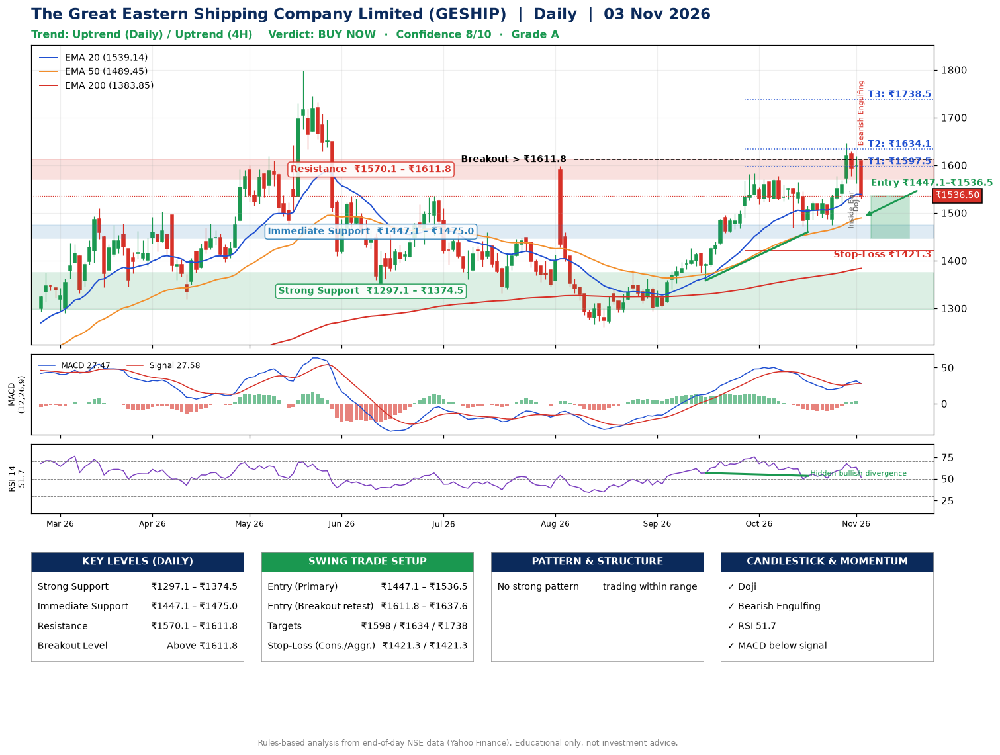

📌 **The Great Eastern Shipping Company Limited (GESHIP) – Multi-Timeframe Technical Analysis (Daily + 4H Combined)**
_Data up to 03 Nov 2026 · Close ₹1536.50_

**📍 Daily Timeframe Trend**
- Trend: **Uptrend** (higher highs and higher lows)
- Recent swing highs: ₹1598.9, ₹1380.0, ₹1583.0 · swing lows: ₹1294.0, ₹1358.8, ₹1460.0
- EMAs: EMA20 ₹1539.1, EMA50 ₹1489.5, EMA200 ₹1383.9; bullish stack (EMA20 > EMA50 > EMA200); price above EMA50, EMA200
- MACD 27.47 below signal 27.58 (above zero), fresh bullish crossover; histogram falling
- RSI(14) 51.7; Hidden bullish divergence

**📍 4-Hour Timeframe Trend**
- Structure: **Uptrend** (higher highs and higher lows)
- Pullback/support area: recent 4H swing lows ₹1475.7, ₹1520.1; EMA20 ₹1557.5
- EMA20/50: bullish stack (EMA20 > EMA50); price above EMA50
- MACD 14.09 below signal 16.30 (above zero), fresh bearish crossover; histogram falling
- RSI(14) 46.7; no divergence

**📍 Pattern Detection (Both Timeframes)**
- No strong pattern detected. Trading within range.

**📍 Candlestick Patterns (last 3 daily candles)**
- **Inside Bar** – 30 Oct: compression inside the prior range ₹1562.8–₹1647.0
- **Doji** – 02 Nov: indecision; wait for the next candle to confirm direction
- **Bearish Engulfing** – 03 Nov: sellers fully reversed the prior green candle

**📍 Price Action Key Levels (Daily Structure)**

| Zone | Price Level (₹) | Context |
|------|-----------------|---------|
| Strong Support | ₹1297.1 – ₹1374.5 | Cluster of earlier swing lows (demand) |
| Immediate Support | ₹1447.1 – ₹1475.0 | Nearest swing-low / wick area |
| Resistance | ₹1570.1 – ₹1611.8 | Nearest swing-high supply |
| Breakout Level | Above ₹1611.8 | Swing continuation trigger (52-week high ₹1798.0) |

**📍 Swing Trade Setup**

🟢 **Entry Zone**
- Primary: ₹1447.1 – ₹1536.5 (daily support / EMA20 area; enter on a bullish 4H candle)
- Alternate: ₹1611.8 – ₹1637.6 (breakout retest)

🎯 **Profit Targets**
- T1: ₹1597.5
- T2: ₹1634.1
- T3: ₹1738.5

🛑 **Stop-Loss**
- Conservative: below daily swing low (₹1421.3)
- Aggressive: below 4H structure (₹1421.3)
- Risk per share ≈ ₹70.5; reward:risk to T1 ≈ 1.5

**📌 Strategy Notes**
- Higher timeframe: daily trend is uptrend; only take longs while price holds above ₹1297.1.
- Entry timing: wait for a bullish 4H candle (engulfing/hammer) inside ₹1447.1 – ₹1536.5 rather than buying mid-range.
- EMA stacking: bullish stack (EMA20 > EMA50 > EMA200); price above EMA50, EMA200.
- Breakout rule: a daily close above ₹1611.8 with volume above its 20-day average (≈694,759) opens T2/T3.
- Momentum: RSI 52 – room to run; Hidden bullish divergence.
- Exit discipline: move the stop to entry once T1 is hit; book partial profits at each target.

**STEP 2 — Marked Up Chart**

**✅ Trade Validation Checklist**
- Trend + momentum aligned: No · Price at entry zone: Yes
- Stop defined (₹1421.3) · Reward:risk ≥ 1.5 to T1: No

## 📌 Final Verdict

Recommendation: **🟢 BUY NOW**

Confidence: **8/10**

Trade Quality: **A**

Reason:
• Daily uptrend (higher highs and higher lows)
• EMAs stacked bullishly

Next Action:
• Buy now within the entry zone, with the stop-loss in place

_Rules-based analysis from end-of-day data. Educational only, not investment advice. Never place orders without your own confirmation._