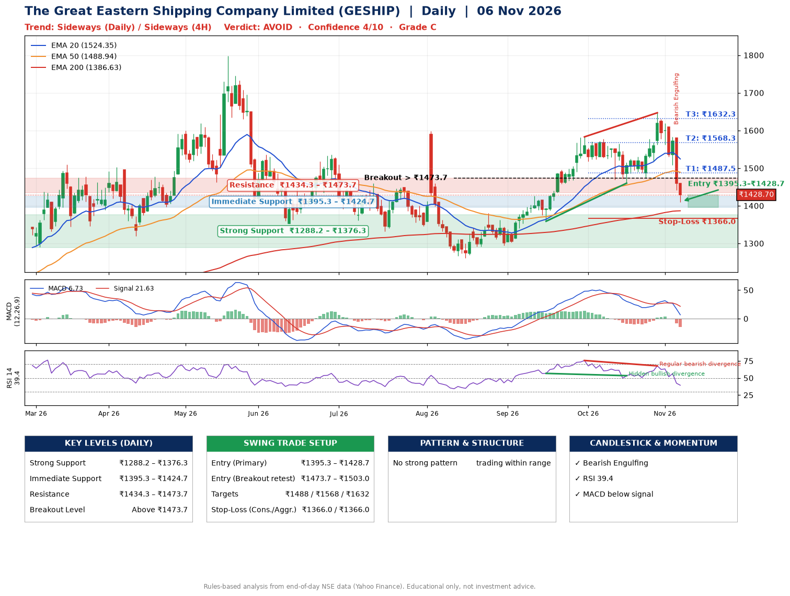

📌 **The Great Eastern Shipping Company Limited (GESHIP) – Multi-Timeframe Technical Analysis (Daily + 4H Combined)**
_Data up to 06 Nov 2026 · Close ₹1428.70_

**📍 Daily Timeframe Trend**
- Trend: **Sideways** (mixed swing structure)
- Recent swing highs: ₹1380.0, ₹1583.0, ₹1647.0 · swing lows: ₹1294.0, ₹1358.8, ₹1460.0
- EMAs: EMA20 ₹1524.4, EMA50 ₹1488.9, EMA200 ₹1386.6; bullish stack (EMA20 > EMA50 > EMA200); price above EMA200
- MACD 6.73 below signal 21.63 (above zero), fresh bearish crossover; histogram falling
- RSI(14) 39.4; Hidden bullish divergence; Regular bearish divergence

**📍 4-Hour Timeframe Trend**
- Structure: **Sideways** (mixed swing structure)
- Pullback/support area: recent 4H swing lows ₹1475.7, ₹1520.1; EMA20 ₹1521.1
- EMA20/50: bullish stack (EMA20 > EMA50); price below all EMAs
- MACD -18.84 below signal 0.14 (below zero); histogram falling
- RSI(14) 31.7; no divergence

**📍 Pattern Detection (Both Timeframes)**
- No strong pattern detected. Trading within range.

**📍 Candlestick Patterns (last 3 daily candles)**
- **Bearish Engulfing** – 05 Nov: sellers fully reversed the prior green candle

**📍 Price Action Key Levels (Daily Structure)**

| Zone | Price Level (₹) | Context |
|------|-----------------|---------|
| Strong Support | ₹1288.2 – ₹1376.3 | Cluster of earlier swing lows (demand) |
| Immediate Support | ₹1395.3 – ₹1424.7 | Nearest swing-low / wick area |
| Resistance | ₹1434.3 – ₹1473.7 | Nearest swing-high supply |
| Breakout Level | Above ₹1473.7 | Swing continuation trigger (52-week high ₹1798.0) |

**📍 Swing Trade Setup**

🟢 **Entry Zone**
- Primary: ₹1395.3 – ₹1428.7 (daily support / EMA20 area; enter on a bullish 4H candle)
- Alternate: ₹1473.7 – ₹1503.0 (breakout retest)

🎯 **Profit Targets**
- T1: ₹1487.5
- T2: ₹1568.3
- T3: ₹1632.3

🛑 **Stop-Loss**
- Conservative: below daily swing low (₹1366.0)
- Aggressive: below 4H structure (₹1366.0)
- Risk per share ≈ ₹58.7; reward:risk to T1 ≈ 1.3

**📌 Strategy Notes**
- Higher timeframe: daily trend is sideways; only take longs while price holds above ₹1288.2.
- Entry timing: wait for a bullish 4H candle (engulfing/hammer) inside ₹1395.3 – ₹1428.7 rather than buying mid-range.
- EMA stacking: bullish stack (EMA20 > EMA50 > EMA200); price above EMA200.
- Breakout rule: a daily close above ₹1473.7 with volume above its 20-day average (≈793,473) opens T2/T3.
- Momentum: RSI 39 – room to run; Hidden bullish divergence; Regular bearish divergence.
- Exit discipline: move the stop to entry once T1 is hit; book partial profits at each target.

**STEP 2 — Marked Up Chart**

**✅ Trade Validation Checklist**
- Trend + momentum aligned: No · Price at entry zone: Yes
- Stop defined (₹1366.0) · Reward:risk ≥ 1.5 to T1: No

## 📌 Final Verdict

Recommendation: **🔴 AVOID**

Confidence: **4/10**

Trade Quality: **C**

Reason:
• Sharp pullback: 13% below the recent ₹1647.0 high
• EMAs stacked bullishly

Next Action:
• Avoid until the trend changes (reclaim EMA50 and a higher low)

_Rules-based analysis from end-of-day data. Educational only, not investment advice. Never place orders without your own confirmation._