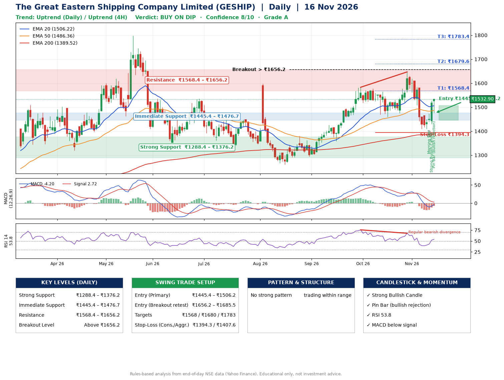

📌 **The Great Eastern Shipping Company Limited (GESHIP) – Multi-Timeframe Technical Analysis (Daily + 4H Combined)**
_Data up to 16 Nov 2026 · Close ₹1532.90_

**📍 Daily Timeframe Trend**
- Trend: **Uptrend** (price above rising EMAs)
- Recent swing highs: ₹1380.0, ₹1583.0, ₹1647.0 · swing lows: ₹1358.8, ₹1460.0, ₹1408.9
- EMAs: EMA20 ₹1506.2, EMA50 ₹1486.4, EMA200 ₹1389.5; bullish stack (EMA20 > EMA50 > EMA200); price above EMA20, EMA50, EMA200
- MACD -4.20 below signal 2.72 (below zero); histogram rising
- RSI(14) 53.8; Regular bearish divergence

**📍 4-Hour Timeframe Trend**
- Structure: **Uptrend** (higher highs and higher lows)
- Pullback/support area: recent 4H swing lows ₹1410.1, ₹1411.2; EMA20 ₹1498.2
- EMA20/50: bearish stack (EMA20 < EMA50); price above EMA20, EMA50
- MACD -7.21 above signal -16.22 (below zero), fresh bullish crossover; histogram rising
- RSI(14) 56.9; no divergence

**📍 Pattern Detection (Both Timeframes)**
- No strong pattern detected. Trading within range.

**📍 Candlestick Patterns (last 3 daily candles)**
- **Doji** – 12 Nov: indecision; wait for the next candle to confirm direction
- **Morning Star** – 12 Nov: three-candle bullish reversal
- **Strong Bullish Candle** – 13 Nov: wide-range green candle, buyers in control
- **Pin Bar (bullish rejection)** – 16 Nov: long lower wick shows dip-buying near ₹1476.7

**📍 Price Action Key Levels (Daily Structure)**

| Zone | Price Level (₹) | Context |
|------|-----------------|---------|
| Strong Support | ₹1288.4 – ₹1376.2 | Cluster of earlier swing lows (demand) |
| Immediate Support | ₹1445.4 – ₹1476.7 | Nearest swing-low / wick area |
| Resistance | ₹1568.4 – ₹1656.2 | Nearest swing-high supply |
| Breakout Level | Above ₹1656.2 | Swing continuation trigger (52-week high ₹1798.0) |

**📍 Swing Trade Setup**

🟢 **Entry Zone**
- Primary: ₹1445.4 – ₹1506.2 (daily support / EMA20 area; enter on a bullish 4H candle)
- Alternate: ₹1656.2 – ₹1685.5 (breakout retest)

🎯 **Profit Targets**
- T1: ₹1568.4
- T2: ₹1679.6
- T3: ₹1783.4

🛑 **Stop-Loss**
- Conservative: below daily swing low (₹1394.3)
- Aggressive: below 4H structure (₹1407.6)
- Risk per share ≈ ₹81.5; reward:risk to T1 ≈ 1.1
- Time to T1: about 11 trading days (it rose this much within 60 trading days 85% of the time in the last 2 years)
- Time to T2: about 26 trading days (it rose this much within 60 trading days 56% of the time in the last 2 years)

**📌 Strategy Notes**
- Higher timeframe: daily trend is uptrend; only take longs while price holds above ₹1288.4.
- Entry timing: wait for a bullish 4H candle (engulfing/hammer) inside ₹1445.4 – ₹1506.2 rather than buying mid-range.
- EMA stacking: bullish stack (EMA20 > EMA50 > EMA200); price above EMA20, EMA50, EMA200.
- Breakout rule: a daily close above ₹1656.2 with volume above its 20-day average (≈850,641) opens T2/T3.
- Momentum: RSI 54 – room to run; Regular bearish divergence.
- Exit discipline: move the stop to entry once T1 is hit; book partial profits at each target.

**STEP 2 — Marked Up Chart**

**✅ Trade Validation Checklist**
- Trend + momentum aligned: No · Price at entry zone: No
- Stop defined (₹1394.3) · Reward:risk ≥ 1.5 to T1: No

## 📌 Final Verdict

Recommendation: **🟡 BUY ON DIP**

Confidence: **8/10**

Trade Quality: **A**

Reason:
• Daily uptrend (price above rising EMAs)
• EMAs stacked bullishly

Next Action:
• Wait for a pullback to ₹1445.4–₹1506.2, or a breakout above ₹1656.2

_Rules-based analysis from end-of-day data. Educational only, not investment advice. Never place orders without your own confirmation._