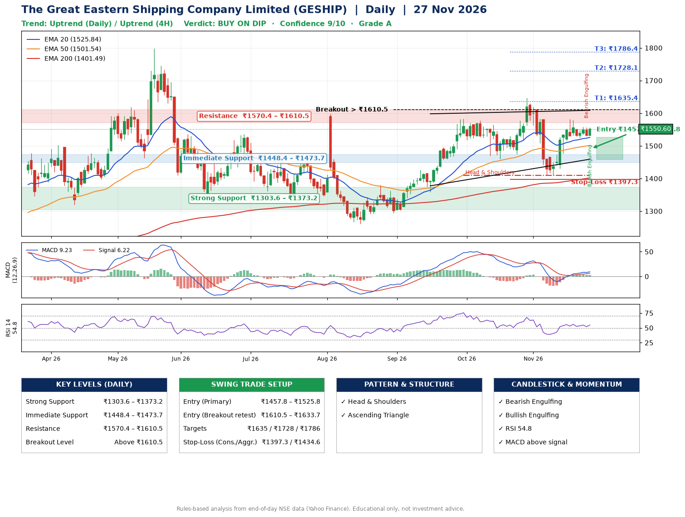

📌 **The Great Eastern Shipping Company Limited (GESHIP) – Multi-Timeframe Technical Analysis (Daily + 4H Combined)**
_Data up to 27 Nov 2026 · Close ₹1550.60_

**📍 Daily Timeframe Trend**
- Trend: **Uptrend** (price above rising EMAs)
- Recent swing highs: ₹1583.0, ₹1647.0, ₹1582.0 · swing lows: ₹1358.8, ₹1460.0, ₹1408.9
- EMAs: EMA20 ₹1525.8, EMA50 ₹1501.5, EMA200 ₹1401.5; bullish stack (EMA20 > EMA50 > EMA200); price above EMA20, EMA50, EMA200
- MACD 9.23 above signal 6.22 (above zero); histogram rising
- RSI(14) 54.8; no divergence on the last two swings

**📍 4-Hour Timeframe Trend**
- Structure: **Uptrend** (price above rising EMAs)
- Pullback/support area: recent 4H swing lows ₹1530.0, ₹1530.0; EMA20 ₹1533.7
- EMA20/50: bullish stack (EMA20 > EMA50); price above EMA20, EMA50
- MACD 8.58 above signal 7.69 (above zero); histogram rising
- RSI(14) 56.4; no divergence

**📍 Pattern Detection (Both Timeframes)**
- Daily: **Head & Shoulders** – head ₹1647.0, neckline ₹1408.9
- Daily: **Ascending Triangle** – converging swing highs and lows over the last ~60 sessions
- 4H: **Symmetrical Triangle** – converging swing highs and lows over the last ~60 sessions

**📍 Candlestick Patterns (last 3 daily candles)**
- **Bearish Engulfing** – 26 Nov: sellers fully reversed the prior green candle
- **Bullish Engulfing** – 27 Nov: buyers fully reversed the prior red candle

**📍 Price Action Key Levels (Daily Structure)**

| Zone | Price Level (₹) | Context |
|------|-----------------|---------|
| Strong Support | ₹1303.6 – ₹1373.2 | Cluster of earlier swing lows (demand) |
| Immediate Support | ₹1448.4 – ₹1473.7 | Nearest swing-low / wick area |
| Resistance | ₹1570.4 – ₹1610.5 | Nearest swing-high supply |
| Breakout Level | Above ₹1610.5 | Swing continuation trigger (52-week high ₹1798.0) |

**📍 Swing Trade Setup**

🟢 **Entry Zone**
- Primary: ₹1457.8 – ₹1525.8 (daily support / EMA20 area; enter on a bullish 4H candle)
- Alternate: ₹1610.5 – ₹1633.7 (breakout retest)

🎯 **Profit Targets**
- T1: ₹1635.4
- T2: ₹1728.1
- T3: ₹1786.4

🛑 **Stop-Loss**
- Conservative: below daily swing low (₹1397.3)
- Aggressive: below 4H structure (₹1434.6)
- Risk per share ≈ ₹94.5; reward:risk to T1 ≈ 1.5
- Time to T1: about 20 trading days (it rose this much within 60 trading days 77% of the time in the last 2 years)
- Time to T2: about 31 trading days (it rose this much within 60 trading days 48% of the time in the last 2 years)

**📌 Strategy Notes**
- Higher timeframe: daily trend is uptrend; only take longs while price holds above ₹1303.6.
- Entry timing: wait for a bullish 4H candle (engulfing/hammer) inside ₹1457.8 – ₹1525.8 rather than buying mid-range.
- EMA stacking: bullish stack (EMA20 > EMA50 > EMA200); price above EMA20, EMA50, EMA200.
- Breakout rule: a daily close above ₹1610.5 with volume above its 20-day average (≈742,629) opens T2/T3.
- Momentum: RSI 55 – room to run; no divergence on the last two swings.
- Exit discipline: move the stop to entry once T1 is hit; book partial profits at each target.

**STEP 2 — Marked Up Chart**

**✅ Trade Validation Checklist**
- Trend + momentum aligned: Yes · Price at entry zone: No
- Stop defined (₹1397.3) · Reward:risk ≥ 1.5 to T1: Yes

## 📌 Final Verdict

Recommendation: **🟡 BUY ON DIP**

Confidence: **9/10**

Trade Quality: **A**

Reason:
• Daily uptrend (price above rising EMAs)
• EMAs stacked bullishly

Next Action:
• Wait for a pullback to ₹1457.8–₹1525.8, or a breakout above ₹1610.5

_Rules-based analysis from end-of-day data. Educational only, not investment advice. Never place orders without your own confirmation._