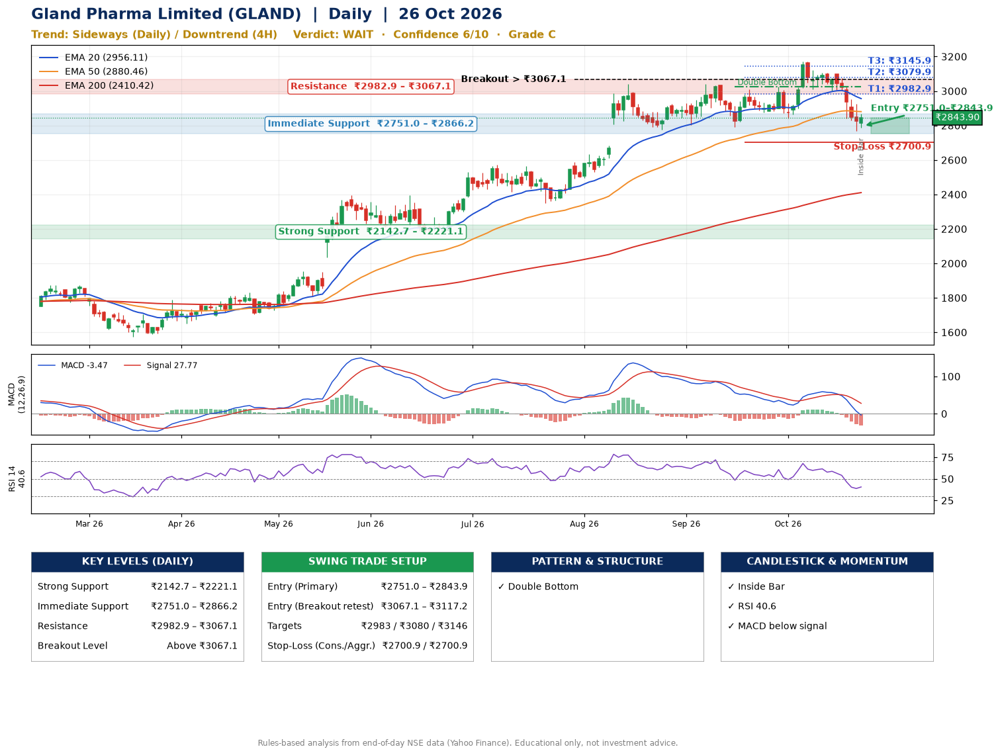

📌 **Gland Pharma Limited (GLAND) – Multi-Timeframe Technical Analysis (Daily + 4H Combined)**
_Data up to 26 Oct 2026 · Close ₹2843.90_

**📍 Daily Timeframe Trend**
- Trend: **Sideways** (mixed swing structure)
- Recent swing highs: ₹3042.0, ₹3008.0, ₹3171.0 · swing lows: ₹2803.0, ₹2792.4, ₹2841.1
- EMAs: EMA20 ₹2956.1, EMA50 ₹2880.5, EMA200 ₹2410.4; bullish stack (EMA20 > EMA50 > EMA200); price above EMA200
- MACD -3.47 below signal 27.77 (below zero), fresh bearish crossover; histogram falling
- RSI(14) 40.6; no divergence on the last two swings

**📍 4-Hour Timeframe Trend**
- Structure: **Downtrend** (lower highs and lower lows)
- Pullback/support area: recent 4H swing lows ₹3001.0, ₹2772.6; EMA20 ₹2934.1
- EMA20/50: bearish stack (EMA20 < EMA50); price below all EMAs
- MACD -46.47 below signal -22.78 (below zero); histogram rising
- RSI(14) 35.8; no divergence

**📍 Pattern Detection (Both Timeframes)**
- Daily: **Double Bottom** – bottoms near ₹2792.4/₹2841.1, neckline ₹3024.0, forming

**📍 Candlestick Patterns (last 3 daily candles)**
- **Inside Bar** – 26 Oct: compression inside the prior range ₹2769.8–₹2924.0

**📍 Price Action Key Levels (Daily Structure)**

| Zone | Price Level (₹) | Context |
|------|-----------------|---------|
| Strong Support | ₹2142.7 – ₹2221.1 | Cluster of earlier swing lows (demand) |
| Immediate Support | ₹2751.0 – ₹2866.2 | Nearest swing-low / wick area |
| Resistance | ₹2982.9 – ₹3067.1 | Nearest swing-high supply |
| Breakout Level | Above ₹3067.1 | Swing continuation trigger (52-week high ₹3171.0) |

**📍 Swing Trade Setup**

🟢 **Entry Zone**
- Primary: ₹2751.0 – ₹2843.9 (daily support / EMA20 area; enter on a bullish 4H candle)
- Alternate: ₹3067.1 – ₹3117.2 (breakout retest)

🎯 **Profit Targets**
- T1: ₹2982.9
- T2: ₹3079.9
- T3: ₹3145.9

🛑 **Stop-Loss**
- Conservative: below daily swing low (₹2700.9)
- Aggressive: below 4H structure (₹2700.9)
- Risk per share ≈ ₹100.3; reward:risk to T1 ≈ 1.8

**📌 Strategy Notes**
- Higher timeframe: daily trend is sideways; only take longs while price holds above ₹2142.7.
- Entry timing: wait for a bullish 4H candle (engulfing/hammer) inside ₹2751.0 – ₹2843.9 rather than buying mid-range.
- EMA stacking: bullish stack (EMA20 > EMA50 > EMA200); price above EMA200.
- Breakout rule: a daily close above ₹3067.1 with volume above its 20-day average (≈412,688) opens T2/T3.
- Momentum: RSI 41 – room to run; no divergence on the last two swings.
- Exit discipline: move the stop to entry once T1 is hit; book partial profits at each target.

**STEP 2 — Marked Up Chart**

**✅ Trade Validation Checklist**
- Trend + momentum aligned: No · Price at entry zone: Yes
- Stop defined (₹2700.9) · Reward:risk ≥ 1.5 to T1: Yes

## 📌 Final Verdict

Recommendation: **🟠 WAIT**

Confidence: **6/10**

Trade Quality: **C**

Reason:
• EMAs stacked bullishly
• Double Bottom: bottoms near ₹2792.4/₹2841.1, neckline ₹3024.0, forming

Next Action:
• Wait for a breakout above ₹3067.1

_Rules-based analysis from end-of-day data. Educational only, not investment advice. Never place orders without your own confirmation._