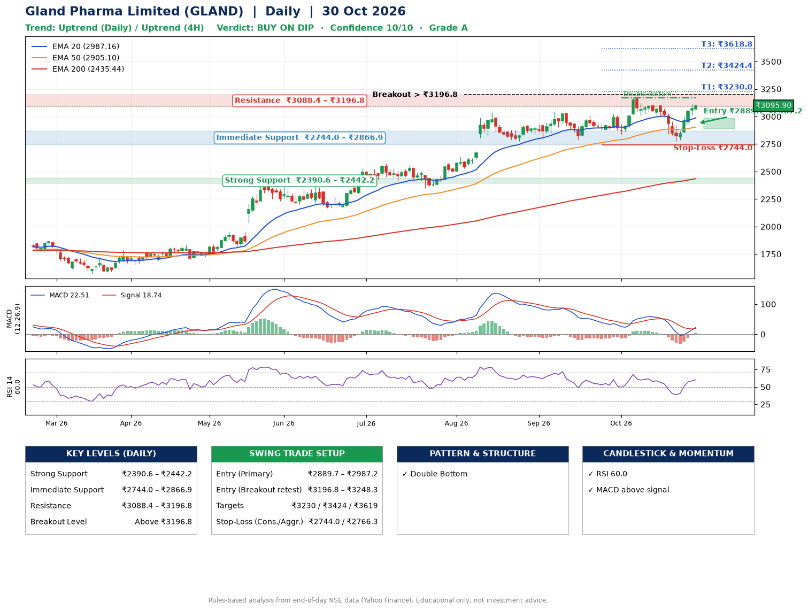

📌 **Gland Pharma Limited (GLAND) – Multi-Timeframe Technical Analysis (Daily + 4H Combined)**
_Data up to 30 Oct 2026 · Close ₹3095.90_

**📍 Daily Timeframe Trend**
- Trend: **Uptrend** (price above rising EMAs)
- Recent swing highs: ₹3042.0, ₹3008.0, ₹3171.0 · swing lows: ₹2792.4, ₹2841.1, ₹2769.8
- EMAs: EMA20 ₹2987.2, EMA50 ₹2905.1, EMA200 ₹2435.4; bullish stack (EMA20 > EMA50 > EMA200); price above EMA20, EMA50, EMA200
- MACD 22.51 above signal 18.74 (above zero), fresh bullish crossover; histogram rising
- RSI(14) 60.0; no divergence on the last two swings

**📍 4-Hour Timeframe Trend**
- Structure: **Uptrend** (price above rising EMAs)
- Pullback/support area: recent 4H swing lows ₹3001.0, ₹2772.6; EMA20 ₹3001.2
- EMA20/50: bullish stack (EMA20 > EMA50); price above EMA20, EMA50
- MACD 23.30 above signal 0.42 (above zero); histogram rising
- RSI(14) 62.3; no divergence

**📍 Pattern Detection (Both Timeframes)**
- Daily: **Double Bottom** – bottoms near ₹2841.1/₹2769.8, neckline ₹3171.0, forming

**📍 Candlestick Patterns (last 3 daily candles)**
- No notable candlestick signal in the last 3 sessions.

**📍 Price Action Key Levels (Daily Structure)**

| Zone | Price Level (₹) | Context |
|------|-----------------|---------|
| Strong Support | ₹2390.6 – ₹2442.2 | Cluster of earlier swing lows (demand) |
| Immediate Support | ₹2744.0 – ₹2866.9 | Nearest swing-low / wick area |
| Resistance | ₹3088.4 – ₹3196.8 | Nearest swing-high supply |
| Breakout Level | Above ₹3196.8 | Swing continuation trigger (52-week high ₹3171.0) |

**📍 Swing Trade Setup**

🟢 **Entry Zone**
- Primary: ₹2889.7 – ₹2987.2 (daily support / EMA20 area; enter on a bullish 4H candle)
- Alternate: ₹3196.8 – ₹3248.3 (breakout retest)

🎯 **Profit Targets**
- T1: ₹3230.0
- T2: ₹3424.4
- T3: ₹3618.8

🛑 **Stop-Loss**
- Conservative: below daily swing low (₹2744.0)
- Aggressive: below 4H structure (₹2766.3)
- Risk per share ≈ ₹194.4; reward:risk to T1 ≈ 1.5

**📌 Strategy Notes**
- Higher timeframe: daily trend is uptrend; only take longs while price holds above ₹2390.6.
- Entry timing: wait for a bullish 4H candle (engulfing/hammer) inside ₹2889.7 – ₹2987.2 rather than buying mid-range.
- EMA stacking: bullish stack (EMA20 > EMA50 > EMA200); price above EMA20, EMA50, EMA200.
- Breakout rule: a daily close above ₹3196.8 with volume above its 20-day average (≈393,334) opens T2/T3.
- Momentum: RSI 60 – room to run; no divergence on the last two swings.
- Exit discipline: move the stop to entry once T1 is hit; book partial profits at each target.

**STEP 2 — Marked Up Chart**

**✅ Trade Validation Checklist**
- Trend + momentum aligned: Yes · Price at entry zone: No
- Stop defined (₹2744.0) · Reward:risk ≥ 1.5 to T1: No

## 📌 Final Verdict

Recommendation: **🟡 BUY ON DIP**

Confidence: **10/10**

Trade Quality: **A**

Reason:
• Daily uptrend (price above rising EMAs)
• EMAs stacked bullishly

Next Action:
• Wait for a pullback to ₹2889.7–₹2987.2

_Rules-based analysis from end-of-day data. Educational only, not investment advice. Never place orders without your own confirmation._