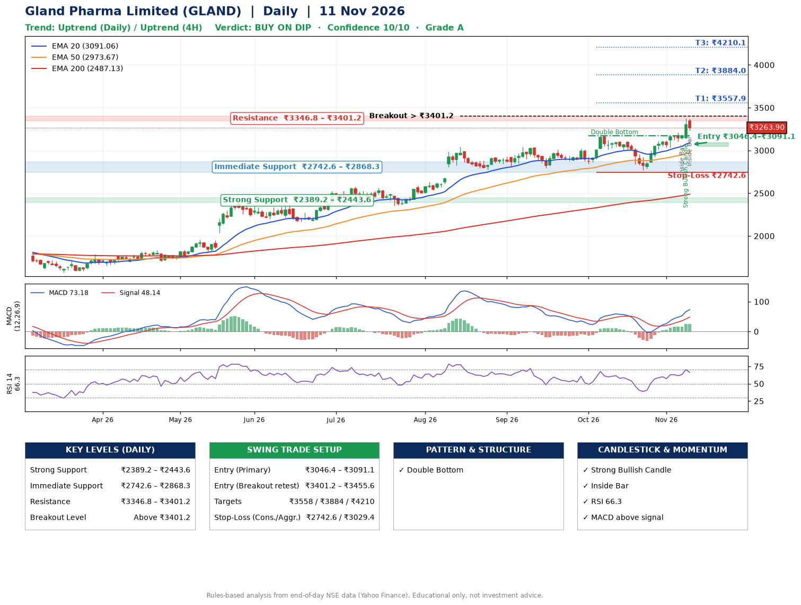

📌 **Gland Pharma Limited (GLAND) – Multi-Timeframe Technical Analysis (Daily + 4H Combined)**
_Data up to 11 Nov 2026 · Close ₹3263.90_

**📍 Daily Timeframe Trend**
- Trend: **Uptrend** (price above rising EMAs)
- Recent swing highs: ₹3042.0, ₹3008.0, ₹3171.0 · swing lows: ₹2792.4, ₹2841.1, ₹2769.8
- EMAs: EMA20 ₹3091.1, EMA50 ₹2973.7, EMA200 ₹2487.1; bullish stack (EMA20 > EMA50 > EMA200); price above EMA20, EMA50, EMA200
- MACD 73.18 above signal 48.14 (above zero); histogram rising
- RSI(14) 66.3; no divergence on the last two swings

**📍 4-Hour Timeframe Trend**
- Structure: **Uptrend** (higher highs and higher lows)
- Pullback/support area: recent 4H swing lows ₹2772.6, ₹3036.3; EMA20 ₹3159.9
- EMA20/50: bullish stack (EMA20 > EMA50); price above EMA20, EMA50
- MACD 73.49 above signal 58.80 (above zero); histogram falling
- RSI(14) 65.8; no divergence

**📍 Pattern Detection (Both Timeframes)**
- Daily: **Double Bottom** – bottoms near ₹2841.1/₹2769.8, neckline ₹3171.0, confirmed (closed above neckline)
- 4H: **Inverse Head & Shoulders** – head ₹2772.6, neckline ₹3144.0

**📍 Candlestick Patterns (last 3 daily candles)**
- **Inside Bar** – 06 Nov: compression inside the prior range ₹3101.3–₹3208.6
- **Strong Bullish Candle** – 09 Nov: wide-range green candle, buyers in control
- **Inside Bar** – 11 Nov: compression inside the prior range ₹3140.8–₹3374.0

**📍 Price Action Key Levels (Daily Structure)**

| Zone | Price Level (₹) | Context |
|------|-----------------|---------|
| Strong Support | ₹2389.2 – ₹2443.6 | Cluster of earlier swing lows (demand) |
| Immediate Support | ₹2742.6 – ₹2868.3 | Nearest swing-low / wick area |
| Resistance | ₹3346.8 – ₹3401.2 | Nearest swing-high supply |
| Breakout Level | Above ₹3401.2 | Swing continuation trigger (52-week high ₹3374.0) |

**📍 Swing Trade Setup**

🟢 **Entry Zone**
- Primary: ₹3046.4 – ₹3091.1 (daily support / EMA20 area; enter on a bullish 4H candle)
- Alternate: ₹3401.2 – ₹3455.6 (breakout retest)

🎯 **Profit Targets**
- T1: ₹3557.9
- T2: ₹3884.0
- T3: ₹4210.1

🛑 **Stop-Loss**
- Conservative: below daily swing low (₹2742.6)
- Aggressive: below 4H structure (₹3029.4)
- Risk per share ≈ ₹326.1; reward:risk to T1 ≈ 1.5

**📌 Strategy Notes**
- Higher timeframe: daily trend is uptrend; only take longs while price holds above ₹2389.2.
- Entry timing: wait for a bullish 4H candle (engulfing/hammer) inside ₹3046.4 – ₹3091.1 rather than buying mid-range.
- EMA stacking: bullish stack (EMA20 > EMA50 > EMA200); price above EMA20, EMA50, EMA200.
- Breakout rule: a daily close above ₹3401.2 with volume above its 20-day average (≈484,758) opens T2/T3.
- Momentum: RSI 66 – elevated, prefer dips; no divergence on the last two swings.
- Exit discipline: move the stop to entry once T1 is hit; book partial profits at each target.

**STEP 2 — Marked Up Chart**

**✅ Trade Validation Checklist**
- Trend + momentum aligned: Yes · Price at entry zone: No
- Stop defined (₹2742.6) · Reward:risk ≥ 1.5 to T1: No

## 📌 Final Verdict

Recommendation: **🟡 BUY ON DIP**

Confidence: **10/10**

Trade Quality: **A**

Reason:
• Daily uptrend (price above rising EMAs)
• EMAs stacked bullishly

Next Action:
• Wait for a pullback to ₹3046.4–₹3091.1

_Rules-based analysis from end-of-day data. Educational only, not investment advice. Never place orders without your own confirmation._