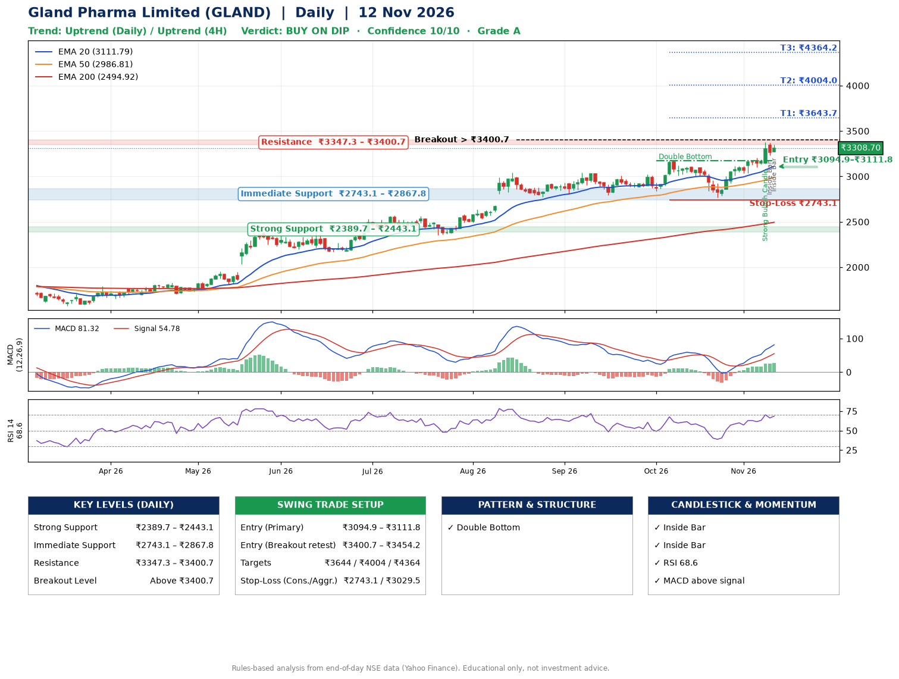

📌 **Gland Pharma Limited (GLAND) – Multi-Timeframe Technical Analysis (Daily + 4H Combined)**
_Data up to 12 Nov 2026 · Close ₹3308.70_

**📍 Daily Timeframe Trend**
- Trend: **Uptrend** (price above rising EMAs)
- Recent swing highs: ₹3042.0, ₹3008.0, ₹3171.0 · swing lows: ₹2792.4, ₹2841.1, ₹2769.8
- EMAs: EMA20 ₹3111.8, EMA50 ₹2986.8, EMA200 ₹2494.9; bullish stack (EMA20 > EMA50 > EMA200); price above EMA20, EMA50, EMA200
- MACD 81.32 above signal 54.78 (above zero); histogram rising
- RSI(14) 68.6; no divergence on the last two swings

**📍 4-Hour Timeframe Trend**
- Structure: **Uptrend** (higher highs and higher lows)
- Pullback/support area: recent 4H swing lows ₹2772.6, ₹3036.3; EMA20 ₹3189.0
- EMA20/50: bullish stack (EMA20 > EMA50); price above EMA20, EMA50
- MACD 78.79 above signal 65.88 (above zero); histogram falling
- RSI(14) 67.0; no divergence

**📍 Pattern Detection (Both Timeframes)**
- Daily: **Double Bottom** – bottoms near ₹2841.1/₹2769.8, neckline ₹3171.0, confirmed (closed above neckline)
- 4H: **Inverse Head & Shoulders** – head ₹2772.6, neckline ₹3144.0

**📍 Candlestick Patterns (last 3 daily candles)**
- **Strong Bullish Candle** – 09 Nov: wide-range green candle, buyers in control
- **Inside Bar** – 11 Nov: compression inside the prior range ₹3140.8–₹3374.0
- **Inside Bar** – 12 Nov: compression inside the prior range ₹3233.1–₹3370.5

**📍 Price Action Key Levels (Daily Structure)**

| Zone | Price Level (₹) | Context |
|------|-----------------|---------|
| Strong Support | ₹2389.7 – ₹2443.1 | Cluster of earlier swing lows (demand) |
| Immediate Support | ₹2743.1 – ₹2867.8 | Nearest swing-low / wick area |
| Resistance | ₹3347.3 – ₹3400.7 | Nearest swing-high supply |
| Breakout Level | Above ₹3400.7 | Swing continuation trigger (52-week high ₹3374.0) |

**📍 Swing Trade Setup**

🟢 **Entry Zone**
- Primary: ₹3094.9 – ₹3111.8 (daily support / EMA20 area; enter on a bullish 4H candle)
- Alternate: ₹3400.7 – ₹3454.2 (breakout retest)

🎯 **Profit Targets**
- T1: ₹3643.7
- T2: ₹4004.0
- T3: ₹4364.2

🛑 **Stop-Loss**
- Conservative: below daily swing low (₹2743.1)
- Aggressive: below 4H structure (₹3029.5)
- Risk per share ≈ ₹360.3; reward:risk to T1 ≈ 1.5
- Time to T1: about 28 trading days (it rose this much within 60 trading days 48% of the time in the last 2 years)
- Time to T2: about 39 trading days (it rose this much within 60 trading days 30% of the time in the last 2 years)

**📌 Strategy Notes**
- Higher timeframe: daily trend is uptrend; only take longs while price holds above ₹2389.7.
- Entry timing: wait for a bullish 4H candle (engulfing/hammer) inside ₹3094.9 – ₹3111.8 rather than buying mid-range.
- EMA stacking: bullish stack (EMA20 > EMA50 > EMA200); price above EMA20, EMA50, EMA200.
- Breakout rule: a daily close above ₹3400.7 with volume above its 20-day average (≈485,581) opens T2/T3.
- Momentum: RSI 69 – elevated, prefer dips; no divergence on the last two swings.
- Exit discipline: move the stop to entry once T1 is hit; book partial profits at each target.

**STEP 2 — Marked Up Chart**

**✅ Trade Validation Checklist**
- Trend + momentum aligned: Yes · Price at entry zone: No
- Stop defined (₹2743.1) · Reward:risk ≥ 1.5 to T1: No

## 📌 Final Verdict

Recommendation: **🟡 BUY ON DIP**

Confidence: **10/10**

Trade Quality: **A**

Reason:
• Daily uptrend (price above rising EMAs)
• EMAs stacked bullishly

Next Action:
• Wait for a pullback to ₹3094.9–₹3111.8

_Rules-based analysis from end-of-day data. Educational only, not investment advice. Never place orders without your own confirmation._