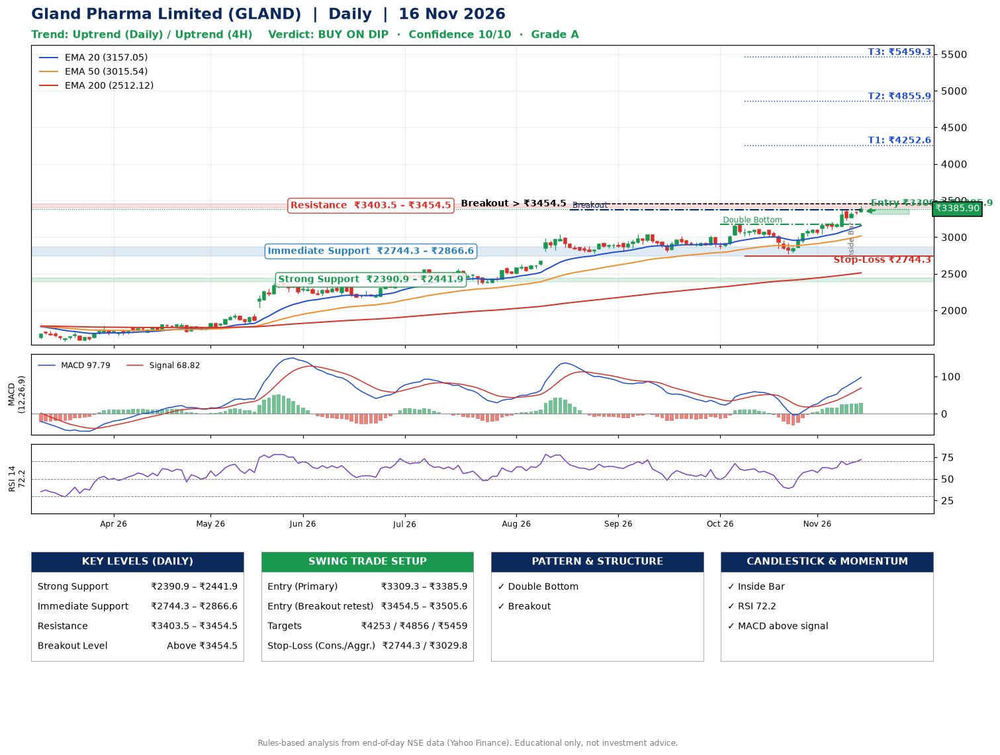

📌 **Gland Pharma Limited (GLAND) – Multi-Timeframe Technical Analysis (Daily + 4H Combined)**
_Data up to 16 Nov 2026 · Close ₹3385.90_

**📍 Daily Timeframe Trend**
- Trend: **Uptrend** (price above rising EMAs)
- Recent swing highs: ₹3042.0, ₹3008.0, ₹3171.0 · swing lows: ₹2792.4, ₹2841.1, ₹2769.8
- EMAs: EMA20 ₹3157.1, EMA50 ₹3015.5, EMA200 ₹2512.1; bullish stack (EMA20 > EMA50 > EMA200); price above EMA20, EMA50, EMA200
- MACD 97.79 above signal 68.82 (above zero); histogram rising
- RSI(14) 72.2; no divergence on the last two swings

**📍 4-Hour Timeframe Trend**
- Structure: **Uptrend** (higher highs and higher lows)
- Pullback/support area: recent 4H swing lows ₹2772.6, ₹3036.3; EMA20 ₹3247.4
- EMA20/50: bullish stack (EMA20 > EMA50); price above EMA20, EMA50
- MACD 87.28 above signal 76.56 (above zero); histogram falling
- RSI(14) 71.5; no divergence

**📍 Pattern Detection (Both Timeframes)**
- Daily: **Double Bottom** – bottoms near ₹2841.1/₹2769.8, neckline ₹3171.0, confirmed (closed above neckline)
- Daily: **Breakout** – closed above the 60-session high ₹3374.0 (volume not confirming yet)
- 4H: **Inverse Head & Shoulders** – head ₹2772.6, neckline ₹3144.0
- 4H: **Bull Flag** – 16% pole then a tight 6% flag; trigger above ₹3429.0

**📍 Candlestick Patterns (last 3 daily candles)**
- **Inside Bar** – 12 Nov: compression inside the prior range ₹3233.1–₹3370.5

**📍 Price Action Key Levels (Daily Structure)**

| Zone | Price Level (₹) | Context |
|------|-----------------|---------|
| Strong Support | ₹2390.9 – ₹2441.9 | Cluster of earlier swing lows (demand) |
| Immediate Support | ₹2744.3 – ₹2866.6 | Nearest swing-low / wick area |
| Resistance | ₹3403.5 – ₹3454.5 | Nearest swing-high supply |
| Breakout Level | Above ₹3454.5 | Swing continuation trigger (52-week high ₹3429.0) |

**📍 Swing Trade Setup**

🟢 **Entry Zone**
- Primary: ₹3309.3 – ₹3385.9 (daily support / EMA20 area; enter on a bullish 4H candle)
- Alternate: ₹3454.5 – ₹3505.6 (breakout retest)

🎯 **Profit Targets**
- T1: ₹4252.6
- T2: ₹4855.9
- T3: ₹5459.3

🛑 **Stop-Loss**
- Conservative: below daily swing low (₹2744.3)
- Aggressive: below 4H structure (₹3029.8)
- Risk per share ≈ ₹603.3; reward:risk to T1 ≈ 1.5
- Time to T1: about 37 trading days (it rose this much within 60 trading days 33% of the time in the last 2 years)
- Time to T2: about 55 trading days (it rose this much within 60 trading days 8% of the time in the last 2 years)

**📌 Strategy Notes**
- Higher timeframe: daily trend is uptrend; only take longs while price holds above ₹2390.9.
- Entry timing: wait for a bullish 4H candle (engulfing/hammer) inside ₹3309.3 – ₹3385.9 rather than buying mid-range.
- EMA stacking: bullish stack (EMA20 > EMA50 > EMA200); price above EMA20, EMA50, EMA200.
- Breakout rule: a daily close above ₹3454.5 with volume above its 20-day average (≈500,125) opens T2/T3.
- Momentum: RSI 72 – elevated, prefer dips; no divergence on the last two swings.
- Exit discipline: move the stop to entry once T1 is hit; book partial profits at each target.

**STEP 2 — Marked Up Chart**

**✅ Trade Validation Checklist**
- Trend + momentum aligned: Yes · Price at entry zone: Yes
- Stop defined (₹2744.3) · Reward:risk ≥ 1.5 to T1: Yes

## 📌 Final Verdict

Recommendation: **🟡 BUY ON DIP**

Confidence: **10/10**

Trade Quality: **A**

Reason:
• Daily uptrend (price above rising EMAs)
• EMAs stacked bullishly

Next Action:
• Wait for a pullback to ₹3309.3–₹3385.9, or a breakout above ₹3454.5

_Rules-based analysis from end-of-day data. Educational only, not investment advice. Never place orders without your own confirmation._