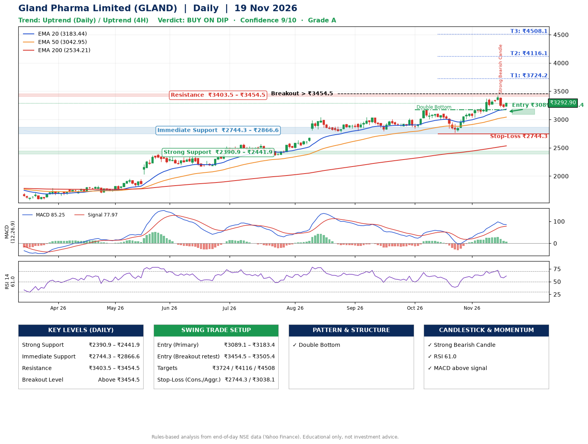

📌 **Gland Pharma Limited (GLAND) – Multi-Timeframe Technical Analysis (Daily + 4H Combined)**
_Data up to 19 Nov 2026 · Close ₹3292.90_

**📍 Daily Timeframe Trend**
- Trend: **Uptrend** (price above rising EMAs)
- Recent swing highs: ₹3042.0, ₹3008.0, ₹3171.0 · swing lows: ₹2792.4, ₹2841.1, ₹2769.8
- EMAs: EMA20 ₹3183.4, EMA50 ₹3042.9, EMA200 ₹2534.2; bullish stack (EMA20 > EMA50 > EMA200); price above EMA20, EMA50, EMA200
- MACD 85.25 above signal 77.97 (above zero); histogram falling
- RSI(14) 61.0; no divergence on the last two swings

**📍 4-Hour Timeframe Trend**
- Structure: **Uptrend** (higher highs and higher lows)
- Pullback/support area: recent 4H swing lows ₹3036.3, ₹3210.1; EMA20 ₹3254.1
- EMA20/50: bullish stack (EMA20 > EMA50); price above EMA20, EMA50
- MACD 45.46 below signal 60.15 (above zero), fresh bearish crossover; histogram rising
- RSI(14) 57.5; Hidden bullish divergence; Regular bearish divergence

**📍 Pattern Detection (Both Timeframes)**
- Daily: **Double Bottom** – bottoms near ₹2841.1/₹2769.8, neckline ₹3171.0, confirmed (closed above neckline)

**📍 Candlestick Patterns (last 3 daily candles)**
- **Strong Bearish Candle** – 17 Nov: wide-range red candle, sellers in control

**📍 Price Action Key Levels (Daily Structure)**

| Zone | Price Level (₹) | Context |
|------|-----------------|---------|
| Strong Support | ₹2390.9 – ₹2441.9 | Cluster of earlier swing lows (demand) |
| Immediate Support | ₹2744.3 – ₹2866.6 | Nearest swing-low / wick area |
| Resistance | ₹3403.5 – ₹3454.5 | Nearest swing-high supply |
| Breakout Level | Above ₹3454.5 | Swing continuation trigger (52-week high ₹3429.0) |

**📍 Swing Trade Setup**

🟢 **Entry Zone**
- Primary: ₹3089.1 – ₹3183.4 (daily support / EMA20 area; enter on a bullish 4H candle)
- Alternate: ₹3454.5 – ₹3505.4 (breakout retest)

🎯 **Profit Targets**
- T1: ₹3724.2
- T2: ₹4116.1
- T3: ₹4508.1

🛑 **Stop-Loss**
- Conservative: below daily swing low (₹2744.3)
- Aggressive: below 4H structure (₹3038.1)
- Risk per share ≈ ₹391.9; reward:risk to T1 ≈ 1.5
- Time to T1: about 30 trading days (it rose this much within 60 trading days 46% of the time in the last 2 years)
- Time to T2: about 40 trading days (it rose this much within 60 trading days 27% of the time in the last 2 years)

**📌 Strategy Notes**
- Higher timeframe: daily trend is uptrend; only take longs while price holds above ₹2390.9.
- Entry timing: wait for a bullish 4H candle (engulfing/hammer) inside ₹3089.1 – ₹3183.4 rather than buying mid-range.
- EMA stacking: bullish stack (EMA20 > EMA50 > EMA200); price above EMA20, EMA50, EMA200.
- Breakout rule: a daily close above ₹3454.5 with volume above its 20-day average (≈455,050) opens T2/T3.
- Momentum: RSI 61 – room to run; no divergence on the last two swings.
- Exit discipline: move the stop to entry once T1 is hit; book partial profits at each target.

**STEP 2 — Marked Up Chart**

**✅ Trade Validation Checklist**
- Trend + momentum aligned: Yes · Price at entry zone: No
- Stop defined (₹2744.3) · Reward:risk ≥ 1.5 to T1: Yes

## 📌 Final Verdict

Recommendation: **🟡 BUY ON DIP**

Confidence: **9/10**

Trade Quality: **A**

Reason:
• Daily uptrend (price above rising EMAs)
• EMAs stacked bullishly

Next Action:
• Wait for a pullback to ₹3089.1–₹3183.4

_Rules-based analysis from end-of-day data. Educational only, not investment advice. Never place orders without your own confirmation._