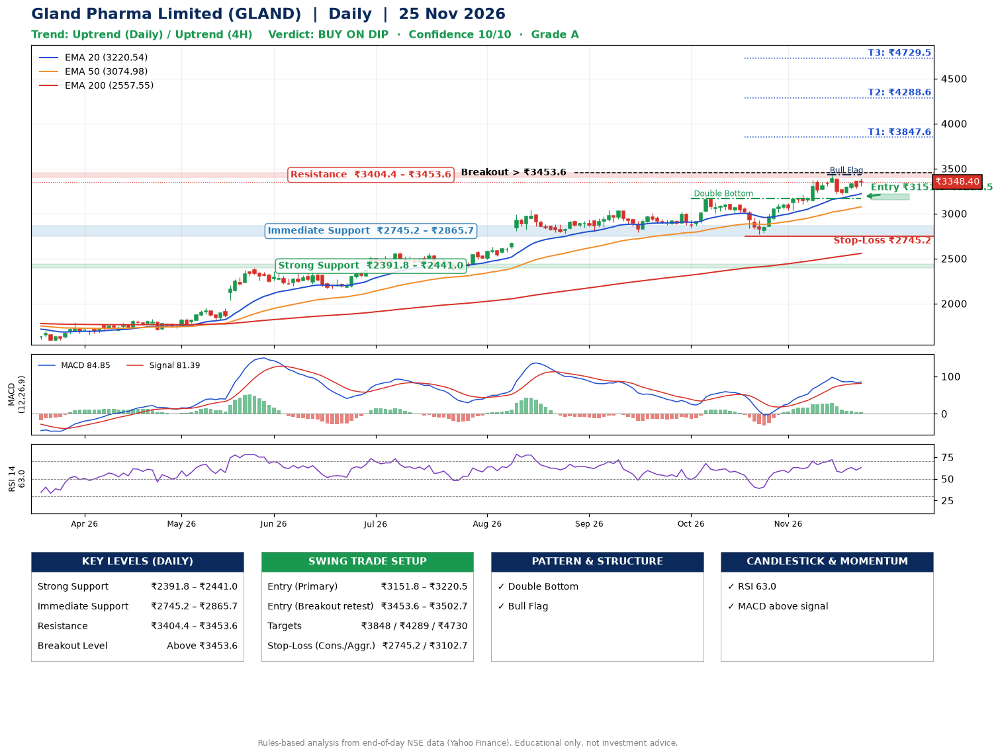

📌 **Gland Pharma Limited (GLAND) – Multi-Timeframe Technical Analysis (Daily + 4H Combined)**
_Data up to 25 Nov 2026 · Close ₹3348.40_

**📍 Daily Timeframe Trend**
- Trend: **Uptrend** (price above rising EMAs)
- Recent swing highs: ₹3008.0, ₹3171.0, ₹3429.0 · swing lows: ₹2792.4, ₹2841.1, ₹2769.8
- EMAs: EMA20 ₹3220.5, EMA50 ₹3075.0, EMA200 ₹2557.6; bullish stack (EMA20 > EMA50 > EMA200); price above EMA20, EMA50, EMA200
- MACD 84.85 above signal 81.39 (above zero); histogram rising
- RSI(14) 63.0; no divergence on the last two swings

**📍 4-Hour Timeframe Trend**
- Structure: **Uptrend** (higher highs and higher lows)
- Pullback/support area: recent 4H swing lows ₹3036.3, ₹3210.1; EMA20 ₹3286.2
- EMA20/50: bullish stack (EMA20 > EMA50); price above EMA20, EMA50
- MACD 41.80 below signal 47.19 (above zero); histogram rising
- RSI(14) 60.8; Hidden bullish divergence; Regular bearish divergence

**📍 Pattern Detection (Both Timeframes)**
- Daily: **Double Bottom** – bottoms near ₹2841.1/₹2769.8, neckline ₹3171.0, confirmed (closed above neckline)
- Daily: **Bull Flag** – 16% pole then a tight 7% flag; trigger above ₹3429.0

**📍 Candlestick Patterns (last 3 daily candles)**
- No notable candlestick signal in the last 3 sessions.

**📍 Price Action Key Levels (Daily Structure)**

| Zone | Price Level (₹) | Context |
|------|-----------------|---------|
| Strong Support | ₹2391.8 – ₹2441.0 | Cluster of earlier swing lows (demand) |
| Immediate Support | ₹2745.2 – ₹2865.7 | Nearest swing-low / wick area |
| Resistance | ₹3404.4 – ₹3453.6 | Nearest swing-high supply |
| Breakout Level | Above ₹3453.6 | Swing continuation trigger (52-week high ₹3429.0) |

**📍 Swing Trade Setup**

🟢 **Entry Zone**
- Primary: ₹3151.8 – ₹3220.5 (daily support / EMA20 area; enter on a bullish 4H candle)
- Alternate: ₹3453.6 – ₹3502.7 (breakout retest)

🎯 **Profit Targets**
- T1: ₹3847.6
- T2: ₹4288.6
- T3: ₹4729.5

🛑 **Stop-Loss**
- Conservative: below daily swing low (₹2745.2)
- Aggressive: below 4H structure (₹3102.7)
- Risk per share ≈ ₹441.0; reward:risk to T1 ≈ 1.5
- Time to T1: about 32 trading days (it rose this much within 60 trading days 41% of the time in the last 2 years)
- Time to T2: about 42 trading days (it rose this much within 60 trading days 20% of the time in the last 2 years)

**📌 Strategy Notes**
- Higher timeframe: daily trend is uptrend; only take longs while price holds above ₹2391.8.
- Entry timing: wait for a bullish 4H candle (engulfing/hammer) inside ₹3151.8 – ₹3220.5 rather than buying mid-range.
- EMA stacking: bullish stack (EMA20 > EMA50 > EMA200); price above EMA20, EMA50, EMA200.
- Breakout rule: a daily close above ₹3453.6 with volume above its 20-day average (≈422,908) opens T2/T3.
- Momentum: RSI 63 – room to run; no divergence on the last two swings.
- Exit discipline: move the stop to entry once T1 is hit; book partial profits at each target.

**STEP 2 — Marked Up Chart**

**✅ Trade Validation Checklist**
- Trend + momentum aligned: Yes · Price at entry zone: No
- Stop defined (₹2745.2) · Reward:risk ≥ 1.5 to T1: No

## 📌 Final Verdict

Recommendation: **🟡 BUY ON DIP**

Confidence: **10/10**

Trade Quality: **A**

Reason:
• Daily uptrend (price above rising EMAs)
• EMAs stacked bullishly

Next Action:
• Wait for a pullback to ₹3151.8–₹3220.5

_Rules-based analysis from end-of-day data. Educational only, not investment advice. Never place orders without your own confirmation._