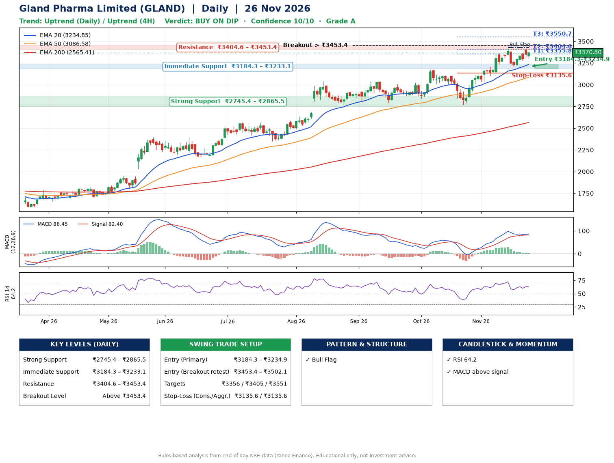

📌 **Gland Pharma Limited (GLAND) – Multi-Timeframe Technical Analysis (Daily + 4H Combined)**
_Data up to 26 Nov 2026 · Close ₹3370.80_

**📍 Daily Timeframe Trend**
- Trend: **Uptrend** (higher highs and higher lows)
- Recent swing highs: ₹3008.0, ₹3171.0, ₹3429.0 · swing lows: ₹2841.1, ₹2769.8, ₹3208.7
- EMAs: EMA20 ₹3234.9, EMA50 ₹3086.6, EMA200 ₹2565.4; bullish stack (EMA20 > EMA50 > EMA200); price above EMA20, EMA50, EMA200
- MACD 86.45 above signal 82.40 (above zero); histogram rising
- RSI(14) 64.2; no divergence on the last two swings

**📍 4-Hour Timeframe Trend**
- Structure: **Uptrend** (price above rising EMAs)
- Pullback/support area: recent 4H swing lows ₹3210.1, ₹3275.9; EMA20 ₹3299.7
- EMA20/50: bullish stack (EMA20 > EMA50); price above EMA20, EMA50
- MACD 43.35 below signal 45.58 (above zero); histogram rising
- RSI(14) 63.1; no divergence

**📍 Pattern Detection (Both Timeframes)**
- Daily: **Bull Flag** – 17% pole then a tight 7% flag; trigger above ₹3429.0
- 4H: **Double Top** – tops near ₹3429.0/₹3387.8, neckline ₹3210.1, forming
- 4H: **Ascending Triangle** – converging swing highs and lows over the last ~60 sessions

**📍 Candlestick Patterns (last 3 daily candles)**
- No notable candlestick signal in the last 3 sessions.

**📍 Price Action Key Levels (Daily Structure)**

| Zone | Price Level (₹) | Context |
|------|-----------------|---------|
| Strong Support | ₹2745.4 – ₹2865.5 | Cluster of earlier swing lows (demand) |
| Immediate Support | ₹3184.3 – ₹3233.1 | Nearest swing-low / wick area |
| Resistance | ₹3404.6 – ₹3453.4 | Nearest swing-high supply |
| Breakout Level | Above ₹3453.4 | Swing continuation trigger (52-week high ₹3429.0) |

**📍 Swing Trade Setup**

🟢 **Entry Zone**
- Primary: ₹3184.3 – ₹3234.9 (daily support / EMA20 area; enter on a bullish 4H candle)
- Alternate: ₹3453.4 – ₹3502.1 (breakout retest)

🎯 **Profit Targets**
- T1: ₹3355.8
- T2: ₹3404.6
- T3: ₹3550.7

🛑 **Stop-Loss**
- Conservative: below daily swing low (₹3135.6)
- Aggressive: below 4H structure (₹3135.6)
- Risk per share ≈ ₹97.4; reward:risk to T1 ≈ 1.5
- Time to T1: about 7 trading days (it rose this much within 60 trading days 92% of the time in the last 2 years)
- Time to T2: about 10 trading days (it rose this much within 60 trading days 84% of the time in the last 2 years)

**📌 Strategy Notes**
- Higher timeframe: daily trend is uptrend; only take longs while price holds above ₹2745.4.
- Entry timing: wait for a bullish 4H candle (engulfing/hammer) inside ₹3184.3 – ₹3234.9 rather than buying mid-range.
- EMA stacking: bullish stack (EMA20 > EMA50 > EMA200); price above EMA20, EMA50, EMA200.
- Breakout rule: a daily close above ₹3453.4 with volume above its 20-day average (≈416,494) opens T2/T3.
- Momentum: RSI 64 – room to run; no divergence on the last two swings.
- Exit discipline: move the stop to entry once T1 is hit; book partial profits at each target.

**STEP 2 — Marked Up Chart**

**✅ Trade Validation Checklist**
- Trend + momentum aligned: Yes · Price at entry zone: No
- Stop defined (₹3135.6) · Reward:risk ≥ 1.5 to T1: Yes

## 📌 Final Verdict

Recommendation: **🟡 BUY ON DIP**

Confidence: **10/10**

Trade Quality: **A**

Reason:
• Daily uptrend (higher highs and higher lows)
• EMAs stacked bullishly

Next Action:
• Wait for a pullback to ₹3184.3–₹3234.9

_Rules-based analysis from end-of-day data. Educational only, not investment advice. Never place orders without your own confirmation._