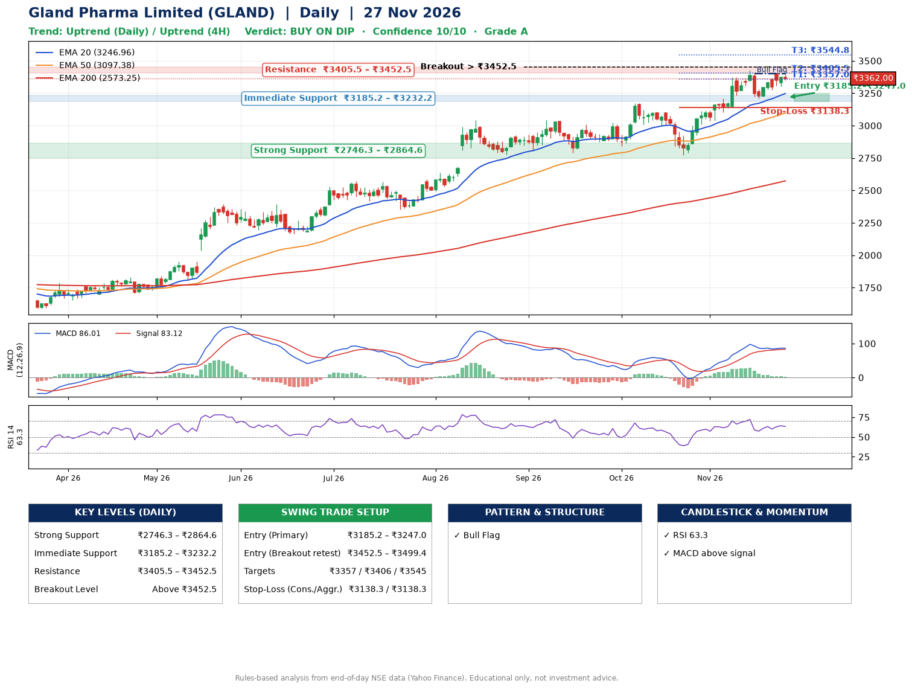

📌 **Gland Pharma Limited (GLAND) – Multi-Timeframe Technical Analysis (Daily + 4H Combined)**
_Data up to 27 Nov 2026 · Close ₹3362.00_

**📍 Daily Timeframe Trend**
- Trend: **Uptrend** (higher highs and higher lows)
- Recent swing highs: ₹3008.0, ₹3171.0, ₹3429.0 · swing lows: ₹2841.1, ₹2769.8, ₹3208.7
- EMAs: EMA20 ₹3247.0, EMA50 ₹3097.4, EMA200 ₹2573.2; bullish stack (EMA20 > EMA50 > EMA200); price above EMA20, EMA50, EMA200
- MACD 86.01 above signal 83.12 (above zero); histogram falling
- RSI(14) 63.3; no divergence on the last two swings

**📍 4-Hour Timeframe Trend**
- Structure: **Uptrend** (price above rising EMAs)
- Pullback/support area: recent 4H swing lows ₹3210.1, ₹3275.9; EMA20 ₹3310.9
- EMA20/50: bullish stack (EMA20 > EMA50); price above EMA20, EMA50
- MACD 42.57 below signal 44.59 (above zero); histogram falling
- RSI(14) 61.5; no divergence

**📍 Pattern Detection (Both Timeframes)**
- Daily: **Bull Flag** – 19% pole then a tight 6% flag; trigger above ₹3399.2
- 4H: **Double Top** – tops near ₹3429.0/₹3387.8, neckline ₹3210.1, forming
- 4H: **Ascending Triangle** – converging swing highs and lows over the last ~60 sessions

**📍 Candlestick Patterns (last 3 daily candles)**
- No notable candlestick signal in the last 3 sessions.

**📍 Price Action Key Levels (Daily Structure)**

| Zone | Price Level (₹) | Context |
|------|-----------------|---------|
| Strong Support | ₹2746.3 – ₹2864.6 | Cluster of earlier swing lows (demand) |
| Immediate Support | ₹3185.2 – ₹3232.2 | Nearest swing-low / wick area |
| Resistance | ₹3405.5 – ₹3452.5 | Nearest swing-high supply |
| Breakout Level | Above ₹3452.5 | Swing continuation trigger (52-week high ₹3429.0) |

**📍 Swing Trade Setup**

🟢 **Entry Zone**
- Primary: ₹3185.2 – ₹3247.0 (daily support / EMA20 area; enter on a bullish 4H candle)
- Alternate: ₹3452.5 – ₹3499.4 (breakout retest)

🎯 **Profit Targets**
- T1: ₹3357.0
- T2: ₹3405.5
- T3: ₹3544.8

🛑 **Stop-Loss**
- Conservative: below daily swing low (₹3138.3)
- Aggressive: below 4H structure (₹3138.3)
- Risk per share ≈ ₹93.9; reward:risk to T1 ≈ 1.5
- Time to T1: about 7 trading days (it rose this much within 60 trading days 93% of the time in the last 2 years)
- Time to T2: about 10 trading days (it rose this much within 60 trading days 86% of the time in the last 2 years)

**📌 Strategy Notes**
- Higher timeframe: daily trend is uptrend; only take longs while price holds above ₹2746.3.
- Entry timing: wait for a bullish 4H candle (engulfing/hammer) inside ₹3185.2 – ₹3247.0 rather than buying mid-range.
- EMA stacking: bullish stack (EMA20 > EMA50 > EMA200); price above EMA20, EMA50, EMA200.
- Breakout rule: a daily close above ₹3452.5 with volume above its 20-day average (≈409,734) opens T2/T3.
- Momentum: RSI 63 – room to run; no divergence on the last two swings.
- Exit discipline: move the stop to entry once T1 is hit; book partial profits at each target.

**STEP 2 — Marked Up Chart**

**✅ Trade Validation Checklist**
- Trend + momentum aligned: Yes · Price at entry zone: No
- Stop defined (₹3138.3) · Reward:risk ≥ 1.5 to T1: Yes

## 📌 Final Verdict

Recommendation: **🟡 BUY ON DIP**

Confidence: **10/10**

Trade Quality: **A**

Reason:
• Daily uptrend (higher highs and higher lows)
• EMAs stacked bullishly

Next Action:
• Wait for a pullback to ₹3185.2–₹3247.0

_Rules-based analysis from end-of-day data. Educational only, not investment advice. Never place orders without your own confirmation._