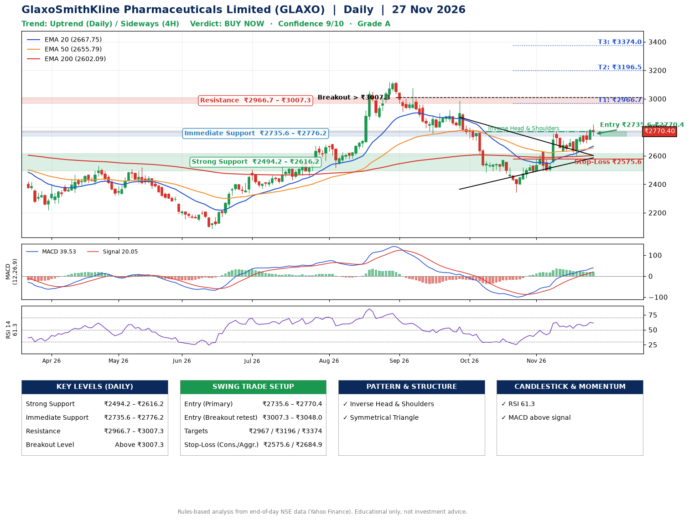

📌 **GlaxoSmithKline Pharmaceuticals Limited (GLAXO) – Multi-Timeframe Technical Analysis (Daily + 4H Combined)**
_Data up to 27 Nov 2026 · Close ₹2770.40_

**📍 Daily Timeframe Trend**
- Trend: **Uptrend** (higher highs and higher lows)
- Recent swing highs: ₹2987.0, ₹2573.2, ₹2770.0 · swing lows: ₹2485.0, ₹2344.1, ₹2595.9
- EMAs: EMA20 ₹2667.8, EMA50 ₹2655.8, EMA200 ₹2602.1; bullish stack (EMA20 > EMA50 > EMA200); price above EMA20, EMA50, EMA200
- MACD 39.53 above signal 20.05 (above zero); histogram falling
- RSI(14) 61.3; no divergence on the last two swings

**📍 4-Hour Timeframe Trend**
- Structure: **Sideways** (mixed swing structure)
- Pullback/support area: recent 4H swing lows ₹2601.5, ₹2690.0; EMA20 ₹2708.0
- EMA20/50: bullish stack (EMA20 > EMA50); price above EMA20, EMA50
- MACD 42.00 above signal 38.25 (above zero), fresh bullish crossover; histogram falling
- RSI(14) 63.6; Hidden bullish divergence

**📍 Pattern Detection (Both Timeframes)**
- Daily: **Inverse Head & Shoulders** – head ₹2344.1, neckline ₹2770.0
- Daily: **Symmetrical Triangle** – converging swing highs and lows over the last ~60 sessions

**📍 Candlestick Patterns (last 3 daily candles)**
- No notable candlestick signal in the last 3 sessions.

**📍 Price Action Key Levels (Daily Structure)**

| Zone | Price Level (₹) | Context |
|------|-----------------|---------|
| Strong Support | ₹2494.2 – ₹2616.2 | Cluster of earlier swing lows (demand) |
| Immediate Support | ₹2735.6 – ₹2776.2 | Nearest swing-low / wick area |
| Resistance | ₹2966.7 – ₹3007.3 | Nearest swing-high supply |
| Breakout Level | Above ₹3007.3 | Swing continuation trigger (52-week high ₹3120.7) |

**📍 Swing Trade Setup**

🟢 **Entry Zone**
- Primary: ₹2735.6 – ₹2770.4 (daily support / EMA20 area; enter on a bullish 4H candle)
- Alternate: ₹3007.3 – ₹3048.0 (breakout retest)

🎯 **Profit Targets**
- T1: ₹2966.7
- T2: ₹3196.5
- T3: ₹3374.0

🛑 **Stop-Loss**
- Conservative: below daily swing low (₹2575.6)
- Aggressive: below 4H structure (₹2684.9)
- Risk per share ≈ ₹177.4; reward:risk to T1 ≈ 1.2
- Time to T1: about 14 trading days (it rose this much within 60 trading days 61% of the time in the last 2 years)
- Time to T2: about 24 trading days (it rose this much within 60 trading days 41% of the time in the last 2 years)

**📌 Strategy Notes**
- Higher timeframe: daily trend is uptrend; only take longs while price holds above ₹2494.2.
- Entry timing: wait for a bullish 4H candle (engulfing/hammer) inside ₹2735.6 – ₹2770.4 rather than buying mid-range.
- EMA stacking: bullish stack (EMA20 > EMA50 > EMA200); price above EMA20, EMA50, EMA200.
- Breakout rule: a daily close above ₹3007.3 with volume above its 20-day average (≈128,990) opens T2/T3.
- Momentum: RSI 61 – room to run; no divergence on the last two swings.
- Exit discipline: move the stop to entry once T1 is hit; book partial profits at each target.

**STEP 2 — Marked Up Chart**

**✅ Trade Validation Checklist**
- Trend + momentum aligned: Yes · Price at entry zone: Yes
- Stop defined (₹2575.6) · Reward:risk ≥ 1.5 to T1: No

## 📌 Final Verdict

Recommendation: **🟢 BUY NOW**

Confidence: **9/10**

Trade Quality: **A**

Reason:
• Daily uptrend (higher highs and higher lows)
• EMAs stacked bullishly

Next Action:
• Buy now within the entry zone, with the stop-loss in place

_Rules-based analysis from end-of-day data. Educational only, not investment advice. Never place orders without your own confirmation._