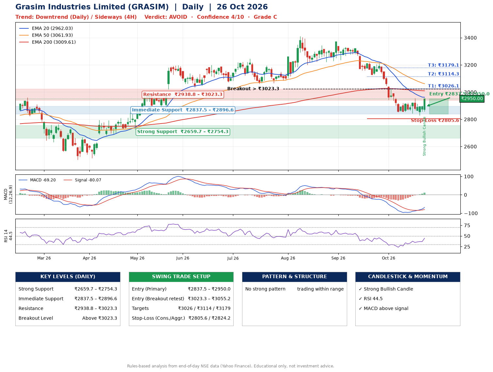

📌 **Grasim Industries Limited (GRASIM) – Multi-Timeframe Technical Analysis (Daily + 4H Combined)**
_Data up to 26 Oct 2026 · Close ₹2950.00_

**📍 Daily Timeframe Trend**
- Trend: **Downtrend** (price below falling EMAs)
- Recent swing highs: ₹3411.1, ₹3343.1, ₹3371.0 · swing lows: ₹3060.0, ₹3222.1, ₹2853.5
- EMAs: EMA20 ₹2962.0, EMA50 ₹3061.9, EMA200 ₹3009.6; mixed / crossing; price below all EMAs
- MACD -69.20 above signal -80.07 (below zero), fresh bullish crossover; histogram rising
- RSI(14) 44.5; no divergence on the last two swings

**📍 4-Hour Timeframe Trend**
- Structure: **Sideways** (mixed swing structure)
- Pullback/support area: recent 4H swing lows ₹2843.4, ₹2828.2; EMA20 ₹2909.4
- EMA20/50: bearish stack (EMA20 < EMA50); price above EMA20
- MACD -20.37 above signal -33.62 (below zero); histogram rising
- RSI(14) 54.9; no divergence

**📍 Pattern Detection (Both Timeframes)**
- No strong pattern detected. Trading within range.

**📍 Candlestick Patterns (last 3 daily candles)**
- **Strong Bullish Candle** – 26 Oct: wide-range green candle, buyers in control

**📍 Price Action Key Levels (Daily Structure)**

| Zone | Price Level (₹) | Context |
|------|-----------------|---------|
| Strong Support | ₹2659.7 – ₹2754.3 | Cluster of earlier swing lows (demand) |
| Immediate Support | ₹2837.5 – ₹2896.6 | Nearest swing-low / wick area |
| Resistance | ₹2938.8 – ₹3023.3 | Nearest swing-high supply |
| Breakout Level | Above ₹3023.3 | Swing continuation trigger (52-week high ₹3411.1) |

**📍 Swing Trade Setup**

🟢 **Entry Zone**
- Primary: ₹2837.5 – ₹2950.0 (daily support / EMA20 area; enter on a bullish 4H candle)
- Alternate: ₹3023.3 – ₹3055.2 (breakout retest)

🎯 **Profit Targets**
- T1: ₹3026.1
- T2: ₹3114.3
- T3: ₹3179.1

🛑 **Stop-Loss**
- Conservative: below daily swing low (₹2805.6)
- Aggressive: below 4H structure (₹2824.2)
- Risk per share ≈ ₹88.2; reward:risk to T1 ≈ 1.5

**📌 Strategy Notes**
- Higher timeframe: daily trend is downtrend; only take longs while price holds above ₹2659.7.
- Entry timing: wait for a bullish 4H candle (engulfing/hammer) inside ₹2837.5 – ₹2950.0 rather than buying mid-range.
- EMA stacking: mixed / crossing; price below all EMAs.
- Breakout rule: a daily close above ₹3023.3 with volume above its 20-day average (≈453,463) opens T2/T3.
- Momentum: RSI 45 – room to run; no divergence on the last two swings.
- Exit discipline: move the stop to entry once T1 is hit; book partial profits at each target.

**STEP 2 — Marked Up Chart**

**✅ Trade Validation Checklist**
- Trend + momentum aligned: No · Price at entry zone: Yes
- Stop defined (₹2805.6) · Reward:risk ≥ 1.5 to T1: Yes

## 📌 Final Verdict

Recommendation: **🔴 AVOID**

Confidence: **4/10**

Trade Quality: **C**

Reason:
• Daily downtrend (price below falling EMAs)

Next Action:
• Avoid until the trend changes (reclaim EMA50 and a higher low)

_Rules-based analysis from end-of-day data. Educational only, not investment advice. Never place orders without your own confirmation._