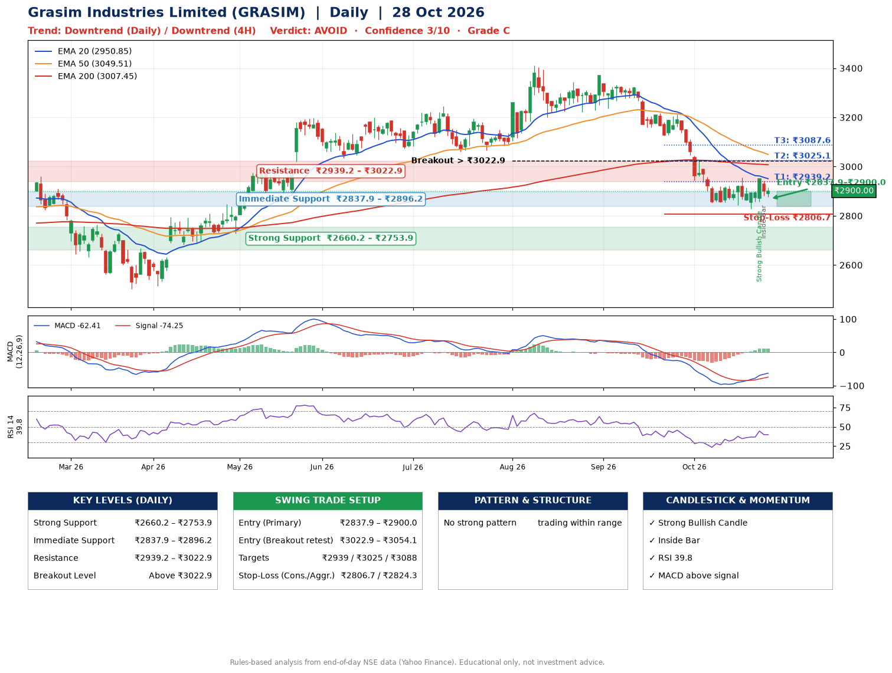

📌 **Grasim Industries Limited (GRASIM) – Multi-Timeframe Technical Analysis (Daily + 4H Combined)**
_Data up to 28 Oct 2026 · Close ₹2900.00_

**📍 Daily Timeframe Trend**
- Trend: **Downtrend** (lower highs and lower lows)
- Recent swing highs: ₹3343.1, ₹3371.0, ₹2954.8 · swing lows: ₹3060.0, ₹3222.1, ₹2853.5
- EMAs: EMA20 ₹2950.8, EMA50 ₹3049.5, EMA200 ₹3007.4; mixed / crossing; price below all EMAs
- MACD -62.41 above signal -74.25 (below zero), fresh bullish crossover; histogram rising
- RSI(14) 39.8; no divergence on the last two swings

**📍 4-Hour Timeframe Trend**
- Structure: **Downtrend** (lower highs and lower lows)
- Pullback/support area: recent 4H swing lows ₹2843.4, ₹2828.2; EMA20 ₹2907.3
- EMA20/50: bearish stack (EMA20 < EMA50); price below all EMAs
- MACD -14.73 above signal -23.37 (below zero); histogram falling
- RSI(14) 46.1; Hidden bearish divergence

**📍 Pattern Detection (Both Timeframes)**
- No strong pattern detected. Trading within range.

**📍 Candlestick Patterns (last 3 daily candles)**
- **Strong Bullish Candle** – 26 Oct: wide-range green candle, buyers in control
- **Inside Bar** – 27 Oct: compression inside the prior range ₹2858.0–₹2950.0

**📍 Price Action Key Levels (Daily Structure)**

| Zone | Price Level (₹) | Context |
|------|-----------------|---------|
| Strong Support | ₹2660.2 – ₹2753.9 | Cluster of earlier swing lows (demand) |
| Immediate Support | ₹2837.9 – ₹2896.2 | Nearest swing-low / wick area |
| Resistance | ₹2939.2 – ₹3022.9 | Nearest swing-high supply |
| Breakout Level | Above ₹3022.9 | Swing continuation trigger (52-week high ₹3411.1) |

**📍 Swing Trade Setup**

🟢 **Entry Zone**
- Primary: ₹2837.9 – ₹2900.0 (daily support / EMA20 area; enter on a bullish 4H candle)
- Alternate: ₹3022.9 – ₹3054.1 (breakout retest)

🎯 **Profit Targets**
- T1: ₹2939.2
- T2: ₹3025.1
- T3: ₹3087.6

🛑 **Stop-Loss**
- Conservative: below daily swing low (₹2806.7)
- Aggressive: below 4H structure (₹2824.3)
- Risk per share ≈ ₹62.5; reward:risk to T1 ≈ 1.1

**📌 Strategy Notes**
- Higher timeframe: daily trend is downtrend; only take longs while price holds above ₹2660.2.
- Entry timing: wait for a bullish 4H candle (engulfing/hammer) inside ₹2837.9 – ₹2900.0 rather than buying mid-range.
- EMA stacking: mixed / crossing; price below all EMAs.
- Breakout rule: a daily close above ₹3022.9 with volume above its 20-day average (≈427,607) opens T2/T3.
- Momentum: RSI 40 – room to run; no divergence on the last two swings.
- Exit discipline: move the stop to entry once T1 is hit; book partial profits at each target.

**STEP 2 — Marked Up Chart**

**✅ Trade Validation Checklist**
- Trend + momentum aligned: No · Price at entry zone: Yes
- Stop defined (₹2806.7) · Reward:risk ≥ 1.5 to T1: No

## 📌 Final Verdict

Recommendation: **🔴 AVOID**

Confidence: **3/10**

Trade Quality: **C**

Reason:
• Daily downtrend (lower highs and lower lows)

Next Action:
• Avoid until the trend changes (reclaim EMA50 and a higher low)

_Rules-based analysis from end-of-day data. Educational only, not investment advice. Never place orders without your own confirmation._