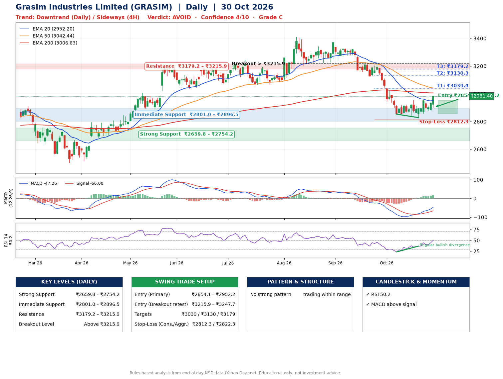

📌 **Grasim Industries Limited (GRASIM) – Multi-Timeframe Technical Analysis (Daily + 4H Combined)**
_Data up to 30 Oct 2026 · Close ₹2981.40_

**📍 Daily Timeframe Trend**
- Trend: **Downtrend** (lower highs and lower lows)
- Recent swing highs: ₹3343.1, ₹3371.0, ₹2954.8 · swing lows: ₹3222.1, ₹2853.5, ₹2828.2
- EMAs: EMA20 ₹2952.2, EMA50 ₹3042.4, EMA200 ₹3006.6; mixed / crossing; price above EMA20
- MACD -47.26 above signal -66.00 (below zero); histogram rising
- RSI(14) 50.2; Regular bullish divergence

**📍 4-Hour Timeframe Trend**
- Structure: **Sideways** (mixed swing structure)
- Pullback/support area: recent 4H swing lows ₹2828.2, ₹2876.3; EMA20 ₹2921.2
- EMA20/50: bearish stack (EMA20 < EMA50); price above EMA20, EMA50
- MACD 0.71 above signal -12.73 (above zero); histogram rising
- RSI(14) 60.9; Hidden bearish divergence

**📍 Pattern Detection (Both Timeframes)**
- No strong pattern detected. Trading within range.

**📍 Candlestick Patterns (last 3 daily candles)**
- No notable candlestick signal in the last 3 sessions.

**📍 Price Action Key Levels (Daily Structure)**

| Zone | Price Level (₹) | Context |
|------|-----------------|---------|
| Strong Support | ₹2659.8 – ₹2754.2 | Cluster of earlier swing lows (demand) |
| Immediate Support | ₹2801.0 – ₹2896.5 | Nearest swing-low / wick area |
| Resistance | ₹3179.2 – ₹3215.9 | Nearest swing-high supply |
| Breakout Level | Above ₹3215.9 | Swing continuation trigger (52-week high ₹3411.1) |

**📍 Swing Trade Setup**

🟢 **Entry Zone**
- Primary: ₹2854.1 – ₹2952.2 (daily support / EMA20 area; enter on a bullish 4H candle)
- Alternate: ₹3215.9 – ₹3247.7 (breakout retest)

🎯 **Profit Targets**
- T1: ₹3039.4
- T2: ₹3130.3
- T3: ₹3179.2

🛑 **Stop-Loss**
- Conservative: below daily swing low (₹2812.3)
- Aggressive: below 4H structure (₹2822.3)
- Risk per share ≈ ₹90.9; reward:risk to T1 ≈ 1.5

**📌 Strategy Notes**
- Higher timeframe: daily trend is downtrend; only take longs while price holds above ₹2659.8.
- Entry timing: wait for a bullish 4H candle (engulfing/hammer) inside ₹2854.1 – ₹2952.2 rather than buying mid-range.
- EMA stacking: mixed / crossing; price above EMA20.
- Breakout rule: a daily close above ₹3215.9 with volume above its 20-day average (≈385,807) opens T2/T3.
- Momentum: RSI 50 – room to run; Regular bullish divergence.
- Exit discipline: move the stop to entry once T1 is hit; book partial profits at each target.

**STEP 2 — Marked Up Chart**

**✅ Trade Validation Checklist**
- Trend + momentum aligned: No · Price at entry zone: No
- Stop defined (₹2812.3) · Reward:risk ≥ 1.5 to T1: No

## 📌 Final Verdict

Recommendation: **🔴 AVOID**

Confidence: **4/10**

Trade Quality: **C**

Reason:
• Daily downtrend (lower highs and lower lows)

Next Action:
• Avoid until the trend changes (reclaim EMA50 and a higher low)

_Rules-based analysis from end-of-day data. Educational only, not investment advice. Never place orders without your own confirmation._