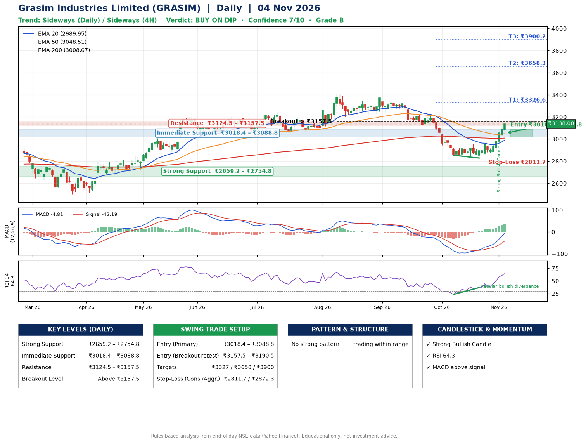

📌 **Grasim Industries Limited (GRASIM) – Multi-Timeframe Technical Analysis (Daily + 4H Combined)**
_Data up to 04 Nov 2026 · Close ₹3138.00_

**📍 Daily Timeframe Trend**
- Trend: **Sideways** (mixed swing structure)
- Recent swing highs: ₹3343.1, ₹3371.0, ₹2954.8 · swing lows: ₹3222.1, ₹2853.5, ₹2828.2
- EMAs: EMA20 ₹2989.9, EMA50 ₹3048.5, EMA200 ₹3008.7; mixed / crossing; price above EMA20, EMA50, EMA200
- MACD -4.81 above signal -42.19 (below zero); histogram rising
- RSI(14) 64.3; Regular bullish divergence

**📍 4-Hour Timeframe Trend**
- Structure: **Sideways** (mixed swing structure)
- Pullback/support area: recent 4H swing lows ₹2828.2, ₹2876.3; EMA20 ₹2998.0
- EMA20/50: bullish stack (EMA20 > EMA50); price above EMA20, EMA50
- MACD 46.88 above signal 21.23 (above zero); histogram rising
- RSI(14) 77.5; Hidden bearish divergence

**📍 Pattern Detection (Both Timeframes)**
- No strong pattern detected. Trading within range.

**📍 Candlestick Patterns (last 3 daily candles)**
- **Strong Bullish Candle** – 02 Nov: wide-range green candle, buyers in control

**📍 Price Action Key Levels (Daily Structure)**

| Zone | Price Level (₹) | Context |
|------|-----------------|---------|
| Strong Support | ₹2659.2 – ₹2754.8 | Cluster of earlier swing lows (demand) |
| Immediate Support | ₹3018.4 – ₹3088.8 | Nearest swing-low / wick area |
| Resistance | ₹3124.5 – ₹3157.5 | Nearest swing-high supply |
| Breakout Level | Above ₹3157.5 | Swing continuation trigger (52-week high ₹3411.1) |

**📍 Swing Trade Setup**

🟢 **Entry Zone**
- Primary: ₹3018.4 – ₹3088.8 (daily support / EMA20 area; enter on a bullish 4H candle)
- Alternate: ₹3157.5 – ₹3190.5 (breakout retest)

🎯 **Profit Targets**
- T1: ₹3326.6
- T2: ₹3658.3
- T3: ₹3900.2

🛑 **Stop-Loss**
- Conservative: below daily swing low (₹2811.7)
- Aggressive: below 4H structure (₹2872.3)
- Risk per share ≈ ₹241.9; reward:risk to T1 ≈ 1.1

**📌 Strategy Notes**
- Higher timeframe: daily trend is sideways; only take longs while price holds above ₹2659.2.
- Entry timing: wait for a bullish 4H candle (engulfing/hammer) inside ₹3018.4 – ₹3088.8 rather than buying mid-range.
- EMA stacking: mixed / crossing; price above EMA20, EMA50, EMA200.
- Breakout rule: a daily close above ₹3157.5 with volume above its 20-day average (≈390,641) opens T2/T3.
- Momentum: RSI 64 – room to run; Regular bullish divergence.
- Exit discipline: move the stop to entry once T1 is hit; book partial profits at each target.

**STEP 2 — Marked Up Chart**

**✅ Trade Validation Checklist**
- Trend + momentum aligned: No · Price at entry zone: No
- Stop defined (₹2811.7) · Reward:risk ≥ 1.5 to T1: No

## 📌 Final Verdict

Recommendation: **🟡 BUY ON DIP**

Confidence: **7/10**

Trade Quality: **B**

Reason:
• No strong edge from trend, momentum or patterns

Next Action:
• Wait for a pullback to ₹3018.4–₹3088.8, or a breakout above ₹3157.5

_Rules-based analysis from end-of-day data. Educational only, not investment advice. Never place orders without your own confirmation._