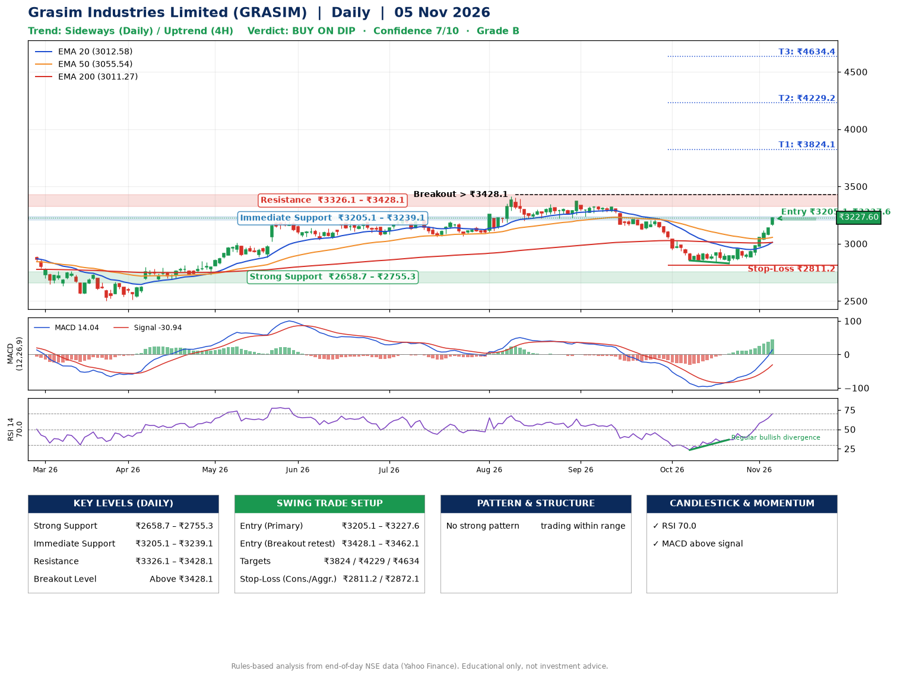

📌 **Grasim Industries Limited (GRASIM) – Multi-Timeframe Technical Analysis (Daily + 4H Combined)**
_Data up to 05 Nov 2026 · Close ₹3227.60_

**📍 Daily Timeframe Trend**
- Trend: **Sideways** (mixed swing structure)
- Recent swing highs: ₹3343.1, ₹3371.0, ₹2954.8 · swing lows: ₹3222.1, ₹2853.5, ₹2828.2
- EMAs: EMA20 ₹3012.6, EMA50 ₹3055.5, EMA200 ₹3011.3; mixed / crossing; price above EMA20, EMA50, EMA200
- MACD 14.04 above signal -30.94 (above zero); histogram rising
- RSI(14) 70.0; Regular bullish divergence

**📍 4-Hour Timeframe Trend**
- Structure: **Uptrend** (price above rising EMAs)
- Pullback/support area: recent 4H swing lows ₹2828.2, ₹2876.3; EMA20 ₹3038.1
- EMA20/50: bullish stack (EMA20 > EMA50); price above EMA20, EMA50
- MACD 66.57 above signal 36.10 (above zero); histogram rising
- RSI(14) 83.0; Hidden bearish divergence

**📍 Pattern Detection (Both Timeframes)**
- No strong pattern detected. Trading within range.

**📍 Candlestick Patterns (last 3 daily candles)**
- No notable candlestick signal in the last 3 sessions.

**📍 Price Action Key Levels (Daily Structure)**

| Zone | Price Level (₹) | Context |
|------|-----------------|---------|
| Strong Support | ₹2658.7 – ₹2755.3 | Cluster of earlier swing lows (demand) |
| Immediate Support | ₹3205.1 – ₹3239.1 | Nearest swing-low / wick area |
| Resistance | ₹3326.1 – ₹3428.1 | Nearest swing-high supply |
| Breakout Level | Above ₹3428.1 | Swing continuation trigger (52-week high ₹3411.1) |

**📍 Swing Trade Setup**

🟢 **Entry Zone**
- Primary: ₹3205.1 – ₹3227.6 (daily support / EMA20 area; enter on a bullish 4H candle)
- Alternate: ₹3428.1 – ₹3462.1 (breakout retest)

🎯 **Profit Targets**
- T1: ₹3824.1
- T2: ₹4229.2
- T3: ₹4634.4

🛑 **Stop-Loss**
- Conservative: below daily swing low (₹2811.2)
- Aggressive: below 4H structure (₹2872.1)
- Risk per share ≈ ₹405.2; reward:risk to T1 ≈ 1.5

**📌 Strategy Notes**
- Higher timeframe: daily trend is sideways; only take longs while price holds above ₹2658.7.
- Entry timing: wait for a bullish 4H candle (engulfing/hammer) inside ₹3205.1 – ₹3227.6 rather than buying mid-range.
- EMA stacking: mixed / crossing; price above EMA20, EMA50, EMA200.
- Breakout rule: a daily close above ₹3428.1 with volume above its 20-day average (≈446,873) opens T2/T3.
- Momentum: RSI 70 – elevated, prefer dips; Regular bullish divergence.
- Exit discipline: move the stop to entry once T1 is hit; book partial profits at each target.

**STEP 2 — Marked Up Chart**

**✅ Trade Validation Checklist**
- Trend + momentum aligned: No · Price at entry zone: Yes
- Stop defined (₹2811.2) · Reward:risk ≥ 1.5 to T1: Yes

## 📌 Final Verdict

Recommendation: **🟡 BUY ON DIP**

Confidence: **7/10**

Trade Quality: **B**

Reason:
• No strong edge from trend, momentum or patterns

Next Action:
• Wait for a pullback to ₹3205.1–₹3227.6, or a breakout above ₹3428.1

_Rules-based analysis from end-of-day data. Educational only, not investment advice. Never place orders without your own confirmation._