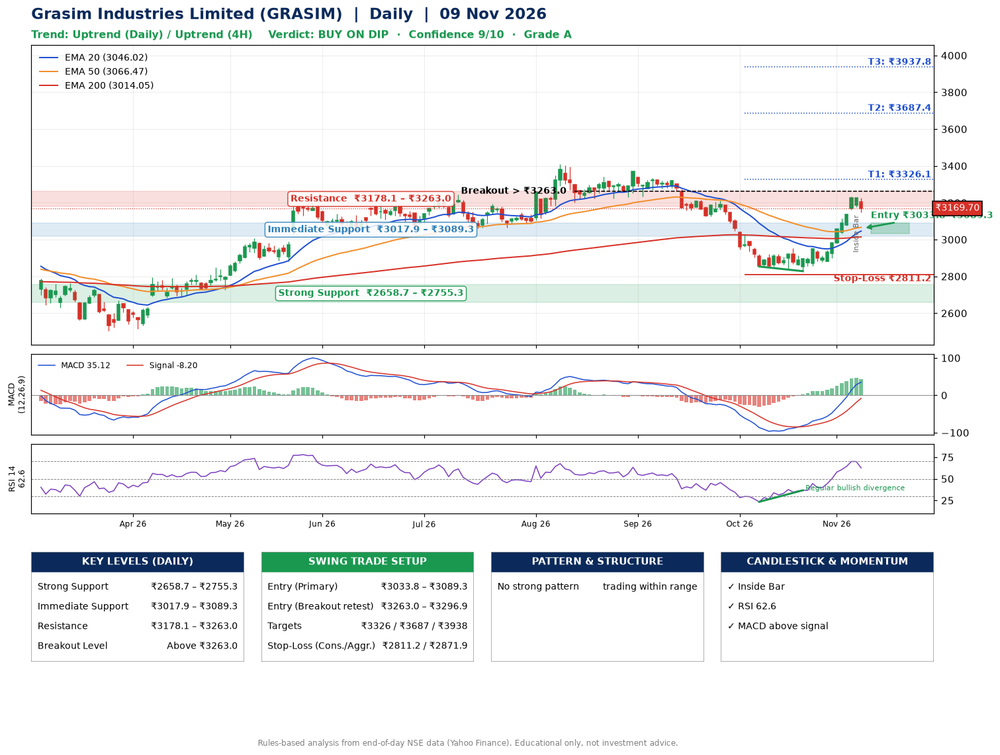

📌 **Grasim Industries Limited (GRASIM) – Multi-Timeframe Technical Analysis (Daily + 4H Combined)**
_Data up to 09 Nov 2026 · Close ₹3169.70_

**📍 Daily Timeframe Trend**
- Trend: **Uptrend** (price above rising EMAs)
- Recent swing highs: ₹3343.1, ₹3371.0, ₹2954.8 · swing lows: ₹3222.1, ₹2853.5, ₹2828.2
- EMAs: EMA20 ₹3046.0, EMA50 ₹3066.5, EMA200 ₹3014.0; mixed / crossing; price above EMA20, EMA50, EMA200
- MACD 35.12 above signal -8.20 (above zero); histogram falling
- RSI(14) 62.6; Regular bullish divergence

**📍 4-Hour Timeframe Trend**
- Structure: **Uptrend** (higher highs and higher lows)
- Pullback/support area: recent 4H swing lows ₹2828.2, ₹2876.3; EMA20 ₹3086.8
- EMA20/50: bullish stack (EMA20 > EMA50); price above EMA20, EMA50
- MACD 70.49 above signal 57.21 (above zero); histogram falling
- RSI(14) 65.3; no divergence

**📍 Pattern Detection (Both Timeframes)**
- No strong pattern detected. Trading within range.

**📍 Candlestick Patterns (last 3 daily candles)**
- **Inside Bar** – 06 Nov: compression inside the prior range ₹3161.7–₹3232.8

**📍 Price Action Key Levels (Daily Structure)**

| Zone | Price Level (₹) | Context |
|------|-----------------|---------|
| Strong Support | ₹2658.7 – ₹2755.3 | Cluster of earlier swing lows (demand) |
| Immediate Support | ₹3017.9 – ₹3089.3 | Nearest swing-low / wick area |
| Resistance | ₹3178.1 – ₹3263.0 | Nearest swing-high supply |
| Breakout Level | Above ₹3263.0 | Swing continuation trigger (52-week high ₹3411.1) |

**📍 Swing Trade Setup**

🟢 **Entry Zone**
- Primary: ₹3033.8 – ₹3089.3 (daily support / EMA20 area; enter on a bullish 4H candle)
- Alternate: ₹3263.0 – ₹3296.9 (breakout retest)

🎯 **Profit Targets**
- T1: ₹3326.1
- T2: ₹3687.4
- T3: ₹3937.8

🛑 **Stop-Loss**
- Conservative: below daily swing low (₹2811.2)
- Aggressive: below 4H structure (₹2871.9)
- Risk per share ≈ ₹250.3; reward:risk to T1 ≈ 1.1

**📌 Strategy Notes**
- Higher timeframe: daily trend is uptrend; only take longs while price holds above ₹2658.7.
- Entry timing: wait for a bullish 4H candle (engulfing/hammer) inside ₹3033.8 – ₹3089.3 rather than buying mid-range.
- EMA stacking: mixed / crossing; price above EMA20, EMA50, EMA200.
- Breakout rule: a daily close above ₹3263.0 with volume above its 20-day average (≈515,648) opens T2/T3.
- Momentum: RSI 63 – room to run; Regular bullish divergence.
- Exit discipline: move the stop to entry once T1 is hit; book partial profits at each target.

**STEP 2 — Marked Up Chart**

**✅ Trade Validation Checklist**
- Trend + momentum aligned: Yes · Price at entry zone: No
- Stop defined (₹2811.2) · Reward:risk ≥ 1.5 to T1: No

## 📌 Final Verdict

Recommendation: **🟡 BUY ON DIP**

Confidence: **9/10**

Trade Quality: **A**

Reason:
• Daily uptrend (price above rising EMAs)

Next Action:
• Wait for a pullback to ₹3033.8–₹3089.3, or a breakout above ₹3263.0

_Rules-based analysis from end-of-day data. Educational only, not investment advice. Never place orders without your own confirmation._