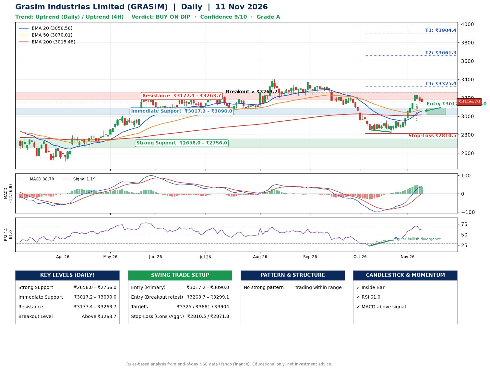

📌 **Grasim Industries Limited (GRASIM) – Multi-Timeframe Technical Analysis (Daily + 4H Combined)**
_Data up to 11 Nov 2026 · Close ₹3156.70_

**📍 Daily Timeframe Trend**
- Trend: **Uptrend** (price above rising EMAs)
- Recent swing highs: ₹3343.1, ₹3371.0, ₹2954.8 · swing lows: ₹3222.1, ₹2853.5, ₹2828.2
- EMAs: EMA20 ₹3056.6, EMA50 ₹3070.0, EMA200 ₹3015.5; mixed / crossing; price above EMA20, EMA50, EMA200
- MACD 38.78 above signal 1.19 (above zero); histogram falling
- RSI(14) 61.0; Regular bullish divergence

**📍 4-Hour Timeframe Trend**
- Structure: **Uptrend** (higher highs and higher lows)
- Pullback/support area: recent 4H swing lows ₹2828.2, ₹2876.3; EMA20 ₹3102.7
- EMA20/50: bullish stack (EMA20 > EMA50); price above EMA20, EMA50
- MACD 51.20 below signal 57.89 (above zero), fresh bearish crossover; histogram falling
- RSI(14) 55.6; Regular bearish divergence

**📍 Pattern Detection (Both Timeframes)**
- No strong pattern detected. Trading within range.

**📍 Candlestick Patterns (last 3 daily candles)**
- **Inside Bar** – 06 Nov: compression inside the prior range ₹3161.7–₹3232.8

**📍 Price Action Key Levels (Daily Structure)**

| Zone | Price Level (₹) | Context |
|------|-----------------|---------|
| Strong Support | ₹2658.0 – ₹2756.0 | Cluster of earlier swing lows (demand) |
| Immediate Support | ₹3017.2 – ₹3090.0 | Nearest swing-low / wick area |
| Resistance | ₹3177.4 – ₹3263.7 | Nearest swing-high supply |
| Breakout Level | Above ₹3263.7 | Swing continuation trigger (52-week high ₹3411.1) |

**📍 Swing Trade Setup**

🟢 **Entry Zone**
- Primary: ₹3017.2 – ₹3090.0 (daily support / EMA20 area; enter on a bullish 4H candle)
- Alternate: ₹3263.7 – ₹3299.1 (breakout retest)

🎯 **Profit Targets**
- T1: ₹3325.4
- T2: ₹3661.3
- T3: ₹3904.4

🛑 **Stop-Loss**
- Conservative: below daily swing low (₹2810.5)
- Aggressive: below 4H structure (₹2871.8)
- Risk per share ≈ ₹243.1; reward:risk to T1 ≈ 1.1
- Time to T1: about 30 trading days (it rose this much within 60 trading days 40% of the time in the last 2 years)
- Time to T2: about 36 trading days (it rose this much within 60 trading days 4% of the time in the last 2 years)

**📌 Strategy Notes**
- Higher timeframe: daily trend is uptrend; only take longs while price holds above ₹2658.0.
- Entry timing: wait for a bullish 4H candle (engulfing/hammer) inside ₹3017.2 – ₹3090.0 rather than buying mid-range.
- EMA stacking: mixed / crossing; price above EMA20, EMA50, EMA200.
- Breakout rule: a daily close above ₹3263.7 with volume above its 20-day average (≈551,305) opens T2/T3.
- Momentum: RSI 61 – room to run; Regular bullish divergence.
- Exit discipline: move the stop to entry once T1 is hit; book partial profits at each target.

**STEP 2 — Marked Up Chart**

**✅ Trade Validation Checklist**
- Trend + momentum aligned: Yes · Price at entry zone: No
- Stop defined (₹2810.5) · Reward:risk ≥ 1.5 to T1: No

## 📌 Final Verdict

Recommendation: **🟡 BUY ON DIP**

Confidence: **9/10**

Trade Quality: **A**

Reason:
• Daily uptrend (price above rising EMAs)

Next Action:
• Wait for a pullback to ₹3017.2–₹3090.0, or a breakout above ₹3263.7

_Rules-based analysis from end-of-day data. Educational only, not investment advice. Never place orders without your own confirmation._