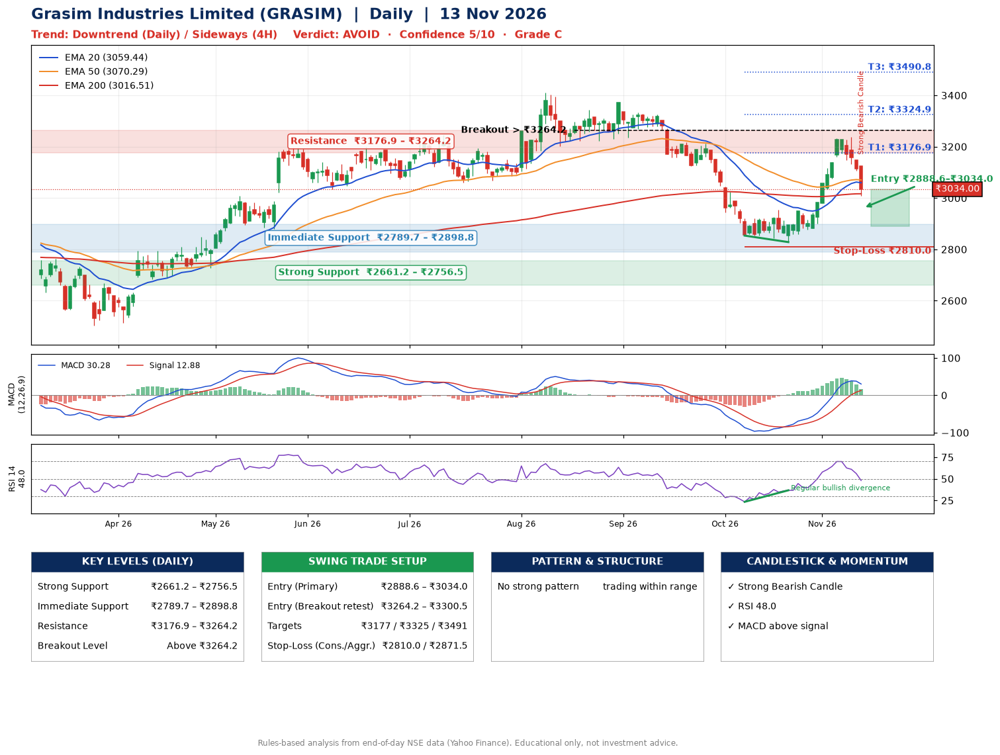

📌 **Grasim Industries Limited (GRASIM) – Multi-Timeframe Technical Analysis (Daily + 4H Combined)**
_Data up to 13 Nov 2026 · Close ₹3034.00_

**📍 Daily Timeframe Trend**
- Trend: **Downtrend** (lower highs and lower lows)
- Recent swing highs: ₹3343.1, ₹3371.0, ₹2954.8 · swing lows: ₹3222.1, ₹2853.5, ₹2828.2
- EMAs: EMA20 ₹3059.4, EMA50 ₹3070.3, EMA200 ₹3016.5; mixed / crossing; price above EMA200
- MACD 30.28 above signal 12.88 (above zero); histogram falling
- RSI(14) 48.0; Regular bullish divergence

**📍 4-Hour Timeframe Trend**
- Structure: **Sideways** (mixed swing structure)
- Pullback/support area: recent 4H swing lows ₹2828.2, ₹2876.3; EMA20 ₹3095.8
- EMA20/50: bullish stack (EMA20 > EMA50); price below all EMAs
- MACD 33.72 below signal 50.92 (above zero), fresh bearish crossover; histogram falling
- RSI(14) 43.6; Regular bearish divergence

**📍 Pattern Detection (Both Timeframes)**
- No strong pattern detected. Trading within range.

**📍 Candlestick Patterns (last 3 daily candles)**
- **Strong Bearish Candle** – 13 Nov: wide-range red candle, sellers in control

**📍 Price Action Key Levels (Daily Structure)**

| Zone | Price Level (₹) | Context |
|------|-----------------|---------|
| Strong Support | ₹2661.2 – ₹2756.5 | Cluster of earlier swing lows (demand) |
| Immediate Support | ₹2789.7 – ₹2898.8 | Nearest swing-low / wick area |
| Resistance | ₹3176.9 – ₹3264.2 | Nearest swing-high supply |
| Breakout Level | Above ₹3264.2 | Swing continuation trigger (52-week high ₹3411.1) |

**📍 Swing Trade Setup**

🟢 **Entry Zone**
- Primary: ₹2888.6 – ₹3034.0 (daily support / EMA20 area; enter on a bullish 4H candle)
- Alternate: ₹3264.2 – ₹3300.5 (breakout retest)

🎯 **Profit Targets**
- T1: ₹3176.9
- T2: ₹3324.9
- T3: ₹3490.8

🛑 **Stop-Loss**
- Conservative: below daily swing low (₹2810.0)
- Aggressive: below 4H structure (₹2871.5)
- Risk per share ≈ ₹151.3; reward:risk to T1 ≈ 1.4
- Time to T1: about 23 trading days (it rose this much within 60 trading days 54% of the time in the last 2 years)
- Time to T2: about 30 trading days (it rose this much within 60 trading days 24% of the time in the last 2 years)

**📌 Strategy Notes**
- Higher timeframe: daily trend is downtrend; only take longs while price holds above ₹2661.2.
- Entry timing: wait for a bullish 4H candle (engulfing/hammer) inside ₹2888.6 – ₹3034.0 rather than buying mid-range.
- EMA stacking: mixed / crossing; price above EMA200.
- Breakout rule: a daily close above ₹3264.2 with volume above its 20-day average (≈642,623) opens T2/T3.
- Momentum: RSI 48 – room to run; Regular bullish divergence.
- Exit discipline: move the stop to entry once T1 is hit; book partial profits at each target.

**STEP 2 — Marked Up Chart**

**✅ Trade Validation Checklist**
- Trend + momentum aligned: No · Price at entry zone: Yes
- Stop defined (₹2810.0) · Reward:risk ≥ 1.5 to T1: No

## 📌 Final Verdict

Recommendation: **🔴 AVOID**

Confidence: **5/10**

Trade Quality: **C**

Reason:
• Daily downtrend (lower highs and lower lows)

Next Action:
• Avoid until the trend changes (reclaim EMA50 and a higher low)

_Rules-based analysis from end-of-day data. Educational only, not investment advice. Never place orders without your own confirmation._