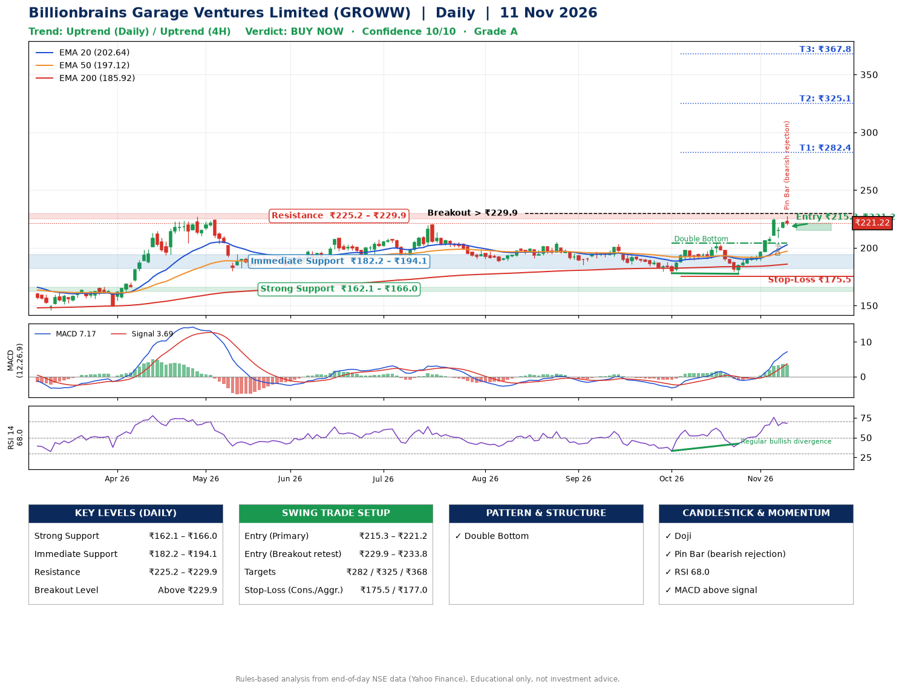

📌 **Billionbrains Garage Ventures Limited (GROWW) – Multi-Timeframe Technical Analysis (Daily + 4H Combined)**
_Data up to 11 Nov 2026 · Close ₹221.22_

**📍 Daily Timeframe Trend**
- Trend: **Uptrend** (price above rising EMAs)
- Recent swing highs: ₹205.2, ₹203.7, ₹204.0 · swing lows: ₹185.4, ₹178.0, ₹177.5
- EMAs: EMA20 ₹202.6, EMA50 ₹197.1, EMA200 ₹185.9; bullish stack (EMA20 > EMA50 > EMA200); price above EMA20, EMA50, EMA200
- MACD 7.17 above signal 3.69 (above zero); histogram falling
- RSI(14) 68.0; Regular bullish divergence

**📍 4-Hour Timeframe Trend**
- Structure: **Uptrend** (price above rising EMAs)
- Pullback/support area: recent 4H swing lows ₹190.9, ₹177.5; EMA20 ₹209.4
- EMA20/50: bullish stack (EMA20 > EMA50); price above EMA20, EMA50
- MACD 8.17 above signal 6.58 (above zero); histogram falling
- RSI(14) 68.3; no divergence

**📍 Pattern Detection (Both Timeframes)**
- Daily: **Double Bottom** – bottoms near ₹178.0/₹177.5, neckline ₹204.0, confirmed (closed above neckline)

**📍 Candlestick Patterns (last 3 daily candles)**
- **Doji** – 06 Nov: indecision; wait for the next candle to confirm direction
- **Pin Bar (bearish rejection)** – 11 Nov: long upper wick shows selling near ₹227.9

**📍 Price Action Key Levels (Daily Structure)**

| Zone | Price Level (₹) | Context |
|------|-----------------|---------|
| Strong Support | ₹162.1 – ₹166.0 | Cluster of earlier swing lows (demand) |
| Immediate Support | ₹182.2 – ₹194.1 | Nearest swing-low / wick area |
| Resistance | ₹225.2 – ₹229.9 | Nearest swing-high supply |
| Breakout Level | Above ₹229.9 | Swing continuation trigger (52-week high ₹227.9) |

**📍 Swing Trade Setup**

🟢 **Entry Zone**
- Primary: ₹215.3 – ₹221.2 (daily support / EMA20 area; enter on a bullish 4H candle)
- Alternate: ₹229.9 – ₹233.8 (breakout retest)

🎯 **Profit Targets**
- T1: ₹282.4
- T2: ₹325.1
- T3: ₹367.8

🛑 **Stop-Loss**
- Conservative: below daily swing low (₹175.5)
- Aggressive: below 4H structure (₹177.0)
- Risk per share ≈ ₹42.7; reward:risk to T1 ≈ 1.5

**📌 Strategy Notes**
- Higher timeframe: daily trend is uptrend; only take longs while price holds above ₹162.1.
- Entry timing: wait for a bullish 4H candle (engulfing/hammer) inside ₹215.3 – ₹221.2 rather than buying mid-range.
- EMA stacking: bullish stack (EMA20 > EMA50 > EMA200); price above EMA20, EMA50, EMA200.
- Breakout rule: a daily close above ₹229.9 with volume above its 20-day average (≈38,207,295) opens T2/T3.
- Momentum: RSI 68 – elevated, prefer dips; Regular bullish divergence.
- Exit discipline: move the stop to entry once T1 is hit; book partial profits at each target.

**STEP 2 — Marked Up Chart**

**✅ Trade Validation Checklist**
- Trend + momentum aligned: Yes · Price at entry zone: Yes
- Stop defined (₹175.5) · Reward:risk ≥ 1.5 to T1: Yes

## 📌 Final Verdict

Recommendation: **🟢 BUY NOW**

Confidence: **10/10**

Trade Quality: **A**

Reason:
• Daily uptrend (price above rising EMAs)
• EMAs stacked bullishly

Next Action:
• Buy now within the entry zone, with the stop-loss in place

_Rules-based analysis from end-of-day data. Educational only, not investment advice. Never place orders without your own confirmation._