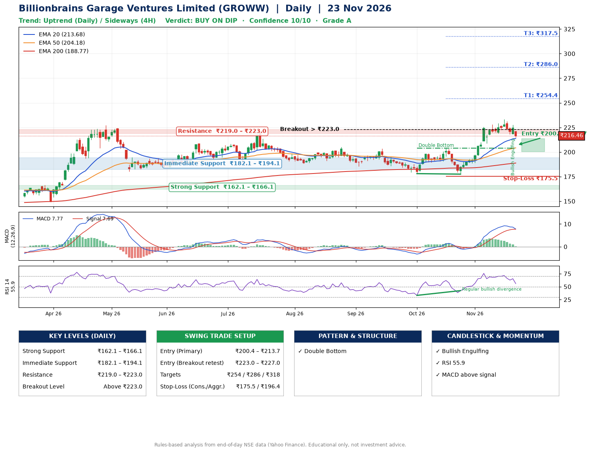

📌 **Billionbrains Garage Ventures Limited (GROWW) – Multi-Timeframe Technical Analysis (Daily + 4H Combined)**
_Data up to 23 Nov 2026 · Close ₹216.46_

**📍 Daily Timeframe Trend**
- Trend: **Uptrend** (price above rising EMAs)
- Recent swing highs: ₹205.2, ₹203.7, ₹204.0 · swing lows: ₹185.4, ₹178.0, ₹177.5
- EMAs: EMA20 ₹213.7, EMA50 ₹204.2, EMA200 ₹188.8; bullish stack (EMA20 > EMA50 > EMA200); price above EMA20, EMA50, EMA200
- MACD 7.77 above signal 7.69 (above zero); histogram falling
- RSI(14) 55.9; Regular bullish divergence

**📍 4-Hour Timeframe Trend**
- Structure: **Sideways** (mixed swing structure)
- Pullback/support area: recent 4H swing lows ₹219.9, ₹218.2; EMA20 ₹220.0
- EMA20/50: bullish stack (EMA20 > EMA50); price above EMA50
- MACD 3.46 below signal 5.33 (above zero); histogram falling
- RSI(14) 47.9; no divergence

**📍 Pattern Detection (Both Timeframes)**
- Daily: **Double Bottom** – bottoms near ₹178.0/₹177.5, neckline ₹204.0, confirmed (closed above neckline)
- 4H: **Bull Flag** – 16% pole then a tight 7% flag; trigger above ₹231.1

**📍 Candlestick Patterns (last 3 daily candles)**
- **Bullish Engulfing** – 20 Nov: buyers fully reversed the prior red candle

**📍 Price Action Key Levels (Daily Structure)**

| Zone | Price Level (₹) | Context |
|------|-----------------|---------|
| Strong Support | ₹162.1 – ₹166.1 | Cluster of earlier swing lows (demand) |
| Immediate Support | ₹182.1 – ₹194.1 | Nearest swing-low / wick area |
| Resistance | ₹219.0 – ₹223.0 | Nearest swing-high supply |
| Breakout Level | Above ₹223.0 | Swing continuation trigger (52-week high ₹233.4) |

**📍 Swing Trade Setup**

🟢 **Entry Zone**
- Primary: ₹200.4 – ₹213.7 (daily support / EMA20 area; enter on a bullish 4H candle)
- Alternate: ₹223.0 – ₹227.0 (breakout retest)

🎯 **Profit Targets**
- T1: ₹254.4
- T2: ₹286.0
- T3: ₹317.5

🛑 **Stop-Loss**
- Conservative: below daily swing low (₹175.5)
- Aggressive: below 4H structure (₹196.4)
- Risk per share ≈ ₹31.6; reward:risk to T1 ≈ 1.5
- Time to T1: about 28 trading days (it rose this much within 60 trading days 36% of the time in the last 2 years)
- Time to T2: about 23 trading days (it rose this much within 60 trading days 14% of the time in the last 2 years)

**📌 Strategy Notes**
- Higher timeframe: daily trend is uptrend; only take longs while price holds above ₹162.1.
- Entry timing: wait for a bullish 4H candle (engulfing/hammer) inside ₹200.4 – ₹213.7 rather than buying mid-range.
- EMA stacking: bullish stack (EMA20 > EMA50 > EMA200); price above EMA20, EMA50, EMA200.
- Breakout rule: a daily close above ₹223.0 with volume above its 20-day average (≈41,361,635) opens T2/T3.
- Momentum: RSI 56 – room to run; Regular bullish divergence.
- Exit discipline: move the stop to entry once T1 is hit; book partial profits at each target.

**STEP 2 — Marked Up Chart**

**✅ Trade Validation Checklist**
- Trend + momentum aligned: Yes · Price at entry zone: No
- Stop defined (₹175.5) · Reward:risk ≥ 1.5 to T1: Yes

## 📌 Final Verdict

Recommendation: **🟡 BUY ON DIP**

Confidence: **10/10**

Trade Quality: **A**

Reason:
• Daily uptrend (price above rising EMAs)
• EMAs stacked bullishly

Next Action:
• Wait for a pullback to ₹200.4–₹213.7, or a breakout above ₹223.0

_Rules-based analysis from end-of-day data. Educational only, not investment advice. Never place orders without your own confirmation._