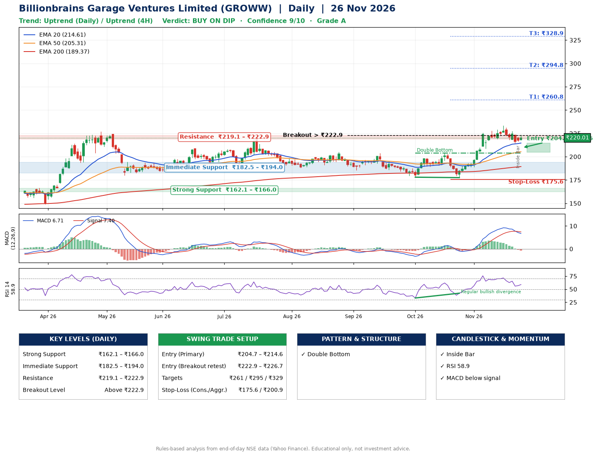

📌 **Billionbrains Garage Ventures Limited (GROWW) – Multi-Timeframe Technical Analysis (Daily + 4H Combined)**
_Data up to 26 Nov 2026 · Close ₹220.01_

**📍 Daily Timeframe Trend**
- Trend: **Uptrend** (price above rising EMAs)
- Recent swing highs: ₹203.7, ₹204.0, ₹233.4 · swing lows: ₹185.4, ₹178.0, ₹177.5
- EMAs: EMA20 ₹214.6, EMA50 ₹205.3, EMA200 ₹189.4; bullish stack (EMA20 > EMA50 > EMA200); price above EMA20, EMA50, EMA200
- MACD 6.71 below signal 7.40 (above zero), fresh bearish crossover; histogram falling
- RSI(14) 58.9; Regular bullish divergence

**📍 4-Hour Timeframe Trend**
- Structure: **Uptrend** (price above rising EMAs)
- Pullback/support area: recent 4H swing lows ₹218.2, ₹214.9; EMA20 ₹219.6
- EMA20/50: bullish stack (EMA20 > EMA50); price above EMA20, EMA50
- MACD 1.97 below signal 3.53 (above zero); histogram rising
- RSI(14) 53.4; no divergence

**📍 Pattern Detection (Both Timeframes)**
- Daily: **Double Bottom** – bottoms near ₹178.0/₹177.5, neckline ₹204.0, confirmed (closed above neckline)

**📍 Candlestick Patterns (last 3 daily candles)**
- **Inside Bar** – 25 Nov: compression inside the prior range ₹214.8–₹223.0

**📍 Price Action Key Levels (Daily Structure)**

| Zone | Price Level (₹) | Context |
|------|-----------------|---------|
| Strong Support | ₹162.1 – ₹166.0 | Cluster of earlier swing lows (demand) |
| Immediate Support | ₹182.5 – ₹194.0 | Nearest swing-low / wick area |
| Resistance | ₹219.1 – ₹222.9 | Nearest swing-high supply |
| Breakout Level | Above ₹222.9 | Swing continuation trigger (52-week high ₹233.4) |

**📍 Swing Trade Setup**

🟢 **Entry Zone**
- Primary: ₹204.7 – ₹214.6 (daily support / EMA20 area; enter on a bullish 4H candle)
- Alternate: ₹222.9 – ₹226.7 (breakout retest)

🎯 **Profit Targets**
- T1: ₹260.8
- T2: ₹294.8
- T3: ₹328.9

🛑 **Stop-Loss**
- Conservative: below daily swing low (₹175.6)
- Aggressive: below 4H structure (₹200.9)
- Risk per share ≈ ₹34.1; reward:risk to T1 ≈ 1.5
- Time to T1: about 31 trading days (it rose this much within 60 trading days 35% of the time in the last 2 years)
- Time to T2: about 24 trading days (it rose this much within 60 trading days 10% of the time in the last 2 years)

**📌 Strategy Notes**
- Higher timeframe: daily trend is uptrend; only take longs while price holds above ₹162.1.
- Entry timing: wait for a bullish 4H candle (engulfing/hammer) inside ₹204.7 – ₹214.6 rather than buying mid-range.
- EMA stacking: bullish stack (EMA20 > EMA50 > EMA200); price above EMA20, EMA50, EMA200.
- Breakout rule: a daily close above ₹222.9 with volume above its 20-day average (≈44,708,598) opens T2/T3.
- Momentum: RSI 59 – room to run; Regular bullish divergence.
- Exit discipline: move the stop to entry once T1 is hit; book partial profits at each target.

**STEP 2 — Marked Up Chart**

**✅ Trade Validation Checklist**
- Trend + momentum aligned: No · Price at entry zone: No
- Stop defined (₹175.6) · Reward:risk ≥ 1.5 to T1: Yes

## 📌 Final Verdict

Recommendation: **🟡 BUY ON DIP**

Confidence: **9/10**

Trade Quality: **A**

Reason:
• Daily uptrend (price above rising EMAs)
• EMAs stacked bullishly

Next Action:
• Wait for a pullback to ₹204.7–₹214.6, or a breakout above ₹222.9

_Rules-based analysis from end-of-day data. Educational only, not investment advice. Never place orders without your own confirmation._