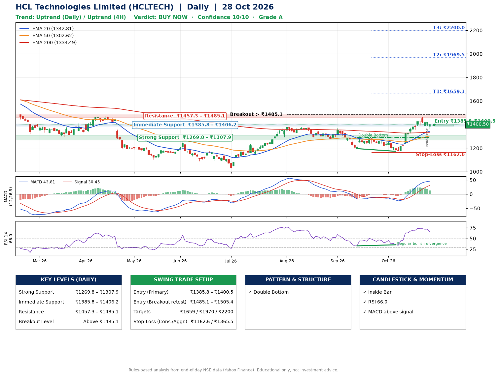

📌 **HCL Technologies Limited (HCLTECH) – Multi-Timeframe Technical Analysis (Daily + 4H Combined)**
_Data up to 28 Oct 2026 · Close ₹1400.50_

**📍 Daily Timeframe Trend**
- Trend: **Uptrend** (price above rising EMAs)
- Recent swing highs: ₹1379.8, ₹1368.0, ₹1290.0 · swing lows: ₹1280.0, ₹1195.7, ₹1172.8
- EMAs: EMA20 ₹1342.8, EMA50 ₹1302.6, EMA200 ₹1334.5; mixed / crossing; price above EMA20, EMA50, EMA200
- MACD 43.81 above signal 30.45 (above zero); histogram falling
- RSI(14) 66.0; Regular bullish divergence

**📍 4-Hour Timeframe Trend**
- Structure: **Uptrend** (higher highs and higher lows)
- Pullback/support area: recent 4H swing lows ₹1173.1, ₹1390.3; EMA20 ₹1380.1
- EMA20/50: bullish stack (EMA20 > EMA50); price above EMA20, EMA50
- MACD 35.10 below signal 40.08 (above zero), fresh bearish crossover; histogram falling
- RSI(14) 61.7; no divergence

**📍 Pattern Detection (Both Timeframes)**
- Daily: **Double Bottom** – bottoms near ₹1195.7/₹1172.8, neckline ₹1290.0, confirmed (closed above neckline)
- 4H: **Bull Flag** – 16% pole then a tight 7% flag; trigger above ₹1467.5

**📍 Candlestick Patterns (last 3 daily candles)**
- **Inside Bar** – 27 Oct: compression inside the prior range ₹1386.0–₹1422.7

**📍 Price Action Key Levels (Daily Structure)**

| Zone | Price Level (₹) | Context |
|------|-----------------|---------|
| Strong Support | ₹1269.8 – ₹1307.9 | Cluster of earlier swing lows (demand) |
| Immediate Support | ₹1385.8 – ₹1406.2 | Nearest swing-low / wick area |
| Resistance | ₹1457.3 – ₹1485.1 | Nearest swing-high supply |
| Breakout Level | Above ₹1485.1 | Swing continuation trigger (52-week high ₹1780.1) |

**📍 Swing Trade Setup**

🟢 **Entry Zone**
- Primary: ₹1385.8 – ₹1400.5 (daily support / EMA20 area; enter on a bullish 4H candle)
- Alternate: ₹1485.1 – ₹1505.4 (breakout retest)

🎯 **Profit Targets**
- T1: ₹1659.3
- T2: ₹1969.5
- T3: ₹2200.0

🛑 **Stop-Loss**
- Conservative: below daily swing low (₹1162.6)
- Aggressive: below 4H structure (₹1365.5)
- Risk per share ≈ ₹230.5; reward:risk to T1 ≈ 1.2

**📌 Strategy Notes**
- Higher timeframe: daily trend is uptrend; only take longs while price holds above ₹1269.8.
- Entry timing: wait for a bullish 4H candle (engulfing/hammer) inside ₹1385.8 – ₹1400.5 rather than buying mid-range.
- EMA stacking: mixed / crossing; price above EMA20, EMA50, EMA200.
- Breakout rule: a daily close above ₹1485.1 with volume above its 20-day average (≈5,027,182) opens T2/T3.
- Momentum: RSI 66 – elevated, prefer dips; Regular bullish divergence.
- Exit discipline: move the stop to entry once T1 is hit; book partial profits at each target.

**STEP 2 — Marked Up Chart**

**✅ Trade Validation Checklist**
- Trend + momentum aligned: Yes · Price at entry zone: Yes
- Stop defined (₹1162.6) · Reward:risk ≥ 1.5 to T1: No

## 📌 Final Verdict

Recommendation: **🟢 BUY NOW**

Confidence: **10/10**

Trade Quality: **A**

Reason:
• Daily uptrend (price above rising EMAs)
• Double Bottom: bottoms near ₹1195.7/₹1172.8, neckline ₹1290.0, confirmed (closed above neckline)

Next Action:
• Buy now within the entry zone, with the stop-loss in place

_Rules-based analysis from end-of-day data. Educational only, not investment advice. Never place orders without your own confirmation._