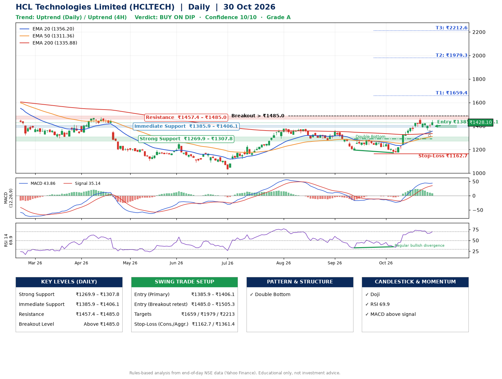

📌 **HCL Technologies Limited (HCLTECH) – Multi-Timeframe Technical Analysis (Daily + 4H Combined)**
_Data up to 30 Oct 2026 · Close ₹1428.10_

**📍 Daily Timeframe Trend**
- Trend: **Uptrend** (price above rising EMAs)
- Recent swing highs: ₹1368.0, ₹1290.0, ₹1467.5 · swing lows: ₹1280.0, ₹1195.7, ₹1172.8
- EMAs: EMA20 ₹1356.2, EMA50 ₹1311.4, EMA200 ₹1335.9; mixed / crossing; price above EMA20, EMA50, EMA200
- MACD 43.86 above signal 35.14 (above zero); histogram falling
- RSI(14) 69.9; Regular bullish divergence

**📍 4-Hour Timeframe Trend**
- Structure: **Uptrend** (price above rising EMAs)
- Pullback/support area: recent 4H swing lows ₹1390.3, ₹1364.0; EMA20 ₹1393.1
- EMA20/50: bullish stack (EMA20 > EMA50); price above EMA20, EMA50
- MACD 30.66 below signal 34.71 (above zero); histogram rising
- RSI(14) 64.5; no divergence

**📍 Pattern Detection (Both Timeframes)**
- Daily: **Double Bottom** – bottoms near ₹1195.7/₹1172.8, neckline ₹1290.0, confirmed (closed above neckline)
- 4H: **Bull Flag** – 16% pole then a tight 6% flag; trigger above ₹1451.5

**📍 Candlestick Patterns (last 3 daily candles)**
- **Doji** – 29 Oct: indecision; wait for the next candle to confirm direction

**📍 Price Action Key Levels (Daily Structure)**

| Zone | Price Level (₹) | Context |
|------|-----------------|---------|
| Strong Support | ₹1269.9 – ₹1307.8 | Cluster of earlier swing lows (demand) |
| Immediate Support | ₹1385.9 – ₹1406.1 | Nearest swing-low / wick area |
| Resistance | ₹1457.4 – ₹1485.0 | Nearest swing-high supply |
| Breakout Level | Above ₹1485.0 | Swing continuation trigger (52-week high ₹1780.1) |

**📍 Swing Trade Setup**

🟢 **Entry Zone**
- Primary: ₹1385.9 – ₹1406.1 (daily support / EMA20 area; enter on a bullish 4H candle)
- Alternate: ₹1485.0 – ₹1505.3 (breakout retest)

🎯 **Profit Targets**
- T1: ₹1659.4
- T2: ₹1979.3
- T3: ₹2212.6

🛑 **Stop-Loss**
- Conservative: below daily swing low (₹1162.7)
- Aggressive: below 4H structure (₹1361.4)
- Risk per share ≈ ₹233.3; reward:risk to T1 ≈ 1.1

**📌 Strategy Notes**
- Higher timeframe: daily trend is uptrend; only take longs while price holds above ₹1269.9.
- Entry timing: wait for a bullish 4H candle (engulfing/hammer) inside ₹1385.9 – ₹1406.1 rather than buying mid-range.
- EMA stacking: mixed / crossing; price above EMA20, EMA50, EMA200.
- Breakout rule: a daily close above ₹1485.0 with volume above its 20-day average (≈4,911,121) opens T2/T3.
- Momentum: RSI 70 – elevated, prefer dips; Regular bullish divergence.
- Exit discipline: move the stop to entry once T1 is hit; book partial profits at each target.

**STEP 2 — Marked Up Chart**

**✅ Trade Validation Checklist**
- Trend + momentum aligned: Yes · Price at entry zone: No
- Stop defined (₹1162.7) · Reward:risk ≥ 1.5 to T1: No

## 📌 Final Verdict

Recommendation: **🟡 BUY ON DIP**

Confidence: **10/10**

Trade Quality: **A**

Reason:
• Daily uptrend (price above rising EMAs)
• Double Bottom: bottoms near ₹1195.7/₹1172.8, neckline ₹1290.0, confirmed (closed above neckline)

Next Action:
• Wait for a pullback to ₹1385.9–₹1406.1, or a breakout above ₹1485.0

_Rules-based analysis from end-of-day data. Educational only, not investment advice. Never place orders without your own confirmation._