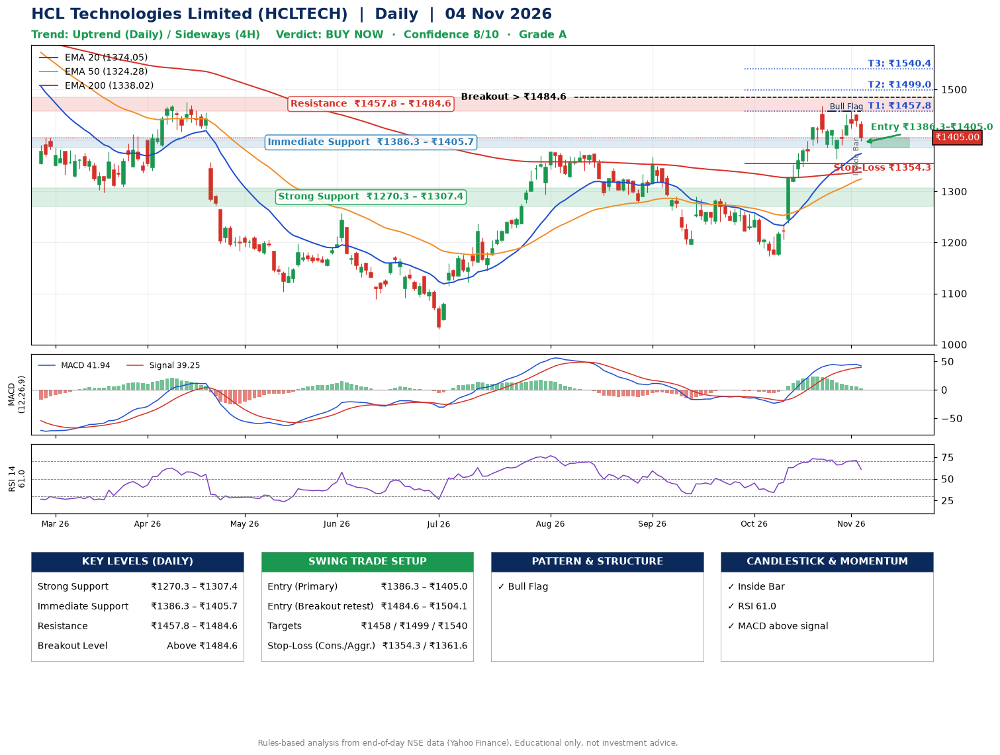

📌 **HCL Technologies Limited (HCLTECH) – Multi-Timeframe Technical Analysis (Daily + 4H Combined)**
_Data up to 04 Nov 2026 · Close ₹1405.00_

**📍 Daily Timeframe Trend**
- Trend: **Uptrend** (higher highs and higher lows)
- Recent swing highs: ₹1368.0, ₹1290.0, ₹1467.5 · swing lows: ₹1195.7, ₹1172.8, ₹1364.0
- EMAs: EMA20 ₹1374.1, EMA50 ₹1324.3, EMA200 ₹1338.0; mixed / crossing; price above EMA20, EMA50, EMA200
- MACD 41.94 above signal 39.25 (above zero); histogram falling
- RSI(14) 61.0; no divergence on the last two swings

**📍 4-Hour Timeframe Trend**
- Structure: **Sideways** (mixed swing structure)
- Pullback/support area: recent 4H swing lows ₹1390.3, ₹1364.0; EMA20 ₹1406.9
- EMA20/50: bullish stack (EMA20 > EMA50); price above EMA50
- MACD 21.95 below signal 28.38 (above zero); histogram falling
- RSI(14) 53.5; no divergence

**📍 Pattern Detection (Both Timeframes)**
- Daily: **Bull Flag** – 17% pole then a tight 7% flag; trigger above ₹1457.1
- 4H: **Double Top** – tops near ₹1467.5/₹1456.2, neckline ₹1364.0, forming

**📍 Candlestick Patterns (last 3 daily candles)**
- **Inside Bar** – 03 Nov: compression inside the prior range ₹1424.0–₹1457.1

**📍 Price Action Key Levels (Daily Structure)**

| Zone | Price Level (₹) | Context |
|------|-----------------|---------|
| Strong Support | ₹1270.3 – ₹1307.4 | Cluster of earlier swing lows (demand) |
| Immediate Support | ₹1386.3 – ₹1405.7 | Nearest swing-low / wick area |
| Resistance | ₹1457.8 – ₹1484.6 | Nearest swing-high supply |
| Breakout Level | Above ₹1484.6 | Swing continuation trigger (52-week high ₹1780.1) |

**📍 Swing Trade Setup**

🟢 **Entry Zone**
- Primary: ₹1386.3 – ₹1405.0 (daily support / EMA20 area; enter on a bullish 4H candle)
- Alternate: ₹1484.6 – ₹1504.1 (breakout retest)

🎯 **Profit Targets**
- T1: ₹1457.8
- T2: ₹1499.0
- T3: ₹1540.4

🛑 **Stop-Loss**
- Conservative: below daily swing low (₹1354.3)
- Aggressive: below 4H structure (₹1361.6)
- Risk per share ≈ ₹41.4; reward:risk to T1 ≈ 1.5

**📌 Strategy Notes**
- Higher timeframe: daily trend is uptrend; only take longs while price holds above ₹1270.3.
- Entry timing: wait for a bullish 4H candle (engulfing/hammer) inside ₹1386.3 – ₹1405.0 rather than buying mid-range.
- EMA stacking: mixed / crossing; price above EMA20, EMA50, EMA200.
- Breakout rule: a daily close above ₹1484.6 with volume above its 20-day average (≈4,793,269) opens T2/T3.
- Momentum: RSI 61 – room to run; no divergence on the last two swings.
- Exit discipline: move the stop to entry once T1 is hit; book partial profits at each target.

**STEP 2 — Marked Up Chart**

**✅ Trade Validation Checklist**
- Trend + momentum aligned: Yes · Price at entry zone: Yes
- Stop defined (₹1354.3) · Reward:risk ≥ 1.5 to T1: Yes

## 📌 Final Verdict

Recommendation: **🟢 BUY NOW**

Confidence: **8/10**

Trade Quality: **A**

Reason:
• Daily uptrend (higher highs and higher lows)
• Bull Flag: 17% pole then a tight 7% flag; trigger above ₹1457.1

Next Action:
• Buy now within the entry zone, with the stop-loss in place

_Rules-based analysis from end-of-day data. Educational only, not investment advice. Never place orders without your own confirmation._