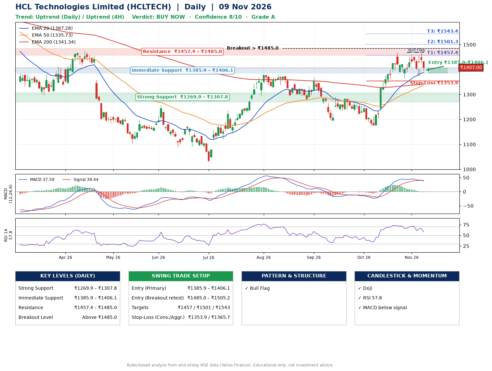

📌 **HCL Technologies Limited (HCLTECH) – Multi-Timeframe Technical Analysis (Daily + 4H Combined)**
_Data up to 09 Nov 2026 · Close ₹1407.00_

**📍 Daily Timeframe Trend**
- Trend: **Uptrend** (higher highs and higher lows)
- Recent swing highs: ₹1368.0, ₹1290.0, ₹1467.5 · swing lows: ₹1195.7, ₹1172.8, ₹1364.0
- EMAs: EMA20 ₹1387.3, EMA50 ₹1335.7, EMA200 ₹1341.3; mixed / crossing; price above EMA20, EMA50, EMA200
- MACD 37.59 below signal 39.44 (above zero), fresh bearish crossover; histogram falling
- RSI(14) 57.8; no divergence on the last two swings

**📍 4-Hour Timeframe Trend**
- Structure: **Uptrend** (higher highs and higher lows)
- Pullback/support area: recent 4H swing lows ₹1364.0, ₹1399.9; EMA20 ₹1413.8
- EMA20/50: bullish stack (EMA20 > EMA50); price above EMA50
- MACD 13.94 below signal 20.59 (above zero); histogram falling
- RSI(14) 50.7; Hidden bullish divergence; Regular bearish divergence

**📍 Pattern Detection (Both Timeframes)**
- Daily: **Bull Flag** – 15% pole then a tight 5% flag; trigger above ₹1469.0
- 4H: **Double Bottom** – bottoms near ₹1364.0/₹1399.9, neckline ₹1456.2, forming
- 4H: **Ascending Triangle** – converging swing highs and lows over the last ~60 sessions

**📍 Candlestick Patterns (last 3 daily candles)**
- **Doji** – 05 Nov: indecision; wait for the next candle to confirm direction

**📍 Price Action Key Levels (Daily Structure)**

| Zone | Price Level (₹) | Context |
|------|-----------------|---------|
| Strong Support | ₹1269.9 – ₹1307.8 | Cluster of earlier swing lows (demand) |
| Immediate Support | ₹1385.9 – ₹1406.1 | Nearest swing-low / wick area |
| Resistance | ₹1457.4 – ₹1485.0 | Nearest swing-high supply |
| Breakout Level | Above ₹1485.0 | Swing continuation trigger (52-week high ₹1780.1) |

**📍 Swing Trade Setup**

🟢 **Entry Zone**
- Primary: ₹1385.9 – ₹1406.1 (daily support / EMA20 area; enter on a bullish 4H candle)
- Alternate: ₹1485.0 – ₹1505.2 (breakout retest)

🎯 **Profit Targets**
- T1: ₹1457.4
- T2: ₹1501.3
- T3: ₹1543.4

🛑 **Stop-Loss**
- Conservative: below daily swing low (₹1353.9)
- Aggressive: below 4H structure (₹1365.7)
- Risk per share ≈ ₹42.1; reward:risk to T1 ≈ 1.5

**📌 Strategy Notes**
- Higher timeframe: daily trend is uptrend; only take longs while price holds above ₹1269.9.
- Entry timing: wait for a bullish 4H candle (engulfing/hammer) inside ₹1385.9 – ₹1406.1 rather than buying mid-range.
- EMA stacking: mixed / crossing; price above EMA20, EMA50, EMA200.
- Breakout rule: a daily close above ₹1485.0 with volume above its 20-day average (≈5,026,431) opens T2/T3.
- Momentum: RSI 58 – room to run; no divergence on the last two swings.
- Exit discipline: move the stop to entry once T1 is hit; book partial profits at each target.

**STEP 2 — Marked Up Chart**

**✅ Trade Validation Checklist**
- Trend + momentum aligned: No · Price at entry zone: No
- Stop defined (₹1353.9) · Reward:risk ≥ 1.5 to T1: No

## 📌 Final Verdict

Recommendation: **🟢 BUY NOW**

Confidence: **8/10**

Trade Quality: **A**

Reason:
• Daily uptrend (higher highs and higher lows)
• Bull Flag: 15% pole then a tight 5% flag; trigger above ₹1469.0

Next Action:
• Buy now within the entry zone, with the stop-loss in place

_Rules-based analysis from end-of-day data. Educational only, not investment advice. Never place orders without your own confirmation._