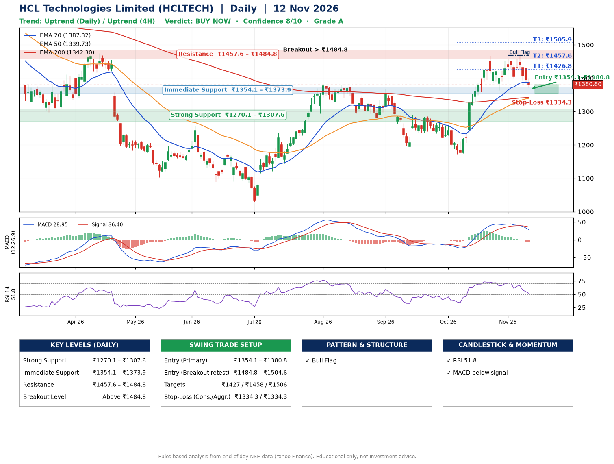

📌 **HCL Technologies Limited (HCLTECH) – Multi-Timeframe Technical Analysis (Daily + 4H Combined)**
_Data up to 12 Nov 2026 · Close ₹1380.80_

**📍 Daily Timeframe Trend**
- Trend: **Uptrend** (higher highs and higher lows)
- Recent swing highs: ₹1368.0, ₹1290.0, ₹1467.5 · swing lows: ₹1195.7, ₹1172.8, ₹1364.0
- EMAs: EMA20 ₹1387.3, EMA50 ₹1339.7, EMA200 ₹1342.3; mixed / crossing; price above EMA50, EMA200
- MACD 28.95 below signal 36.40 (above zero), fresh bearish crossover; histogram falling
- RSI(14) 51.8; no divergence on the last two swings

**📍 4-Hour Timeframe Trend**
- Structure: **Uptrend** (higher highs and higher lows)
- Pullback/support area: recent 4H swing lows ₹1364.0, ₹1399.9; EMA20 ₹1405.0
- EMA20/50: bullish stack (EMA20 > EMA50); price above EMA50
- MACD 2.58 below signal 12.07 (above zero); histogram falling
- RSI(14) 43.9; Hidden bullish divergence; Regular bearish divergence

**📍 Pattern Detection (Both Timeframes)**
- Daily: **Bull Flag** – 17% pole then a tight 7% flag; trigger above ₹1469.0
- 4H: **Double Bottom** – bottoms near ₹1364.0/₹1399.9, neckline ₹1456.2, forming
- 4H: **Ascending Triangle** – converging swing highs and lows over the last ~60 sessions

**📍 Candlestick Patterns (last 3 daily candles)**
- No notable candlestick signal in the last 3 sessions.

**📍 Price Action Key Levels (Daily Structure)**

| Zone | Price Level (₹) | Context |
|------|-----------------|---------|
| Strong Support | ₹1270.1 – ₹1307.6 | Cluster of earlier swing lows (demand) |
| Immediate Support | ₹1354.1 – ₹1373.9 | Nearest swing-low / wick area |
| Resistance | ₹1457.6 – ₹1484.8 | Nearest swing-high supply |
| Breakout Level | Above ₹1484.8 | Swing continuation trigger (52-week high ₹1780.1) |

**📍 Swing Trade Setup**

🟢 **Entry Zone**
- Primary: ₹1354.1 – ₹1380.8 (daily support / EMA20 area; enter on a bullish 4H candle)
- Alternate: ₹1484.8 – ₹1504.6 (breakout retest)

🎯 **Profit Targets**
- T1: ₹1426.8
- T2: ₹1457.6
- T3: ₹1505.9

🛑 **Stop-Loss**
- Conservative: below daily swing low (₹1334.3)
- Aggressive: below 4H structure (₹1334.3)
- Risk per share ≈ ₹39.5; reward:risk to T1 ≈ 1.5
- Time to T1: about 11 trading days (it rose this much within 60 trading days 74% of the time in the last 2 years)
- Time to T2: about 18 trading days (it rose this much within 60 trading days 60% of the time in the last 2 years)

**📌 Strategy Notes**
- Higher timeframe: daily trend is uptrend; only take longs while price holds above ₹1270.1.
- Entry timing: wait for a bullish 4H candle (engulfing/hammer) inside ₹1354.1 – ₹1380.8 rather than buying mid-range.
- EMA stacking: mixed / crossing; price above EMA50, EMA200.
- Breakout rule: a daily close above ₹1484.8 with volume above its 20-day average (≈4,085,495) opens T2/T3.
- Momentum: RSI 52 – room to run; no divergence on the last two swings.
- Exit discipline: move the stop to entry once T1 is hit; book partial profits at each target.

**STEP 2 — Marked Up Chart**

**✅ Trade Validation Checklist**
- Trend + momentum aligned: No · Price at entry zone: Yes
- Stop defined (₹1334.3) · Reward:risk ≥ 1.5 to T1: Yes

## 📌 Final Verdict

Recommendation: **🟢 BUY NOW**

Confidence: **8/10**

Trade Quality: **A**

Reason:
• Daily uptrend (higher highs and higher lows)
• Bull Flag: 17% pole then a tight 7% flag; trigger above ₹1469.0

Next Action:
• Buy now within the entry zone, with the stop-loss in place

_Rules-based analysis from end-of-day data. Educational only, not investment advice. Never place orders without your own confirmation._