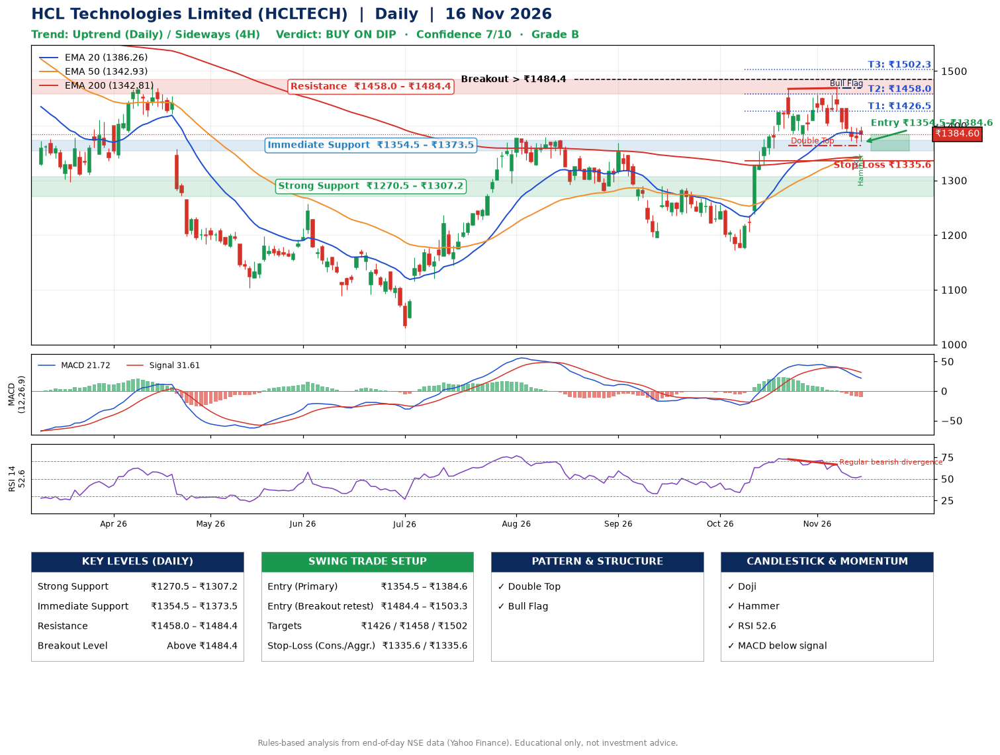

📌 **HCL Technologies Limited (HCLTECH) – Multi-Timeframe Technical Analysis (Daily + 4H Combined)**
_Data up to 16 Nov 2026 · Close ₹1384.60_

**📍 Daily Timeframe Trend**
- Trend: **Uptrend** (higher highs and higher lows)
- Recent swing highs: ₹1290.0, ₹1467.5, ₹1469.0 · swing lows: ₹1195.7, ₹1172.8, ₹1364.0
- EMAs: EMA20 ₹1386.3, EMA50 ₹1342.9, EMA200 ₹1342.8; bullish stack (EMA20 > EMA50 > EMA200); price above EMA50, EMA200
- MACD 21.72 below signal 31.61 (above zero), fresh bearish crossover; histogram falling
- RSI(14) 52.6; Regular bearish divergence

**📍 4-Hour Timeframe Trend**
- Structure: **Sideways** (mixed swing structure)
- Pullback/support area: recent 4H swing lows ₹1399.9, ₹1368.5; EMA20 ₹1396.8
- EMA20/50: bullish stack (EMA20 > EMA50); price above EMA50
- MACD -3.20 below signal 3.75 (below zero); histogram rising
- RSI(14) 45.9; Regular bearish divergence

**📍 Pattern Detection (Both Timeframes)**
- Daily: **Double Top** – tops near ₹1467.5/₹1469.0, neckline ₹1364.0, forming
- Daily: **Bull Flag** – 18% pole then a tight 7% flag; trigger above ₹1469.0
- 4H: **Double Bottom** – bottoms near ₹1399.9/₹1368.5, neckline ₹1468.9, forming

**📍 Candlestick Patterns (last 3 daily candles)**
- **Doji** – 13 Nov: indecision; wait for the next candle to confirm direction
- **Hammer** – 16 Nov: long lower wick shows dip-buying near ₹1371.1

**📍 Price Action Key Levels (Daily Structure)**

| Zone | Price Level (₹) | Context |
|------|-----------------|---------|
| Strong Support | ₹1270.5 – ₹1307.2 | Cluster of earlier swing lows (demand) |
| Immediate Support | ₹1354.5 – ₹1373.5 | Nearest swing-low / wick area |
| Resistance | ₹1458.0 – ₹1484.4 | Nearest swing-high supply |
| Breakout Level | Above ₹1484.4 | Swing continuation trigger (52-week high ₹1780.1) |

**📍 Swing Trade Setup**

🟢 **Entry Zone**
- Primary: ₹1354.5 – ₹1384.6 (daily support / EMA20 area; enter on a bullish 4H candle)
- Alternate: ₹1484.4 – ₹1503.3 (breakout retest)

🎯 **Profit Targets**
- T1: ₹1426.5
- T2: ₹1458.0
- T3: ₹1502.3

🛑 **Stop-Loss**
- Conservative: below daily swing low (₹1335.6)
- Aggressive: below 4H structure (₹1335.6)
- Risk per share ≈ ₹37.9; reward:risk to T1 ≈ 1.5
- Time to T1: about 10 trading days (it rose this much within 60 trading days 74% of the time in the last 2 years)
- Time to T2: about 18 trading days (it rose this much within 60 trading days 61% of the time in the last 2 years)

**📌 Strategy Notes**
- Higher timeframe: daily trend is uptrend; only take longs while price holds above ₹1270.5.
- Entry timing: wait for a bullish 4H candle (engulfing/hammer) inside ₹1354.5 – ₹1384.6 rather than buying mid-range.
- EMA stacking: bullish stack (EMA20 > EMA50 > EMA200); price above EMA50, EMA200.
- Breakout rule: a daily close above ₹1484.4 with volume above its 20-day average (≈3,434,109) opens T2/T3.
- Momentum: RSI 53 – room to run; Regular bearish divergence.
- Exit discipline: move the stop to entry once T1 is hit; book partial profits at each target.

**STEP 2 — Marked Up Chart**

**✅ Trade Validation Checklist**
- Trend + momentum aligned: No · Price at entry zone: Yes
- Stop defined (₹1335.6) · Reward:risk ≥ 1.5 to T1: Yes

## 📌 Final Verdict

Recommendation: **🟡 BUY ON DIP**

Confidence: **7/10**

Trade Quality: **B**

Reason:
• Daily uptrend (higher highs and higher lows)
• EMAs stacked bullishly

Next Action:
• Wait for a pullback to ₹1354.5–₹1384.6, or a breakout above ₹1484.4

_Rules-based analysis from end-of-day data. Educational only, not investment advice. Never place orders without your own confirmation._