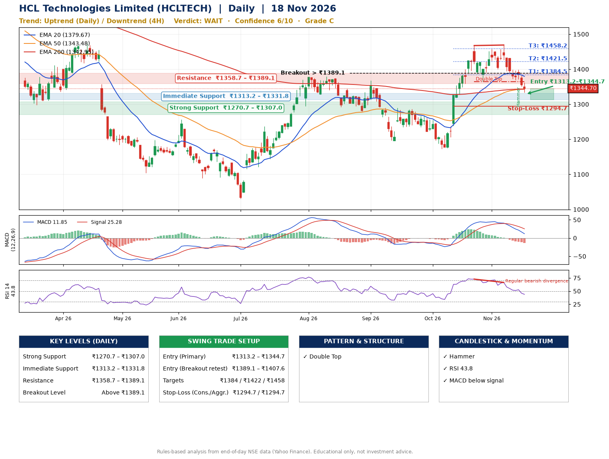

📌 **HCL Technologies Limited (HCLTECH) – Multi-Timeframe Technical Analysis (Daily + 4H Combined)**
_Data up to 18 Nov 2026 · Close ₹1344.70_

**📍 Daily Timeframe Trend**
- Trend: **Uptrend** (higher highs and higher lows)
- Recent swing highs: ₹1290.0, ₹1467.5, ₹1469.0 · swing lows: ₹1195.7, ₹1172.8, ₹1364.0
- EMAs: EMA20 ₹1379.7, EMA50 ₹1343.5, EMA200 ₹1343.0; bullish stack (EMA20 > EMA50 > EMA200); price above EMA50, EMA200
- MACD 11.85 below signal 25.28 (above zero); histogram falling
- RSI(14) 43.8; Regular bearish divergence

**📍 4-Hour Timeframe Trend**
- Structure: **Downtrend** (lower highs and lower lows)
- Pullback/support area: recent 4H swing lows ₹1399.9, ₹1368.5; EMA20 ₹1382.0
- EMA20/50: bullish stack (EMA20 > EMA50); price below all EMAs
- MACD -11.51 below signal -3.94 (below zero); histogram falling
- RSI(14) 34.5; no divergence

**📍 Pattern Detection (Both Timeframes)**
- Daily: **Double Top** – tops near ₹1467.5/₹1469.0, neckline ₹1364.0, confirmed (closed below neckline)
- 4H: **Descending Triangle** – converging swing highs and lows over the last ~60 sessions

**📍 Candlestick Patterns (last 3 daily candles)**
- **Hammer** – 16 Nov: long lower wick shows dip-buying near ₹1371.1

**📍 Price Action Key Levels (Daily Structure)**

| Zone | Price Level (₹) | Context |
|------|-----------------|---------|
| Strong Support | ₹1270.7 – ₹1307.0 | Cluster of earlier swing lows (demand) |
| Immediate Support | ₹1313.2 – ₹1331.8 | Nearest swing-low / wick area |
| Resistance | ₹1358.7 – ₹1389.1 | Nearest swing-high supply |
| Breakout Level | Above ₹1389.1 | Swing continuation trigger (52-week high ₹1780.1) |

**📍 Swing Trade Setup**

🟢 **Entry Zone**
- Primary: ₹1313.2 – ₹1344.7 (daily support / EMA20 area; enter on a bullish 4H candle)
- Alternate: ₹1389.1 – ₹1407.6 (breakout retest)

🎯 **Profit Targets**
- T1: ₹1384.5
- T2: ₹1421.5
- T3: ₹1458.2

🛑 **Stop-Loss**
- Conservative: below daily swing low (₹1294.7)
- Aggressive: below 4H structure (₹1294.7)
- Risk per share ≈ ₹37.0; reward:risk to T1 ≈ 1.5
- Time to T1: about 10 trading days (it rose this much within 60 trading days 74% of the time in the last 2 years)
- Time to T2: about 19 trading days (it rose this much within 60 trading days 58% of the time in the last 2 years)

**📌 Strategy Notes**
- Higher timeframe: daily trend is uptrend; only take longs while price holds above ₹1270.7.
- Entry timing: wait for a bullish 4H candle (engulfing/hammer) inside ₹1313.2 – ₹1344.7 rather than buying mid-range.
- EMA stacking: bullish stack (EMA20 > EMA50 > EMA200); price above EMA50, EMA200.
- Breakout rule: a daily close above ₹1389.1 with volume above its 20-day average (≈3,136,159) opens T2/T3.
- Momentum: RSI 44 – room to run; Regular bearish divergence.
- Exit discipline: move the stop to entry once T1 is hit; book partial profits at each target.

**STEP 2 — Marked Up Chart**

**✅ Trade Validation Checklist**
- Trend + momentum aligned: No · Price at entry zone: Yes
- Stop defined (₹1294.7) · Reward:risk ≥ 1.5 to T1: Yes

## 📌 Final Verdict

Recommendation: **🟠 WAIT**

Confidence: **6/10**

Trade Quality: **C**

Reason:
• Daily uptrend (higher highs and higher lows)
• EMAs stacked bullishly

Next Action:
• Wait for a breakout above ₹1389.1

_Rules-based analysis from end-of-day data. Educational only, not investment advice. Never place orders without your own confirmation._