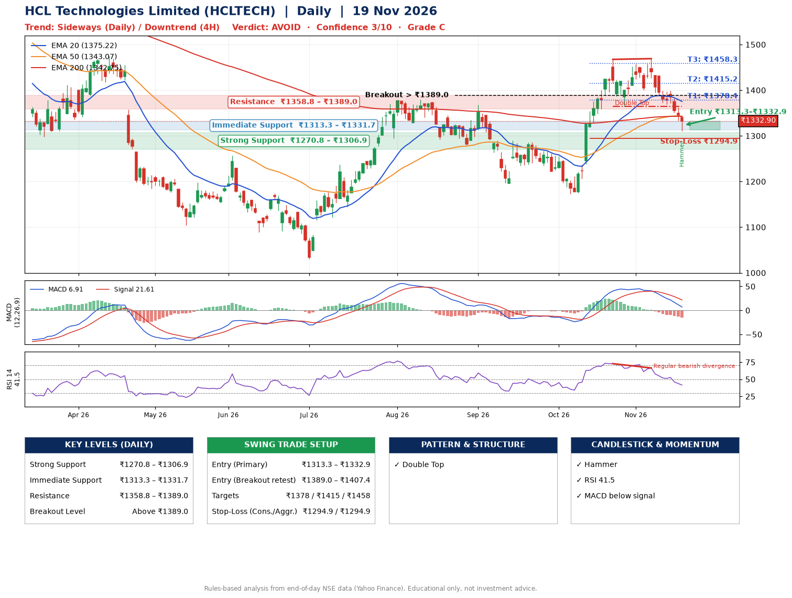

📌 **HCL Technologies Limited (HCLTECH) – Multi-Timeframe Technical Analysis (Daily + 4H Combined)**
_Data up to 19 Nov 2026 · Close ₹1332.90_

**📍 Daily Timeframe Trend**
- Trend: **Sideways** (mixed swing structure)
- Recent swing highs: ₹1290.0, ₹1467.5, ₹1469.0 · swing lows: ₹1195.7, ₹1172.8, ₹1364.0
- EMAs: EMA20 ₹1375.2, EMA50 ₹1343.1, EMA200 ₹1342.8; bullish stack (EMA20 > EMA50 > EMA200); price below all EMAs
- MACD 6.91 below signal 21.61 (above zero); histogram falling
- RSI(14) 41.5; Regular bearish divergence

**📍 4-Hour Timeframe Trend**
- Structure: **Downtrend** (lower highs and lower lows)
- Pullback/support area: recent 4H swing lows ₹1399.9, ₹1368.5; EMA20 ₹1372.2
- EMA20/50: bullish stack (EMA20 > EMA50); price below all EMAs
- MACD -16.12 below signal -8.09 (below zero); histogram rising
- RSI(14) 34.4; no divergence

**📍 Pattern Detection (Both Timeframes)**
- Daily: **Double Top** – tops near ₹1467.5/₹1469.0, neckline ₹1364.0, confirmed (closed below neckline)
- 4H: **Descending Triangle** – converging swing highs and lows over the last ~60 sessions

**📍 Candlestick Patterns (last 3 daily candles)**
- **Hammer** – 19 Nov: long lower wick shows dip-buying near ₹1310.0

**📍 Price Action Key Levels (Daily Structure)**

| Zone | Price Level (₹) | Context |
|------|-----------------|---------|
| Strong Support | ₹1270.8 – ₹1306.9 | Cluster of earlier swing lows (demand) |
| Immediate Support | ₹1313.3 – ₹1331.7 | Nearest swing-low / wick area |
| Resistance | ₹1358.8 – ₹1389.0 | Nearest swing-high supply |
| Breakout Level | Above ₹1389.0 | Swing continuation trigger (52-week high ₹1780.1) |

**📍 Swing Trade Setup**

🟢 **Entry Zone**
- Primary: ₹1313.3 – ₹1332.9 (daily support / EMA20 area; enter on a bullish 4H candle)
- Alternate: ₹1389.0 – ₹1407.4 (breakout retest)

🎯 **Profit Targets**
- T1: ₹1378.4
- T2: ₹1415.2
- T3: ₹1458.3

🛑 **Stop-Loss**
- Conservative: below daily swing low (₹1294.9)
- Aggressive: below 4H structure (₹1294.9)
- Risk per share ≈ ₹36.8; reward:risk to T1 ≈ 1.5
- Time to T1: about 10 trading days (it rose this much within 60 trading days 74% of the time in the last 2 years)
- Time to T2: about 20 trading days (it rose this much within 60 trading days 58% of the time in the last 2 years)

**📌 Strategy Notes**
- Higher timeframe: daily trend is sideways; only take longs while price holds above ₹1270.8.
- Entry timing: wait for a bullish 4H candle (engulfing/hammer) inside ₹1313.3 – ₹1332.9 rather than buying mid-range.
- EMA stacking: bullish stack (EMA20 > EMA50 > EMA200); price below all EMAs.
- Breakout rule: a daily close above ₹1389.0 with volume above its 20-day average (≈3,070,892) opens T2/T3.
- Momentum: RSI 42 – room to run; Regular bearish divergence.
- Exit discipline: move the stop to entry once T1 is hit; book partial profits at each target.

**STEP 2 — Marked Up Chart**

**✅ Trade Validation Checklist**
- Trend + momentum aligned: No · Price at entry zone: Yes
- Stop defined (₹1294.9) · Reward:risk ≥ 1.5 to T1: Yes

## 📌 Final Verdict

Recommendation: **🔴 AVOID**

Confidence: **3/10**

Trade Quality: **C**

Reason:
• EMAs stacked bullishly
• Double Top: tops near ₹1467.5/₹1469.0, neckline ₹1364.0, confirmed (closed below neckline)

Next Action:
• Avoid until the trend changes (reclaim EMA50 and a higher low)

_Rules-based analysis from end-of-day data. Educational only, not investment advice. Never place orders without your own confirmation._