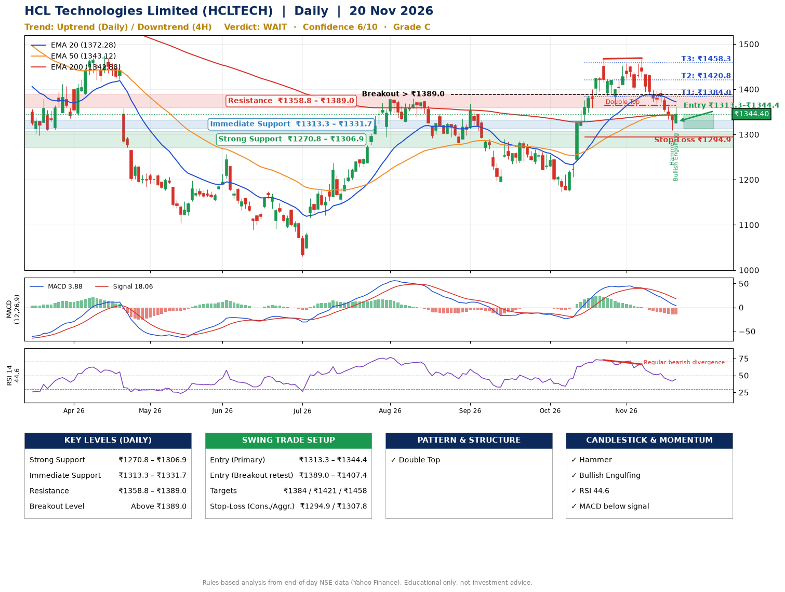

📌 **HCL Technologies Limited (HCLTECH) – Multi-Timeframe Technical Analysis (Daily + 4H Combined)**
_Data up to 20 Nov 2026 · Close ₹1344.40_

**📍 Daily Timeframe Trend**
- Trend: **Uptrend** (higher highs and higher lows)
- Recent swing highs: ₹1290.0, ₹1467.5, ₹1469.0 · swing lows: ₹1195.7, ₹1172.8, ₹1364.0
- EMAs: EMA20 ₹1372.3, EMA50 ₹1343.1, EMA200 ₹1342.9; bullish stack (EMA20 > EMA50 > EMA200); price above EMA50, EMA200
- MACD 3.88 below signal 18.06 (above zero); histogram rising
- RSI(14) 44.6; Regular bearish divergence

**📍 4-Hour Timeframe Trend**
- Structure: **Downtrend** (lower highs and lower lows)
- Pullback/support area: recent 4H swing lows ₹1368.5, ₹1310.0; EMA20 ₹1367.3
- EMA20/50: bullish stack (EMA20 > EMA50); price below all EMAs
- MACD -15.86 below signal -10.90 (below zero); histogram rising
- RSI(14) 39.7; no divergence

**📍 Pattern Detection (Both Timeframes)**
- Daily: **Double Top** – tops near ₹1467.5/₹1469.0, neckline ₹1364.0, confirmed (closed below neckline)

**📍 Candlestick Patterns (last 3 daily candles)**
- **Hammer** – 19 Nov: long lower wick shows dip-buying near ₹1309.4
- **Bullish Engulfing** – 20 Nov: buyers fully reversed the prior red candle

**📍 Price Action Key Levels (Daily Structure)**

| Zone | Price Level (₹) | Context |
|------|-----------------|---------|
| Strong Support | ₹1270.8 – ₹1306.9 | Cluster of earlier swing lows (demand) |
| Immediate Support | ₹1313.3 – ₹1331.7 | Nearest swing-low / wick area |
| Resistance | ₹1358.8 – ₹1389.0 | Nearest swing-high supply |
| Breakout Level | Above ₹1389.0 | Swing continuation trigger (52-week high ₹1780.1) |

**📍 Swing Trade Setup**

🟢 **Entry Zone**
- Primary: ₹1313.3 – ₹1344.4 (daily support / EMA20 area; enter on a bullish 4H candle)
- Alternate: ₹1389.0 – ₹1407.4 (breakout retest)

🎯 **Profit Targets**
- T1: ₹1384.0
- T2: ₹1420.8
- T3: ₹1458.3

🛑 **Stop-Loss**
- Conservative: below daily swing low (₹1294.9)
- Aggressive: below 4H structure (₹1307.8)
- Risk per share ≈ ₹36.8; reward:risk to T1 ≈ 1.5
- Time to T1: about 10 trading days (it rose this much within 60 trading days 74% of the time in the last 2 years)
- Time to T2: about 20 trading days (it rose this much within 60 trading days 58% of the time in the last 2 years)

**📌 Strategy Notes**
- Higher timeframe: daily trend is uptrend; only take longs while price holds above ₹1270.8.
- Entry timing: wait for a bullish 4H candle (engulfing/hammer) inside ₹1313.3 – ₹1344.4 rather than buying mid-range.
- EMA stacking: bullish stack (EMA20 > EMA50 > EMA200); price above EMA50, EMA200.
- Breakout rule: a daily close above ₹1389.0 with volume above its 20-day average (≈3,043,260) opens T2/T3.
- Momentum: RSI 45 – room to run; Regular bearish divergence.
- Exit discipline: move the stop to entry once T1 is hit; book partial profits at each target.

**STEP 2 — Marked Up Chart**

**✅ Trade Validation Checklist**
- Trend + momentum aligned: No · Price at entry zone: Yes
- Stop defined (₹1294.9) · Reward:risk ≥ 1.5 to T1: No

## 📌 Final Verdict

Recommendation: **🟠 WAIT**

Confidence: **6/10**

Trade Quality: **C**

Reason:
• Daily uptrend (higher highs and higher lows)
• EMAs stacked bullishly

Next Action:
• Wait for a breakout above ₹1389.0

_Rules-based analysis from end-of-day data. Educational only, not investment advice. Never place orders without your own confirmation._