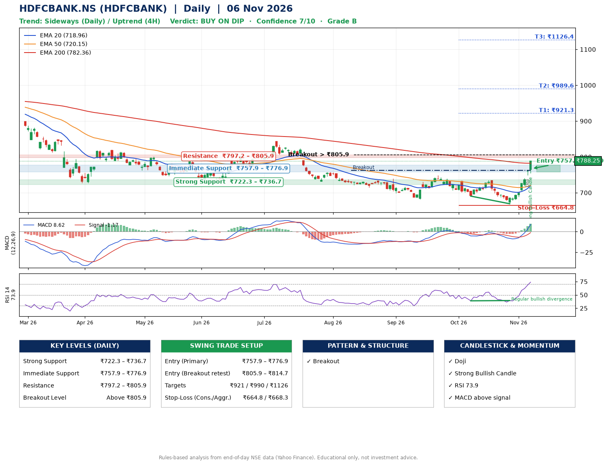

📌 **HDFCBANK.NS (HDFCBANK) – Multi-Timeframe Technical Analysis (Daily + 4H Combined)**
_Data up to 06 Nov 2026 · Close ₹788.25_

**📍 Daily Timeframe Trend**
- Trend: **Sideways** (mixed swing structure)
- Recent swing highs: ₹739.8, ₹749.3, ₹734.9 · swing lows: ₹681.9, ₹690.5, ₹669.2
- EMAs: EMA20 ₹719.0, EMA50 ₹720.2, EMA200 ₹782.4; bearish stack (EMA20 < EMA50 < EMA200); price above EMA20, EMA50, EMA200
- MACD 8.62 above signal -1.17 (above zero), fresh bullish crossover; histogram rising
- RSI(14) 73.9; Regular bullish divergence

**📍 4-Hour Timeframe Trend**
- Structure: **Uptrend** (price above rising EMAs)
- Pullback/support area: recent 4H swing lows ₹690.5, ₹669.5; EMA20 ₹727.6
- EMA20/50: bullish stack (EMA20 > EMA50); price above EMA20, EMA50
- MACD 18.10 above signal 7.83 (above zero); histogram rising
- RSI(14) 83.4; no divergence

**📍 Pattern Detection (Both Timeframes)**
- Daily: **Breakout** – closed above the 60-session high ₹762.7 on strong volume

**📍 Candlestick Patterns (last 3 daily candles)**
- **Doji** – 05 Nov: indecision; wait for the next candle to confirm direction
- **Strong Bullish Candle** – 06 Nov: wide-range green candle, buyers in control

**📍 Price Action Key Levels (Daily Structure)**

| Zone | Price Level (₹) | Context |
|------|-----------------|---------|
| Strong Support | ₹722.3 – ₹736.7 | Cluster of earlier swing lows (demand) |
| Immediate Support | ₹757.9 – ₹776.9 | Nearest swing-low / wick area |
| Resistance | ₹797.2 – ₹805.9 | Nearest swing-high supply |
| Breakout Level | Above ₹805.9 | Swing continuation trigger (52-week high ₹1017.5) |

**📍 Swing Trade Setup**

🟢 **Entry Zone**
- Primary: ₹757.9 – ₹776.9 (daily support / EMA20 area; enter on a bullish 4H candle)
- Alternate: ₹805.9 – ₹814.7 (breakout retest)

🎯 **Profit Targets**
- T1: ₹921.3
- T2: ₹989.6
- T3: ₹1126.4

🛑 **Stop-Loss**
- Conservative: below daily swing low (₹664.8)
- Aggressive: below 4H structure (₹668.3)
- Risk per share ≈ ₹102.6; reward:risk to T1 ≈ 1.5

**📌 Strategy Notes**
- Higher timeframe: daily trend is sideways; only take longs while price holds above ₹722.3.
- Entry timing: wait for a bullish 4H candle (engulfing/hammer) inside ₹757.9 – ₹776.9 rather than buying mid-range.
- EMA stacking: bearish stack (EMA20 < EMA50 < EMA200); price above EMA20, EMA50, EMA200.
- Breakout rule: a daily close above ₹805.9 with volume above its 20-day average (≈34,209,883) opens T2/T3.
- Momentum: RSI 74 – elevated, prefer dips; Regular bullish divergence.
- Exit discipline: move the stop to entry once T1 is hit; book partial profits at each target.

**STEP 2 — Marked Up Chart**

**✅ Trade Validation Checklist**
- Trend + momentum aligned: No · Price at entry zone: No
- Stop defined (₹664.8) · Reward:risk ≥ 1.5 to T1: Yes

## 📌 Final Verdict

Recommendation: **🟡 BUY ON DIP**

Confidence: **7/10**

Trade Quality: **B**

Reason:
• Breakout: closed above the 60-session high ₹762.7 on strong volume

Next Action:
• Wait for a pullback to ₹757.9–₹776.9, or a breakout above ₹805.9

_Rules-based analysis from end-of-day data. Educational only, not investment advice. Never place orders without your own confirmation._