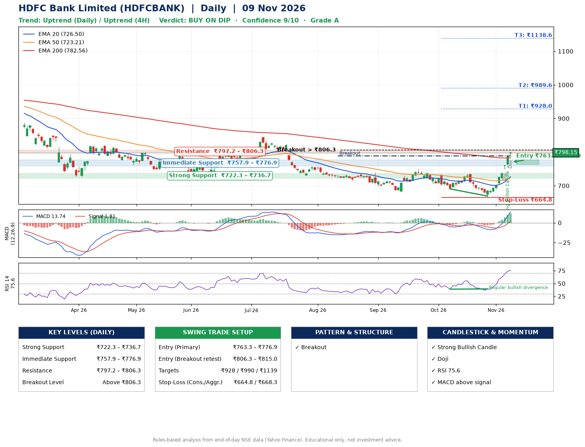

📌 **HDFC Bank Limited (HDFCBANK) – Multi-Timeframe Technical Analysis (Daily + 4H Combined)**
_Data up to 09 Nov 2026 · Close ₹798.15_

**📍 Daily Timeframe Trend**
- Trend: **Uptrend** (price above rising EMAs)
- Recent swing highs: ₹739.8, ₹749.3, ₹734.9 · swing lows: ₹681.9, ₹690.5, ₹669.2
- EMAs: EMA20 ₹726.5, EMA50 ₹723.2, EMA200 ₹782.6; mixed / crossing; price above EMA20, EMA50, EMA200
- MACD 13.74 above signal 1.81 (above zero), fresh bullish crossover; histogram rising
- RSI(14) 75.6; Regular bullish divergence

**📍 4-Hour Timeframe Trend**
- Structure: **Uptrend** (price above rising EMAs)
- Pullback/support area: recent 4H swing lows ₹690.5, ₹669.5; EMA20 ₹739.9
- EMA20/50: bullish stack (EMA20 > EMA50); price above EMA20, EMA50
- MACD 23.32 above signal 13.03 (above zero); histogram falling
- RSI(14) 85.0; no divergence

**📍 Pattern Detection (Both Timeframes)**
- Daily: **Breakout** – closed above the 60-session high ₹788.2 on strong volume

**📍 Candlestick Patterns (last 3 daily candles)**
- **Doji** – 05 Nov: indecision; wait for the next candle to confirm direction
- **Strong Bullish Candle** – 06 Nov: wide-range green candle, buyers in control
- **Doji** – 09 Nov: indecision; wait for the next candle to confirm direction

**📍 Price Action Key Levels (Daily Structure)**

| Zone | Price Level (₹) | Context |
|------|-----------------|---------|
| Strong Support | ₹722.3 – ₹736.7 | Cluster of earlier swing lows (demand) |
| Immediate Support | ₹757.9 – ₹776.9 | Nearest swing-low / wick area |
| Resistance | ₹797.2 – ₹806.3 | Nearest swing-high supply |
| Breakout Level | Above ₹806.3 | Swing continuation trigger (52-week high ₹1017.5) |

**📍 Swing Trade Setup**

🟢 **Entry Zone**
- Primary: ₹763.3 – ₹776.9 (daily support / EMA20 area; enter on a bullish 4H candle)
- Alternate: ₹806.3 – ₹815.0 (breakout retest)

🎯 **Profit Targets**
- T1: ₹928.0
- T2: ₹989.6
- T3: ₹1138.6

🛑 **Stop-Loss**
- Conservative: below daily swing low (₹664.8)
- Aggressive: below 4H structure (₹668.3)
- Risk per share ≈ ₹105.3; reward:risk to T1 ≈ 1.5

**📌 Strategy Notes**
- Higher timeframe: daily trend is uptrend; only take longs while price holds above ₹722.3.
- Entry timing: wait for a bullish 4H candle (engulfing/hammer) inside ₹763.3 – ₹776.9 rather than buying mid-range.
- EMA stacking: mixed / crossing; price above EMA20, EMA50, EMA200.
- Breakout rule: a daily close above ₹806.3 with volume above its 20-day average (≈36,531,326) opens T2/T3.
- Momentum: RSI 76 – elevated, prefer dips; Regular bullish divergence.
- Exit discipline: move the stop to entry once T1 is hit; book partial profits at each target.

**STEP 2 — Marked Up Chart**

**✅ Trade Validation Checklist**
- Trend + momentum aligned: Yes · Price at entry zone: No
- Stop defined (₹664.8) · Reward:risk ≥ 1.5 to T1: No

## 📌 Final Verdict

Recommendation: **🟡 BUY ON DIP**

Confidence: **9/10**

Trade Quality: **A**

Reason:
• Daily uptrend (price above rising EMAs)
• RSI 76 is stretched; chasing here is risky

Next Action:
• Wait for a pullback to ₹763.3–₹776.9, or a breakout above ₹806.3

_Rules-based analysis from end-of-day data. Educational only, not investment advice. Never place orders without your own confirmation._