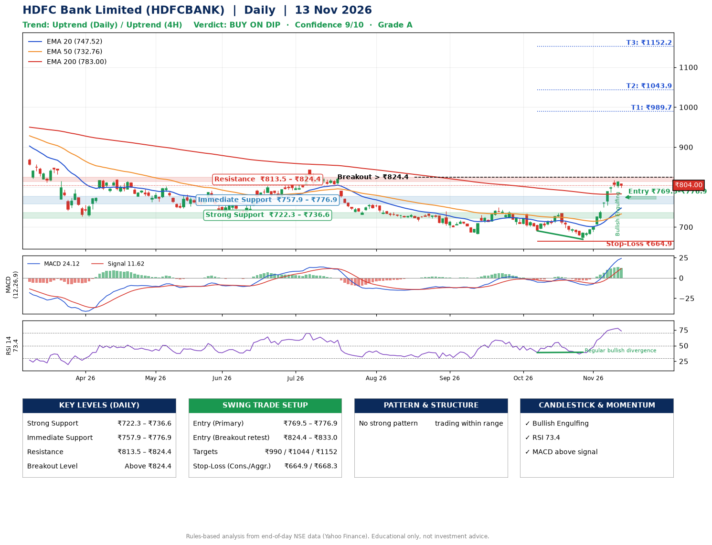

📌 **HDFC Bank Limited (HDFCBANK) – Multi-Timeframe Technical Analysis (Daily + 4H Combined)**
_Data up to 13 Nov 2026 · Close ₹804.00_

**📍 Daily Timeframe Trend**
- Trend: **Uptrend** (price above rising EMAs)
- Recent swing highs: ₹739.8, ₹749.3, ₹734.9 · swing lows: ₹681.9, ₹690.5, ₹669.2
- EMAs: EMA20 ₹747.5, EMA50 ₹732.8, EMA200 ₹783.0; mixed / crossing; price above EMA20, EMA50, EMA200
- MACD 24.12 above signal 11.62 (above zero); histogram falling
- RSI(14) 73.4; Regular bullish divergence

**📍 4-Hour Timeframe Trend**
- Structure: **Uptrend** (price above rising EMAs)
- Pullback/support area: recent 4H swing lows ₹690.5, ₹669.5; EMA20 ₹770.3
- EMA20/50: bullish stack (EMA20 > EMA50); price above EMA20, EMA50
- MACD 27.85 above signal 24.16 (above zero); histogram falling
- RSI(14) 74.7; no divergence

**📍 Pattern Detection (Both Timeframes)**
- 4H: **Bull Flag** – 15% pole then a tight 4% flag; trigger above ₹817.8

**📍 Candlestick Patterns (last 3 daily candles)**
- **Bullish Engulfing** – 12 Nov: buyers fully reversed the prior red candle

**📍 Price Action Key Levels (Daily Structure)**

| Zone | Price Level (₹) | Context |
|------|-----------------|---------|
| Strong Support | ₹722.3 – ₹736.6 | Cluster of earlier swing lows (demand) |
| Immediate Support | ₹757.9 – ₹776.9 | Nearest swing-low / wick area |
| Resistance | ₹813.5 – ₹824.4 | Nearest swing-high supply |
| Breakout Level | Above ₹824.4 | Swing continuation trigger (52-week high ₹1017.5) |

**📍 Swing Trade Setup**

🟢 **Entry Zone**
- Primary: ₹769.5 – ₹776.9 (daily support / EMA20 area; enter on a bullish 4H candle)
- Alternate: ₹824.4 – ₹833.0 (breakout retest)

🎯 **Profit Targets**
- T1: ₹989.7
- T2: ₹1043.9
- T3: ₹1152.2

🛑 **Stop-Loss**
- Conservative: below daily swing low (₹664.9)
- Aggressive: below 4H structure (₹668.3)
- Risk per share ≈ ₹108.3; reward:risk to T1 ≈ 2.0
- Time to T1: it never rose this much within 60 trading days in the price history
- Time to T2: it never rose this much within 60 trading days in the price history

**📌 Strategy Notes**
- Higher timeframe: daily trend is uptrend; only take longs while price holds above ₹722.3.
- Entry timing: wait for a bullish 4H candle (engulfing/hammer) inside ₹769.5 – ₹776.9 rather than buying mid-range.
- EMA stacking: mixed / crossing; price above EMA20, EMA50, EMA200.
- Breakout rule: a daily close above ₹824.4 with volume above its 20-day average (≈39,388,656) opens T2/T3.
- Momentum: RSI 73 – elevated, prefer dips; Regular bullish divergence.
- Exit discipline: move the stop to entry once T1 is hit; book partial profits at each target.

**STEP 2 — Marked Up Chart**

**✅ Trade Validation Checklist**
- Trend + momentum aligned: Yes · Price at entry zone: No
- Stop defined (₹664.9) · Reward:risk ≥ 1.5 to T1: Yes

## 📌 Final Verdict

Recommendation: **🟡 BUY ON DIP**

Confidence: **9/10**

Trade Quality: **A**

Reason:
• Daily uptrend (price above rising EMAs)

Next Action:
• Wait for a pullback to ₹769.5–₹776.9

_Rules-based analysis from end-of-day data. Educational only, not investment advice. Never place orders without your own confirmation._