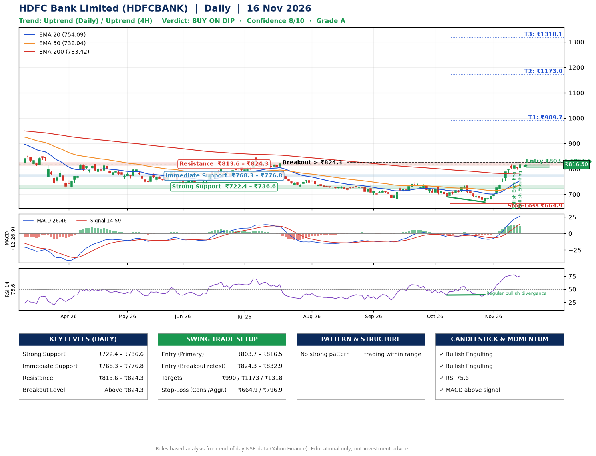

📌 **HDFC Bank Limited (HDFCBANK) – Multi-Timeframe Technical Analysis (Daily + 4H Combined)**
_Data up to 16 Nov 2026 · Close ₹816.50_

**📍 Daily Timeframe Trend**
- Trend: **Uptrend** (price above rising EMAs)
- Recent swing highs: ₹739.8, ₹749.3, ₹734.9 · swing lows: ₹681.9, ₹690.5, ₹669.2
- EMAs: EMA20 ₹754.1, EMA50 ₹736.0, EMA200 ₹783.4; mixed / crossing; price above EMA20, EMA50, EMA200
- MACD 26.46 above signal 14.59 (above zero); histogram falling
- RSI(14) 75.6; Regular bullish divergence

**📍 4-Hour Timeframe Trend**
- Structure: **Uptrend** (higher highs and higher lows)
- Pullback/support area: recent 4H swing lows ₹669.5, ₹798.0; EMA20 ₹778.7
- EMA20/50: bullish stack (EMA20 > EMA50); price above EMA20, EMA50
- MACD 27.83 above signal 25.51 (above zero); histogram falling
- RSI(14) 77.7; no divergence

**📍 Pattern Detection (Both Timeframes)**
- 4H: **Bull Flag** – 16% pole then a tight 2% flag; trigger above ₹817.8

**📍 Candlestick Patterns (last 3 daily candles)**
- **Bullish Engulfing** – 12 Nov: buyers fully reversed the prior red candle
- **Bullish Engulfing** – 16 Nov: buyers fully reversed the prior red candle

**📍 Price Action Key Levels (Daily Structure)**

| Zone | Price Level (₹) | Context |
|------|-----------------|---------|
| Strong Support | ₹722.4 – ₹736.6 | Cluster of earlier swing lows (demand) |
| Immediate Support | ₹768.3 – ₹776.8 | Nearest swing-low / wick area |
| Resistance | ₹813.6 – ₹824.3 | Nearest swing-high supply |
| Breakout Level | Above ₹824.3 | Swing continuation trigger (52-week high ₹1017.5) |

**📍 Swing Trade Setup**

🟢 **Entry Zone**
- Primary: ₹803.7 – ₹816.5 (daily support / EMA20 area; enter on a bullish 4H candle)
- Alternate: ₹824.3 – ₹832.9 (breakout retest)

🎯 **Profit Targets**
- T1: ₹989.7
- T2: ₹1173.0
- T3: ₹1318.1

🛑 **Stop-Loss**
- Conservative: below daily swing low (₹664.9)
- Aggressive: below 4H structure (₹796.9)
- Risk per share ≈ ₹145.2; reward:risk to T1 ≈ 1.2
- Time to T1: it never rose this much within 60 trading days in the price history
- Time to T2: it never rose this much within 60 trading days in the price history

**📌 Strategy Notes**
- Higher timeframe: daily trend is uptrend; only take longs while price holds above ₹722.4.
- Entry timing: wait for a bullish 4H candle (engulfing/hammer) inside ₹803.7 – ₹816.5 rather than buying mid-range.
- EMA stacking: mixed / crossing; price above EMA20, EMA50, EMA200.
- Breakout rule: a daily close above ₹824.3 with volume above its 20-day average (≈38,877,842) opens T2/T3.
- Momentum: RSI 76 – elevated, prefer dips; Regular bullish divergence.
- Exit discipline: move the stop to entry once T1 is hit; book partial profits at each target.

**STEP 2 — Marked Up Chart**

**✅ Trade Validation Checklist**
- Trend + momentum aligned: Yes · Price at entry zone: Yes
- Stop defined (₹664.9) · Reward:risk ≥ 1.5 to T1: No

## 📌 Final Verdict

Recommendation: **🟡 BUY ON DIP**

Confidence: **8/10**

Trade Quality: **A**

Reason:
• Daily uptrend (price above rising EMAs)
• RSI 76 is stretched; chasing here is risky

Next Action:
• Wait for a pullback to ₹803.7–₹816.5, or a breakout above ₹824.3

_Rules-based analysis from end-of-day data. Educational only, not investment advice. Never place orders without your own confirmation._