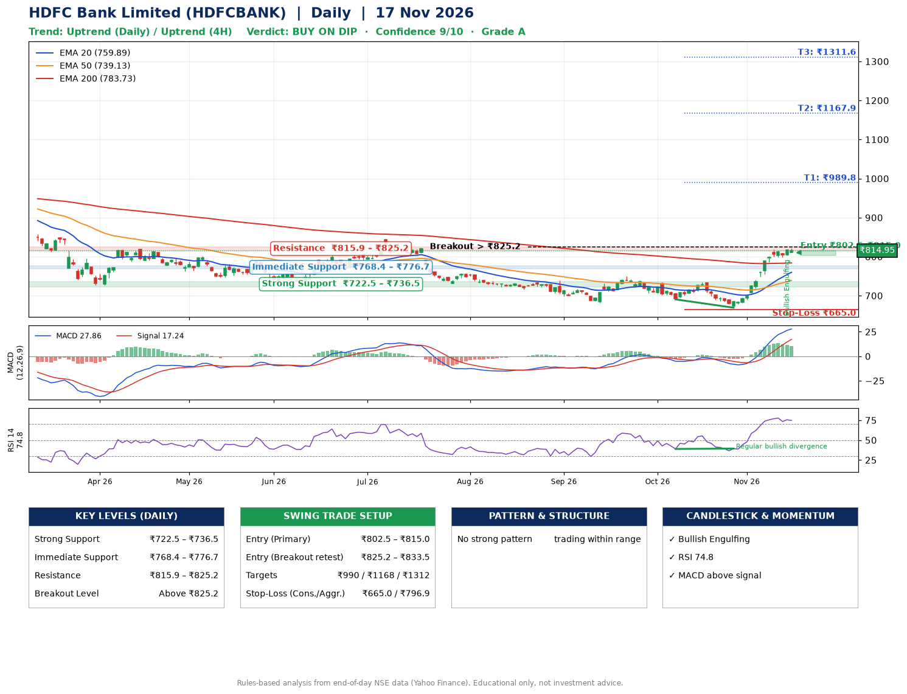

📌 **HDFC Bank Limited (HDFCBANK) – Multi-Timeframe Technical Analysis (Daily + 4H Combined)**
_Data up to 17 Nov 2026 · Close ₹814.95_

**📍 Daily Timeframe Trend**
- Trend: **Uptrend** (price above rising EMAs)
- Recent swing highs: ₹739.8, ₹749.3, ₹734.9 · swing lows: ₹681.9, ₹690.5, ₹669.2
- EMAs: EMA20 ₹759.9, EMA50 ₹739.1, EMA200 ₹783.7; mixed / crossing; price above EMA20, EMA50, EMA200
- MACD 27.86 above signal 17.24 (above zero); histogram falling
- RSI(14) 74.8; Regular bullish divergence

**📍 4-Hour Timeframe Trend**
- Structure: **Uptrend** (higher highs and higher lows)
- Pullback/support area: recent 4H swing lows ₹669.5, ₹798.0; EMA20 ₹785.3
- EMA20/50: bullish stack (EMA20 > EMA50); price above EMA20, EMA50
- MACD 26.52 above signal 26.00 (above zero); histogram falling
- RSI(14) 76.4; no divergence

**📍 Pattern Detection (Both Timeframes)**
- 4H: **Bull Flag** – 15% pole then a tight 3% flag; trigger above ₹821.0

**📍 Candlestick Patterns (last 3 daily candles)**
- **Bullish Engulfing** – 16 Nov: buyers fully reversed the prior red candle

**📍 Price Action Key Levels (Daily Structure)**

| Zone | Price Level (₹) | Context |
|------|-----------------|---------|
| Strong Support | ₹722.5 – ₹736.5 | Cluster of earlier swing lows (demand) |
| Immediate Support | ₹768.4 – ₹776.7 | Nearest swing-low / wick area |
| Resistance | ₹815.9 – ₹825.2 | Nearest swing-high supply |
| Breakout Level | Above ₹825.2 | Swing continuation trigger (52-week high ₹1017.5) |

**📍 Swing Trade Setup**

🟢 **Entry Zone**
- Primary: ₹802.5 – ₹815.0 (daily support / EMA20 area; enter on a bullish 4H candle)
- Alternate: ₹825.2 – ₹833.5 (breakout retest)

🎯 **Profit Targets**
- T1: ₹989.8
- T2: ₹1167.9
- T3: ₹1311.6

🛑 **Stop-Loss**
- Conservative: below daily swing low (₹665.0)
- Aggressive: below 4H structure (₹796.9)
- Risk per share ≈ ₹143.7; reward:risk to T1 ≈ 1.3
- Time to T1: it never rose this much within 60 trading days in the price history
- Time to T2: it never rose this much within 60 trading days in the price history

**📌 Strategy Notes**
- Higher timeframe: daily trend is uptrend; only take longs while price holds above ₹722.5.
- Entry timing: wait for a bullish 4H candle (engulfing/hammer) inside ₹802.5 – ₹815.0 rather than buying mid-range.
- EMA stacking: mixed / crossing; price above EMA20, EMA50, EMA200.
- Breakout rule: a daily close above ₹825.2 with volume above its 20-day average (≈39,176,892) opens T2/T3.
- Momentum: RSI 75 – elevated, prefer dips; Regular bullish divergence.
- Exit discipline: move the stop to entry once T1 is hit; book partial profits at each target.

**STEP 2 — Marked Up Chart**

**✅ Trade Validation Checklist**
- Trend + momentum aligned: Yes · Price at entry zone: Yes
- Stop defined (₹665.0) · Reward:risk ≥ 1.5 to T1: No

## 📌 Final Verdict

Recommendation: **🟡 BUY ON DIP**

Confidence: **9/10**

Trade Quality: **A**

Reason:
• Daily uptrend (price above rising EMAs)

Next Action:
• Wait for a pullback to ₹802.5–₹815.0, or a breakout above ₹825.2

_Rules-based analysis from end-of-day data. Educational only, not investment advice. Never place orders without your own confirmation._