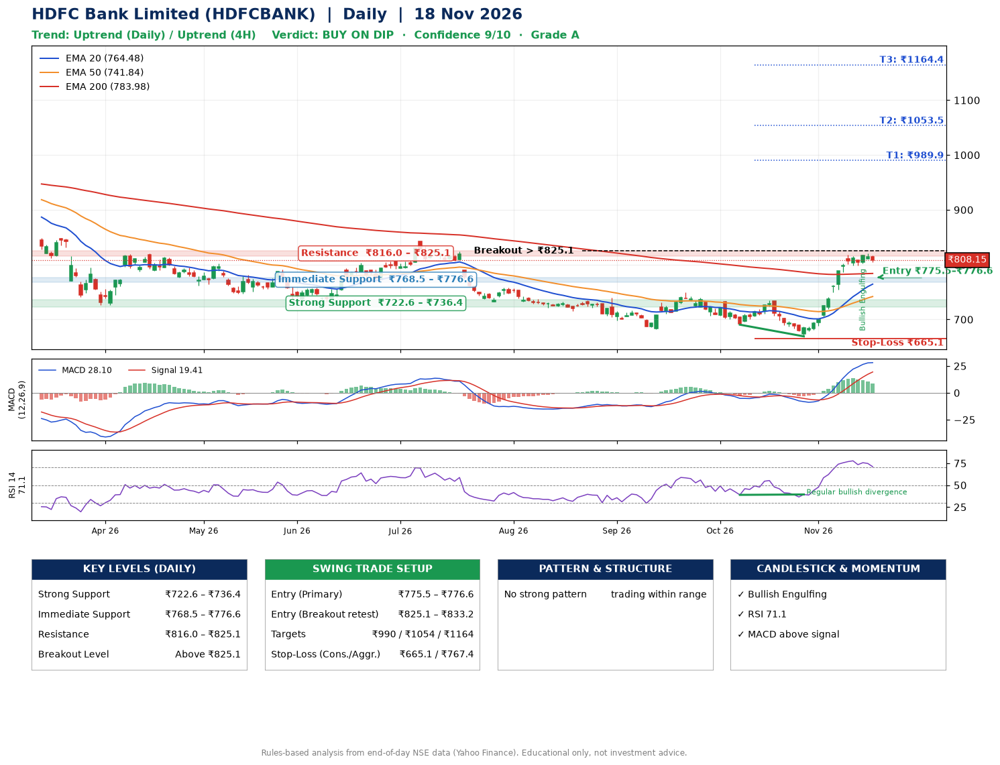

📌 **HDFC Bank Limited (HDFCBANK) – Multi-Timeframe Technical Analysis (Daily + 4H Combined)**
_Data up to 18 Nov 2026 · Close ₹808.15_

**📍 Daily Timeframe Trend**
- Trend: **Uptrend** (price above rising EMAs)
- Recent swing highs: ₹739.8, ₹749.3, ₹734.9 · swing lows: ₹681.9, ₹690.5, ₹669.2
- EMAs: EMA20 ₹764.5, EMA50 ₹741.8, EMA200 ₹784.0; mixed / crossing; price above EMA20, EMA50, EMA200
- MACD 28.10 above signal 19.41 (above zero); histogram falling
- RSI(14) 71.1; Regular bullish divergence

**📍 4-Hour Timeframe Trend**
- Structure: **Uptrend** (higher highs and higher lows)
- Pullback/support area: recent 4H swing lows ₹669.5, ₹798.0; EMA20 ₹789.5
- EMA20/50: bullish stack (EMA20 > EMA50); price above EMA20, EMA50
- MACD 23.69 below signal 25.39 (above zero), fresh bearish crossover; histogram falling
- RSI(14) 70.2; Regular bearish divergence

**📍 Pattern Detection (Both Timeframes)**
- 4H: **Bull Flag** – 16% pole then a tight 3% flag; trigger above ₹821.0

**📍 Candlestick Patterns (last 3 daily candles)**
- **Bullish Engulfing** – 16 Nov: buyers fully reversed the prior red candle

**📍 Price Action Key Levels (Daily Structure)**

| Zone | Price Level (₹) | Context |
|------|-----------------|---------|
| Strong Support | ₹722.6 – ₹736.4 | Cluster of earlier swing lows (demand) |
| Immediate Support | ₹768.5 – ₹776.6 | Nearest swing-low / wick area |
| Resistance | ₹816.0 – ₹825.1 | Nearest swing-high supply |
| Breakout Level | Above ₹825.1 | Swing continuation trigger (52-week high ₹1017.5) |

**📍 Swing Trade Setup**

🟢 **Entry Zone**
- Primary: ₹775.5 – ₹776.6 (daily support / EMA20 area; enter on a bullish 4H candle)
- Alternate: ₹825.1 – ₹833.2 (breakout retest)

🎯 **Profit Targets**
- T1: ₹989.9
- T2: ₹1053.5
- T3: ₹1164.4

🛑 **Stop-Loss**
- Conservative: below daily swing low (₹665.1)
- Aggressive: below 4H structure (₹767.4)
- Risk per share ≈ ₹111.0; reward:risk to T1 ≈ 1.9
- Time to T1: it never rose this much within 60 trading days in the price history
- Time to T2: it never rose this much within 60 trading days in the price history

**📌 Strategy Notes**
- Higher timeframe: daily trend is uptrend; only take longs while price holds above ₹722.6.
- Entry timing: wait for a bullish 4H candle (engulfing/hammer) inside ₹775.5 – ₹776.6 rather than buying mid-range.
- EMA stacking: mixed / crossing; price above EMA20, EMA50, EMA200.
- Breakout rule: a daily close above ₹825.1 with volume above its 20-day average (≈38,579,270) opens T2/T3.
- Momentum: RSI 71 – elevated, prefer dips; Regular bullish divergence.
- Exit discipline: move the stop to entry once T1 is hit; book partial profits at each target.

**STEP 2 — Marked Up Chart**

**✅ Trade Validation Checklist**
- Trend + momentum aligned: Yes · Price at entry zone: No
- Stop defined (₹665.1) · Reward:risk ≥ 1.5 to T1: Yes

## 📌 Final Verdict

Recommendation: **🟡 BUY ON DIP**

Confidence: **9/10**

Trade Quality: **A**

Reason:
• Daily uptrend (price above rising EMAs)

Next Action:
• Wait for a pullback to ₹775.5–₹776.6

_Rules-based analysis from end-of-day data. Educational only, not investment advice. Never place orders without your own confirmation._