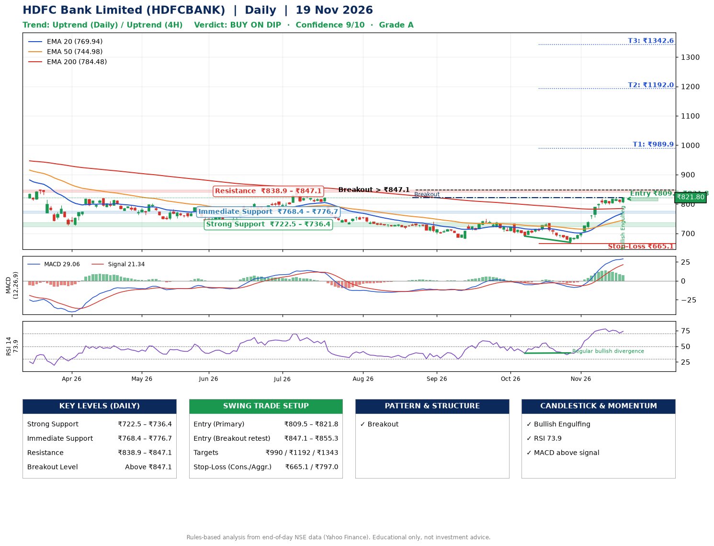

📌 **HDFC Bank Limited (HDFCBANK) – Multi-Timeframe Technical Analysis (Daily + 4H Combined)**
_Data up to 19 Nov 2026 · Close ₹821.80_

**📍 Daily Timeframe Trend**
- Trend: **Uptrend** (price above rising EMAs)
- Recent swing highs: ₹739.8, ₹749.3, ₹734.9 · swing lows: ₹681.9, ₹690.5, ₹669.2
- EMAs: EMA20 ₹769.9, EMA50 ₹745.0, EMA200 ₹784.5; mixed / crossing; price above EMA20, EMA50, EMA200
- MACD 29.06 above signal 21.34 (above zero); histogram falling
- RSI(14) 73.9; Regular bullish divergence

**📍 4-Hour Timeframe Trend**
- Structure: **Uptrend** (higher highs and higher lows)
- Pullback/support area: recent 4H swing lows ₹669.5, ₹798.0; EMA20 ₹794.8
- EMA20/50: bullish stack (EMA20 > EMA50); price above EMA20, EMA50
- MACD 22.46 below signal 24.40 (above zero), fresh bearish crossover; histogram rising
- RSI(14) 75.1; Regular bearish divergence

**📍 Pattern Detection (Both Timeframes)**
- Daily: **Breakout** – closed above the 60-session high ₹821.0 (volume not confirming yet)
- 4H: **Bull Flag** – 17% pole then a tight 2% flag; trigger above ₹822.0

**📍 Candlestick Patterns (last 3 daily candles)**
- **Bullish Engulfing** – 19 Nov: buyers fully reversed the prior red candle

**📍 Price Action Key Levels (Daily Structure)**

| Zone | Price Level (₹) | Context |
|------|-----------------|---------|
| Strong Support | ₹722.5 – ₹736.4 | Cluster of earlier swing lows (demand) |
| Immediate Support | ₹768.4 – ₹776.7 | Nearest swing-low / wick area |
| Resistance | ₹838.9 – ₹847.1 | Nearest swing-high supply |
| Breakout Level | Above ₹847.1 | Swing continuation trigger (52-week high ₹1017.5) |

**📍 Swing Trade Setup**

🟢 **Entry Zone**
- Primary: ₹809.5 – ₹821.8 (daily support / EMA20 area; enter on a bullish 4H candle)
- Alternate: ₹847.1 – ₹855.3 (breakout retest)

🎯 **Profit Targets**
- T1: ₹989.9
- T2: ₹1192.0
- T3: ₹1342.6

🛑 **Stop-Loss**
- Conservative: below daily swing low (₹665.1)
- Aggressive: below 4H structure (₹797.0)
- Risk per share ≈ ₹150.5; reward:risk to T1 ≈ 1.2
- Time to T1: about 57 trading days (it rose this much within 60 trading days 0% of the time in the last 2 years)
- Time to T2: it never rose this much within 60 trading days in the price history

**📌 Strategy Notes**
- Higher timeframe: daily trend is uptrend; only take longs while price holds above ₹722.5.
- Entry timing: wait for a bullish 4H candle (engulfing/hammer) inside ₹809.5 – ₹821.8 rather than buying mid-range.
- EMA stacking: mixed / crossing; price above EMA20, EMA50, EMA200.
- Breakout rule: a daily close above ₹847.1 with volume above its 20-day average (≈38,229,489) opens T2/T3.
- Momentum: RSI 74 – elevated, prefer dips; Regular bullish divergence.
- Exit discipline: move the stop to entry once T1 is hit; book partial profits at each target.

**STEP 2 — Marked Up Chart**

**✅ Trade Validation Checklist**
- Trend + momentum aligned: Yes · Price at entry zone: Yes
- Stop defined (₹665.1) · Reward:risk ≥ 1.5 to T1: No

## 📌 Final Verdict

Recommendation: **🟡 BUY ON DIP**

Confidence: **9/10**

Trade Quality: **A**

Reason:
• Daily uptrend (price above rising EMAs)
• Breakout: closed above the 60-session high ₹821.0 (volume not confirming yet)

Next Action:
• Wait for a pullback to ₹809.5–₹821.8, or a breakout above ₹847.1

_Rules-based analysis from end-of-day data. Educational only, not investment advice. Never place orders without your own confirmation._