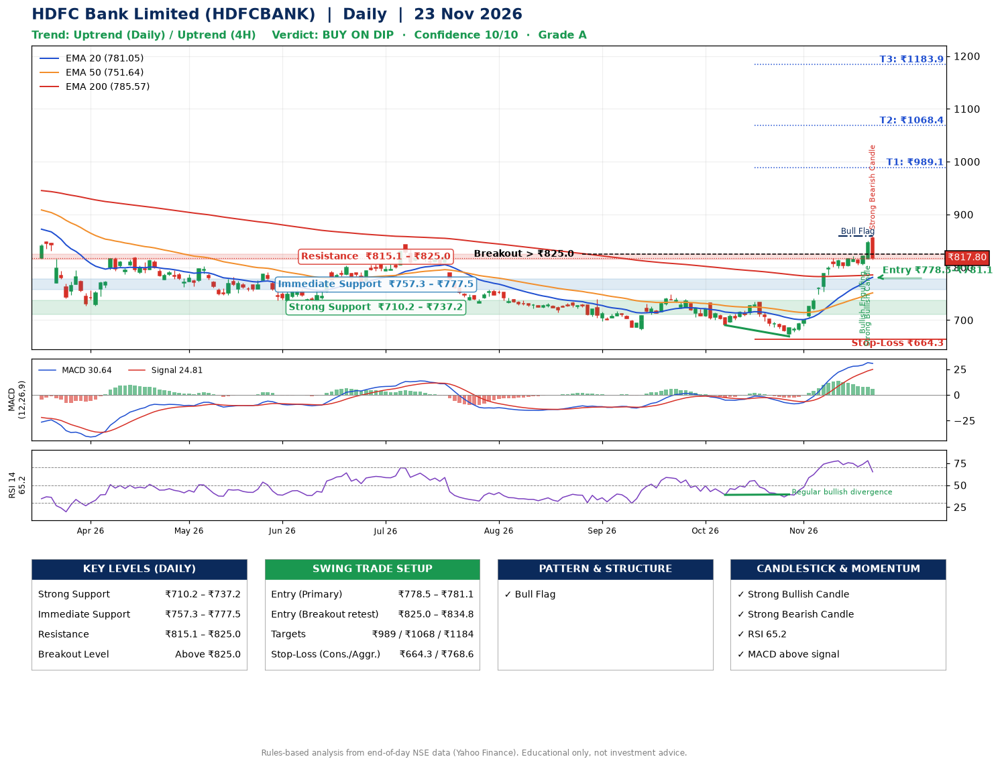

📌 **HDFC Bank Limited (HDFCBANK) – Multi-Timeframe Technical Analysis (Daily + 4H Combined)**
_Data up to 23 Nov 2026 · Close ₹817.80_

**📍 Daily Timeframe Trend**
- Trend: **Uptrend** (price above rising EMAs)
- Recent swing highs: ₹739.8, ₹749.3, ₹734.9 · swing lows: ₹681.9, ₹690.5, ₹669.2
- EMAs: EMA20 ₹781.1, EMA50 ₹751.6, EMA200 ₹785.6; mixed / crossing; price above EMA20, EMA50, EMA200
- MACD 30.64 above signal 24.81 (above zero); histogram falling
- RSI(14) 65.2; Regular bullish divergence

**📍 4-Hour Timeframe Trend**
- Structure: **Uptrend** (higher highs and higher lows)
- Pullback/support area: recent 4H swing lows ₹798.0, ₹804.2; EMA20 ₹807.1
- EMA20/50: bullish stack (EMA20 > EMA50); price above EMA20, EMA50
- MACD 21.39 below signal 23.56 (above zero), fresh bullish crossover; histogram falling
- RSI(14) 60.8; Hidden bullish divergence; Regular bearish divergence

**📍 Pattern Detection (Both Timeframes)**
- Daily: **Bull Flag** – 18% pole then a tight 8% flag; trigger above ₹859.5
- 4H: **Bull Flag** – 16% pole then a tight 7% flag; trigger above ₹859.5

**📍 Candlestick Patterns (last 3 daily candles)**
- **Bullish Engulfing** – 19 Nov: buyers fully reversed the prior red candle
- **Strong Bullish Candle** – 20 Nov: wide-range green candle, buyers in control
- **Strong Bearish Candle** – 23 Nov: wide-range red candle, sellers in control

**📍 Price Action Key Levels (Daily Structure)**

| Zone | Price Level (₹) | Context |
|------|-----------------|---------|
| Strong Support | ₹710.2 – ₹737.2 | Cluster of earlier swing lows (demand) |
| Immediate Support | ₹757.3 – ₹777.5 | Nearest swing-low / wick area |
| Resistance | ₹815.1 – ₹825.0 | Nearest swing-high supply |
| Breakout Level | Above ₹825.0 | Swing continuation trigger (52-week high ₹1017.5) |

**📍 Swing Trade Setup**

🟢 **Entry Zone**
- Primary: ₹778.5 – ₹781.1 (daily support / EMA20 area; enter on a bullish 4H candle)
- Alternate: ₹825.0 – ₹834.8 (breakout retest)

🎯 **Profit Targets**
- T1: ₹989.1
- T2: ₹1068.4
- T3: ₹1183.9

🛑 **Stop-Loss**
- Conservative: below daily swing low (₹664.3)
- Aggressive: below 4H structure (₹768.6)
- Risk per share ≈ ₹115.5; reward:risk to T1 ≈ 1.8
- Time to T1: it never rose this much within 60 trading days in the price history
- Time to T2: it never rose this much within 60 trading days in the price history

**📌 Strategy Notes**
- Higher timeframe: daily trend is uptrend; only take longs while price holds above ₹710.2.
- Entry timing: wait for a bullish 4H candle (engulfing/hammer) inside ₹778.5 – ₹781.1 rather than buying mid-range.
- EMA stacking: mixed / crossing; price above EMA20, EMA50, EMA200.
- Breakout rule: a daily close above ₹825.0 with volume above its 20-day average (≈39,771,123) opens T2/T3.
- Momentum: RSI 65 – elevated, prefer dips; Regular bullish divergence.
- Exit discipline: move the stop to entry once T1 is hit; book partial profits at each target.

**STEP 2 — Marked Up Chart**

**✅ Trade Validation Checklist**
- Trend + momentum aligned: Yes · Price at entry zone: No
- Stop defined (₹664.3) · Reward:risk ≥ 1.5 to T1: Yes

## 📌 Final Verdict

Recommendation: **🟡 BUY ON DIP**

Confidence: **10/10**

Trade Quality: **A**

Reason:
• Daily uptrend (price above rising EMAs)
• Bull Flag: 18% pole then a tight 8% flag; trigger above ₹859.5

Next Action:
• Wait for a pullback to ₹778.5–₹781.1

_Rules-based analysis from end-of-day data. Educational only, not investment advice. Never place orders without your own confirmation._