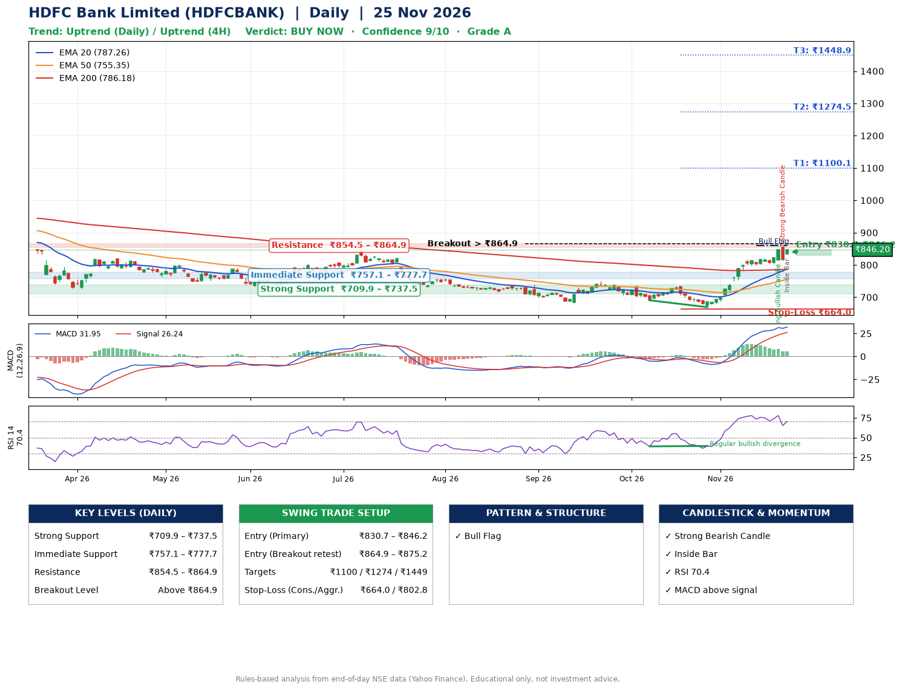

📌 **HDFC Bank Limited (HDFCBANK) – Multi-Timeframe Technical Analysis (Daily + 4H Combined)**
_Data up to 25 Nov 2026 · Close ₹846.20_

**📍 Daily Timeframe Trend**
- Trend: **Uptrend** (price above rising EMAs)
- Recent swing highs: ₹739.8, ₹749.3, ₹734.9 · swing lows: ₹681.9, ₹690.5, ₹669.2
- EMAs: EMA20 ₹787.3, EMA50 ₹755.3, EMA200 ₹786.2; mixed / crossing; price above EMA20, EMA50, EMA200
- MACD 31.95 above signal 26.24 (above zero); histogram falling
- RSI(14) 70.4; Regular bullish divergence

**📍 4-Hour Timeframe Trend**
- Structure: **Uptrend** (higher highs and higher lows)
- Pullback/support area: recent 4H swing lows ₹798.0, ₹804.2; EMA20 ₹813.4
- EMA20/50: bullish stack (EMA20 > EMA50); price above EMA20, EMA50
- MACD 21.64 below signal 22.81 (above zero), fresh bullish crossover; histogram rising
- RSI(14) 69.7; Hidden bullish divergence; Regular bearish divergence

**📍 Pattern Detection (Both Timeframes)**
- Daily: **Bull Flag** – 19% pole then a tight 8% flag; trigger above ₹859.7
- 4H: **Bull Flag** – 15% pole then a tight 7% flag; trigger above ₹859.5

**📍 Candlestick Patterns (last 3 daily candles)**
- **Strong Bullish Candle** – 20 Nov: wide-range green candle, buyers in control
- **Strong Bearish Candle** – 23 Nov: wide-range red candle, sellers in control
- **Inside Bar** – 25 Nov: compression inside the prior range ₹814.0–₹859.7

**📍 Price Action Key Levels (Daily Structure)**

| Zone | Price Level (₹) | Context |
|------|-----------------|---------|
| Strong Support | ₹709.9 – ₹737.5 | Cluster of earlier swing lows (demand) |
| Immediate Support | ₹757.1 – ₹777.7 | Nearest swing-low / wick area |
| Resistance | ₹854.5 – ₹864.9 | Nearest swing-high supply |
| Breakout Level | Above ₹864.9 | Swing continuation trigger (52-week high ₹1017.5) |

**📍 Swing Trade Setup**

🟢 **Entry Zone**
- Primary: ₹830.7 – ₹846.2 (daily support / EMA20 area; enter on a bullish 4H candle)
- Alternate: ₹864.9 – ₹875.2 (breakout retest)

🎯 **Profit Targets**
- T1: ₹1100.1
- T2: ₹1274.5
- T3: ₹1448.9

🛑 **Stop-Loss**
- Conservative: below daily swing low (₹664.0)
- Aggressive: below 4H structure (₹802.8)
- Risk per share ≈ ₹174.4; reward:risk to T1 ≈ 1.5
- Time to T1: it never rose this much within 60 trading days in the price history
- Time to T2: it never rose this much within 60 trading days in the price history

**📌 Strategy Notes**
- Higher timeframe: daily trend is uptrend; only take longs while price holds above ₹709.9.
- Entry timing: wait for a bullish 4H candle (engulfing/hammer) inside ₹830.7 – ₹846.2 rather than buying mid-range.
- EMA stacking: mixed / crossing; price above EMA20, EMA50, EMA200.
- Breakout rule: a daily close above ₹864.9 with volume above its 20-day average (≈41,225,612) opens T2/T3.
- Momentum: RSI 70 – elevated, prefer dips; Regular bullish divergence.
- Exit discipline: move the stop to entry once T1 is hit; book partial profits at each target.

**STEP 2 — Marked Up Chart**

**✅ Trade Validation Checklist**
- Trend + momentum aligned: Yes · Price at entry zone: Yes
- Stop defined (₹664.0) · Reward:risk ≥ 1.5 to T1: Yes

## 📌 Final Verdict

Recommendation: **🟢 BUY NOW**

Confidence: **9/10**

Trade Quality: **A**

Reason:
• Daily uptrend (price above rising EMAs)
• Bull Flag: 19% pole then a tight 8% flag; trigger above ₹859.7

Next Action:
• Buy now within the entry zone, with the stop-loss in place

_Rules-based analysis from end-of-day data. Educational only, not investment advice. Never place orders without your own confirmation._