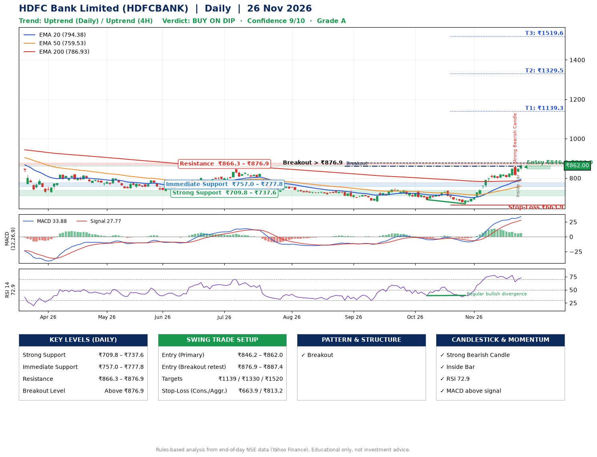

📌 **HDFC Bank Limited (HDFCBANK) – Multi-Timeframe Technical Analysis (Daily + 4H Combined)**
_Data up to 26 Nov 2026 · Close ₹862.00_

**📍 Daily Timeframe Trend**
- Trend: **Uptrend** (price above rising EMAs)
- Recent swing highs: ₹739.8, ₹749.3, ₹734.9 · swing lows: ₹681.9, ₹690.5, ₹669.2
- EMAs: EMA20 ₹794.4, EMA50 ₹759.5, EMA200 ₹786.9; mixed / crossing; price above EMA20, EMA50, EMA200
- MACD 33.88 above signal 27.77 (above zero); histogram rising
- RSI(14) 72.9; Regular bullish divergence

**📍 4-Hour Timeframe Trend**
- Structure: **Uptrend** (higher highs and higher lows)
- Pullback/support area: recent 4H swing lows ₹804.2, ₹814.7; EMA20 ₹822.6
- EMA20/50: bullish stack (EMA20 > EMA50); price above EMA20, EMA50
- MACD 23.95 above signal 23.12 (above zero), fresh bullish crossover; histogram rising
- RSI(14) 71.7; Hidden bullish divergence; Regular bearish divergence

**📍 Pattern Detection (Both Timeframes)**
- Daily: **Breakout** – closed above the 60-session high ₹859.7 on strong volume
- 4H: **Bull Flag** – 17% pole then a tight 7% flag; trigger above ₹871.6

**📍 Candlestick Patterns (last 3 daily candles)**
- **Strong Bearish Candle** – 23 Nov: wide-range red candle, sellers in control
- **Inside Bar** – 25 Nov: compression inside the prior range ₹814.0–₹859.7

**📍 Price Action Key Levels (Daily Structure)**

| Zone | Price Level (₹) | Context |
|------|-----------------|---------|
| Strong Support | ₹709.8 – ₹737.6 | Cluster of earlier swing lows (demand) |
| Immediate Support | ₹757.0 – ₹777.8 | Nearest swing-low / wick area |
| Resistance | ₹866.3 – ₹876.9 | Nearest swing-high supply |
| Breakout Level | Above ₹876.9 | Swing continuation trigger (52-week high ₹1017.5) |

**📍 Swing Trade Setup**

🟢 **Entry Zone**
- Primary: ₹846.2 – ₹862.0 (daily support / EMA20 area; enter on a bullish 4H candle)
- Alternate: ₹876.9 – ₹887.4 (breakout retest)

🎯 **Profit Targets**
- T1: ₹1139.3
- T2: ₹1329.5
- T3: ₹1519.6

🛑 **Stop-Loss**
- Conservative: below daily swing low (₹663.9)
- Aggressive: below 4H structure (₹813.2)
- Risk per share ≈ ₹190.2; reward:risk to T1 ≈ 1.5
- Time to T1: it never rose this much within 60 trading days in the price history
- Time to T2: it never rose this much within 60 trading days in the price history

**📌 Strategy Notes**
- Higher timeframe: daily trend is uptrend; only take longs while price holds above ₹709.8.
- Entry timing: wait for a bullish 4H candle (engulfing/hammer) inside ₹846.2 – ₹862.0 rather than buying mid-range.
- EMA stacking: mixed / crossing; price above EMA20, EMA50, EMA200.
- Breakout rule: a daily close above ₹876.9 with volume above its 20-day average (≈43,505,213) opens T2/T3.
- Momentum: RSI 73 – elevated, prefer dips; Regular bullish divergence.
- Exit discipline: move the stop to entry once T1 is hit; book partial profits at each target.

**STEP 2 — Marked Up Chart**

**✅ Trade Validation Checklist**
- Trend + momentum aligned: Yes · Price at entry zone: Yes
- Stop defined (₹663.9) · Reward:risk ≥ 1.5 to T1: No

## 📌 Final Verdict

Recommendation: **🟡 BUY ON DIP**

Confidence: **9/10**

Trade Quality: **A**

Reason:
• Daily uptrend (price above rising EMAs)
• Breakout: closed above the 60-session high ₹859.7 on strong volume

Next Action:
• Wait for a pullback to ₹846.2–₹862.0, or a breakout above ₹876.9

_Rules-based analysis from end-of-day data. Educational only, not investment advice. Never place orders without your own confirmation._