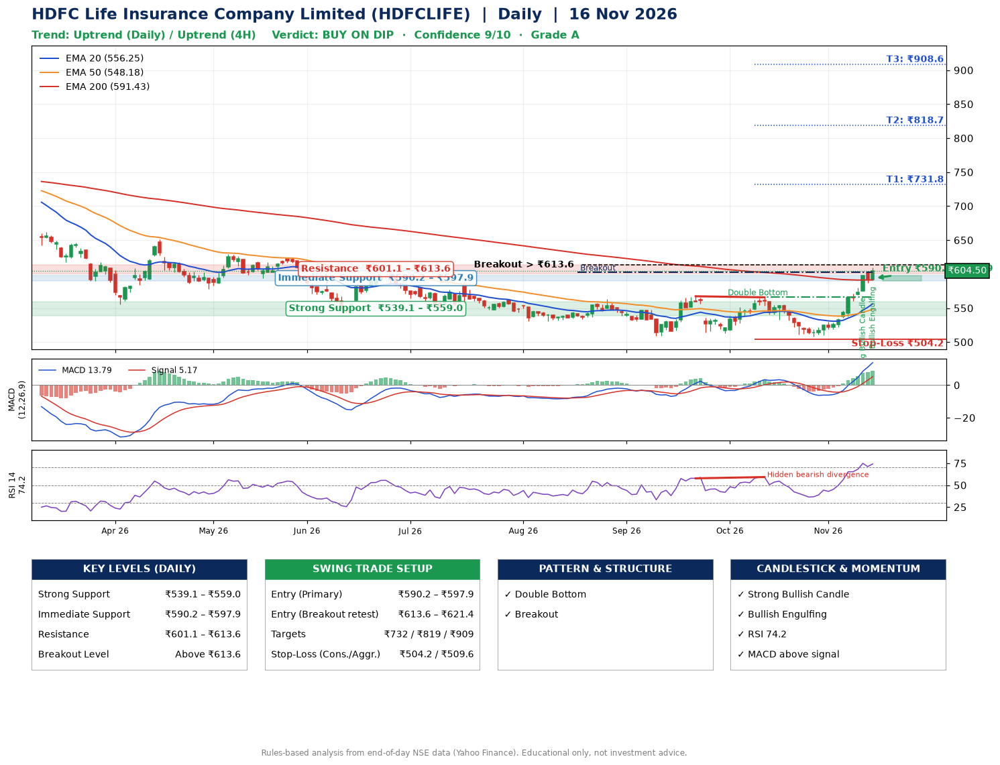

📌 **HDFC Life Insurance Company Limited (HDFCLIFE) – Multi-Timeframe Technical Analysis (Daily + 4H Combined)**
_Data up to 16 Nov 2026 · Close ₹604.50_

**📍 Daily Timeframe Trend**
- Trend: **Uptrend** (price above rising EMAs)
- Recent swing highs: ₹563.5, ₹567.4, ₹565.8 · swing lows: ₹508.7, ₹513.4, ₹508.0
- EMAs: EMA20 ₹556.3, EMA50 ₹548.2, EMA200 ₹591.4; mixed / crossing; price above EMA20, EMA50, EMA200
- MACD 13.79 above signal 5.17 (above zero); histogram rising
- RSI(14) 74.2; Hidden bearish divergence

**📍 4-Hour Timeframe Trend**
- Structure: **Uptrend** (price above rising EMAs)
- Pullback/support area: recent 4H swing lows ₹508.4, ₹510.6; EMA20 ₹569.7
- EMA20/50: bullish stack (EMA20 > EMA50); price above EMA20, EMA50
- MACD 18.48 above signal 13.69 (above zero); histogram falling
- RSI(14) 75.9; no divergence

**📍 Pattern Detection (Both Timeframes)**
- Daily: **Double Bottom** – bottoms near ₹513.4/₹508.0, neckline ₹565.8, confirmed (closed above neckline)
- Daily: **Breakout** – closed above the 60-session high ₹602.3 on strong volume
- 4H: **Descending Triangle** – converging swing highs and lows over the last ~60 sessions

**📍 Candlestick Patterns (last 3 daily candles)**
- **Strong Bullish Candle** – 12 Nov: wide-range green candle, buyers in control
- **Bullish Engulfing** – 16 Nov: buyers fully reversed the prior red candle

**📍 Price Action Key Levels (Daily Structure)**

| Zone | Price Level (₹) | Context |
|------|-----------------|---------|
| Strong Support | ₹539.1 – ₹559.0 | Cluster of earlier swing lows (demand) |
| Immediate Support | ₹590.2 – ₹597.9 | Nearest swing-low / wick area |
| Resistance | ₹601.1 – ₹613.6 | Nearest swing-high supply |
| Breakout Level | Above ₹613.6 | Swing continuation trigger (52-week high ₹788.5) |

**📍 Swing Trade Setup**

🟢 **Entry Zone**
- Primary: ₹590.2 – ₹597.9 (daily support / EMA20 area; enter on a bullish 4H candle)
- Alternate: ₹613.6 – ₹621.4 (breakout retest)

🎯 **Profit Targets**
- T1: ₹731.8
- T2: ₹818.7
- T3: ₹908.6

🛑 **Stop-Loss**
- Conservative: below daily swing low (₹504.2)
- Aggressive: below 4H structure (₹509.6)
- Risk per share ≈ ₹89.9; reward:risk to T1 ≈ 1.5
- Time to T1: about 50 trading days (it rose this much within 60 trading days 4% of the time in the last 2 years)
- Time to T2: it never rose this much within 60 trading days in the price history

**📌 Strategy Notes**
- Higher timeframe: daily trend is uptrend; only take longs while price holds above ₹539.1.
- Entry timing: wait for a bullish 4H candle (engulfing/hammer) inside ₹590.2 – ₹597.9 rather than buying mid-range.
- EMA stacking: mixed / crossing; price above EMA20, EMA50, EMA200.
- Breakout rule: a daily close above ₹613.6 with volume above its 20-day average (≈2,742,031) opens T2/T3.
- Momentum: RSI 74 – elevated, prefer dips; Hidden bearish divergence.
- Exit discipline: move the stop to entry once T1 is hit; book partial profits at each target.

**STEP 2 — Marked Up Chart**

**✅ Trade Validation Checklist**
- Trend + momentum aligned: Yes · Price at entry zone: No
- Stop defined (₹504.2) · Reward:risk ≥ 1.5 to T1: Yes

## 📌 Final Verdict

Recommendation: **🟡 BUY ON DIP**

Confidence: **9/10**

Trade Quality: **A**

Reason:
• Daily uptrend (price above rising EMAs)
• Double Bottom: bottoms near ₹513.4/₹508.0, neckline ₹565.8, confirmed (closed above neckline)

Next Action:
• Wait for a pullback to ₹590.2–₹597.9, or a breakout above ₹613.6

_Rules-based analysis from end-of-day data. Educational only, not investment advice. Never place orders without your own confirmation._