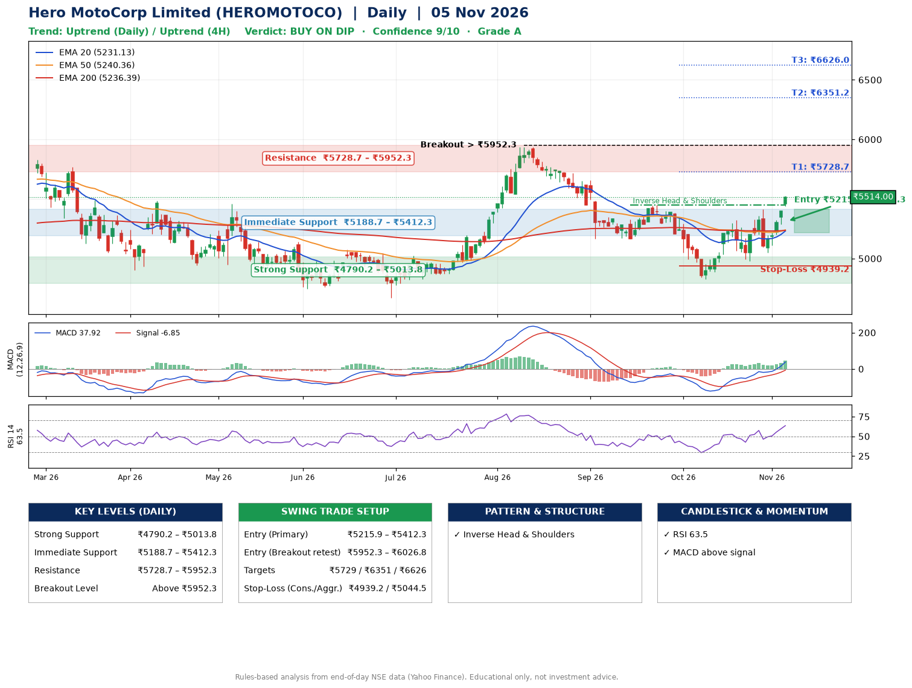

📌 **Hero MotoCorp Limited (HEROMOTOCO) – Multi-Timeframe Technical Analysis (Daily + 4H Combined)**
_Data up to 05 Nov 2026 · Close ₹5514.00_

**📍 Daily Timeframe Trend**
- Trend: **Uptrend** (price above rising EMAs)
- Recent swing highs: ₹5024.0, ₹5937.0, ₹5448.5 · swing lows: ₹5166.0, ₹4825.0, ₹4976.5
- EMAs: EMA20 ₹5231.1, EMA50 ₹5240.4, EMA200 ₹5236.4; mixed / crossing; price above EMA20, EMA50, EMA200
- MACD 37.92 above signal -6.85 (above zero); histogram rising
- RSI(14) 63.5; no divergence on the last two swings

**📍 4-Hour Timeframe Trend**
- Structure: **Uptrend** (higher highs and higher lows)
- Pullback/support area: recent 4H swing lows ₹4977.5, ₹5054.0; EMA20 ₹5274.2
- EMA20/50: bullish stack (EMA20 > EMA50); price above EMA20, EMA50
- MACD 77.42 above signal 44.28 (above zero); histogram rising
- RSI(14) 70.0; no divergence

**📍 Pattern Detection (Both Timeframes)**
- Daily: **Inverse Head & Shoulders** – head ₹4825.0, neckline ₹5448.5
- 4H: **Ascending Triangle** – converging swing highs and lows over the last ~60 sessions

**📍 Candlestick Patterns (last 3 daily candles)**
- No notable candlestick signal in the last 3 sessions.

**📍 Price Action Key Levels (Daily Structure)**

| Zone | Price Level (₹) | Context |
|------|-----------------|---------|
| Strong Support | ₹4790.2 – ₹5013.8 | Cluster of earlier swing lows (demand) |
| Immediate Support | ₹5188.7 – ₹5412.3 | Nearest swing-low / wick area |
| Resistance | ₹5728.7 – ₹5952.3 | Nearest swing-high supply |
| Breakout Level | Above ₹5952.3 | Swing continuation trigger (52-week high ₹6388.5) |

**📍 Swing Trade Setup**

🟢 **Entry Zone**
- Primary: ₹5215.9 – ₹5412.3 (daily support / EMA20 area; enter on a bullish 4H candle)
- Alternate: ₹5952.3 – ₹6026.8 (breakout retest)

🎯 **Profit Targets**
- T1: ₹5728.7
- T2: ₹6351.2
- T3: ₹6626.0

🛑 **Stop-Loss**
- Conservative: below daily swing low (₹4939.2)
- Aggressive: below 4H structure (₹5044.5)
- Risk per share ≈ ₹374.8; reward:risk to T1 ≈ 1.1

**📌 Strategy Notes**
- Higher timeframe: daily trend is uptrend; only take longs while price holds above ₹4790.2.
- Entry timing: wait for a bullish 4H candle (engulfing/hammer) inside ₹5215.9 – ₹5412.3 rather than buying mid-range.
- EMA stacking: mixed / crossing; price above EMA20, EMA50, EMA200.
- Breakout rule: a daily close above ₹5952.3 with volume above its 20-day average (≈554,712) opens T2/T3.
- Momentum: RSI 64 – room to run; no divergence on the last two swings.
- Exit discipline: move the stop to entry once T1 is hit; book partial profits at each target.

**STEP 2 — Marked Up Chart**

**✅ Trade Validation Checklist**
- Trend + momentum aligned: Yes · Price at entry zone: No
- Stop defined (₹4939.2) · Reward:risk ≥ 1.5 to T1: No

## 📌 Final Verdict

Recommendation: **🟡 BUY ON DIP**

Confidence: **9/10**

Trade Quality: **A**

Reason:
• Daily uptrend (price above rising EMAs)
• Inverse Head & Shoulders: head ₹4825.0, neckline ₹5448.5

Next Action:
• Wait for a pullback to ₹5215.9–₹5412.3, or a breakout above ₹5952.3

_Rules-based analysis from end-of-day data. Educational only, not investment advice. Never place orders without your own confirmation._