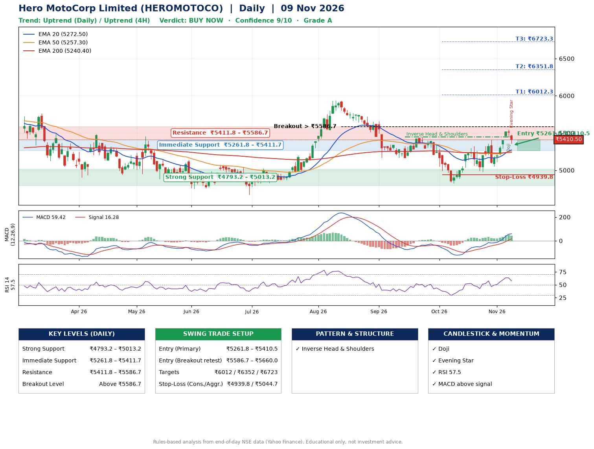

📌 **Hero MotoCorp Limited (HEROMOTOCO) – Multi-Timeframe Technical Analysis (Daily + 4H Combined)**
_Data up to 09 Nov 2026 · Close ₹5410.50_

**📍 Daily Timeframe Trend**
- Trend: **Uptrend** (price above rising EMAs)
- Recent swing highs: ₹5024.0, ₹5937.0, ₹5448.5 · swing lows: ₹5166.0, ₹4825.0, ₹4976.5
- EMAs: EMA20 ₹5272.5, EMA50 ₹5257.3, EMA200 ₹5240.4; bullish stack (EMA20 > EMA50 > EMA200); price above EMA20, EMA50, EMA200
- MACD 59.42 above signal 16.28 (above zero); histogram falling
- RSI(14) 57.5; no divergence on the last two swings

**📍 4-Hour Timeframe Trend**
- Structure: **Uptrend** (higher highs and higher lows)
- Pullback/support area: recent 4H swing lows ₹4977.5, ₹5054.0; EMA20 ₹5329.6
- EMA20/50: bullish stack (EMA20 > EMA50); price above EMA20, EMA50
- MACD 80.87 above signal 67.84 (above zero); histogram falling
- RSI(14) 58.2; no divergence

**📍 Pattern Detection (Both Timeframes)**
- Daily: **Inverse Head & Shoulders** – head ₹4825.0, neckline ₹5448.5
- 4H: **Double Top** – tops near ₹5410.5/₹5550.0, neckline ₹5054.0, forming

**📍 Candlestick Patterns (last 3 daily candles)**
- **Doji** – 06 Nov: indecision; wait for the next candle to confirm direction
- **Evening Star** – 09 Nov: three-candle bearish reversal

**📍 Price Action Key Levels (Daily Structure)**

| Zone | Price Level (₹) | Context |
|------|-----------------|---------|
| Strong Support | ₹4793.2 – ₹5013.2 | Cluster of earlier swing lows (demand) |
| Immediate Support | ₹5261.8 – ₹5411.7 | Nearest swing-low / wick area |
| Resistance | ₹5411.8 – ₹5586.7 | Nearest swing-high supply |
| Breakout Level | Above ₹5586.7 | Swing continuation trigger (52-week high ₹6388.5) |

**📍 Swing Trade Setup**

🟢 **Entry Zone**
- Primary: ₹5261.8 – ₹5410.5 (daily support / EMA20 area; enter on a bullish 4H candle)
- Alternate: ₹5586.7 – ₹5660.0 (breakout retest)

🎯 **Profit Targets**
- T1: ₹6012.3
- T2: ₹6351.8
- T3: ₹6723.3

🛑 **Stop-Loss**
- Conservative: below daily swing low (₹4939.8)
- Aggressive: below 4H structure (₹5044.7)
- Risk per share ≈ ₹396.3; reward:risk to T1 ≈ 1.7

**📌 Strategy Notes**
- Higher timeframe: daily trend is uptrend; only take longs while price holds above ₹4793.2.
- Entry timing: wait for a bullish 4H candle (engulfing/hammer) inside ₹5261.8 – ₹5410.5 rather than buying mid-range.
- EMA stacking: bullish stack (EMA20 > EMA50 > EMA200); price above EMA20, EMA50, EMA200.
- Breakout rule: a daily close above ₹5586.7 with volume above its 20-day average (≈569,435) opens T2/T3.
- Momentum: RSI 58 – room to run; no divergence on the last two swings.
- Exit discipline: move the stop to entry once T1 is hit; book partial profits at each target.

**STEP 2 — Marked Up Chart**

**✅ Trade Validation Checklist**
- Trend + momentum aligned: Yes · Price at entry zone: Yes
- Stop defined (₹4939.8) · Reward:risk ≥ 1.5 to T1: Yes

## 📌 Final Verdict

Recommendation: **🟢 BUY NOW**

Confidence: **9/10**

Trade Quality: **A**

Reason:
• Daily uptrend (price above rising EMAs)
• EMAs stacked bullishly

Next Action:
• Buy now within the entry zone, with the stop-loss in place

_Rules-based analysis from end-of-day data. Educational only, not investment advice. Never place orders without your own confirmation._