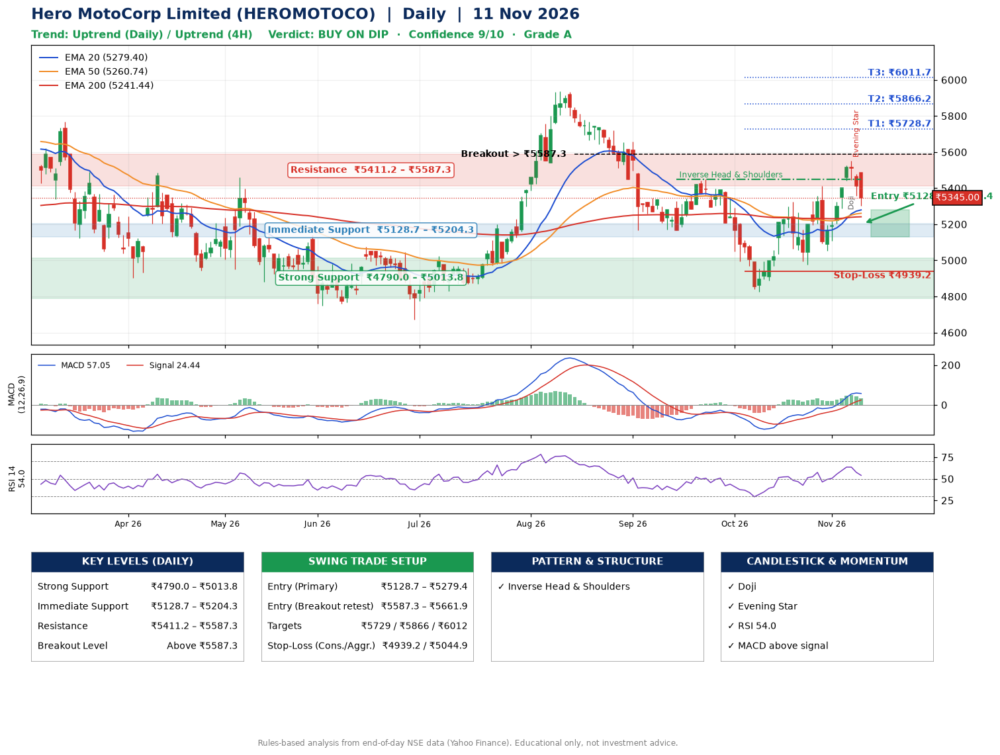

📌 **Hero MotoCorp Limited (HEROMOTOCO) – Multi-Timeframe Technical Analysis (Daily + 4H Combined)**
_Data up to 11 Nov 2026 · Close ₹5345.00_

**📍 Daily Timeframe Trend**
- Trend: **Uptrend** (price above rising EMAs)
- Recent swing highs: ₹5024.0, ₹5937.0, ₹5448.5 · swing lows: ₹5166.0, ₹4825.0, ₹4976.5
- EMAs: EMA20 ₹5279.4, EMA50 ₹5260.7, EMA200 ₹5241.4; bullish stack (EMA20 > EMA50 > EMA200); price above EMA20, EMA50, EMA200
- MACD 57.05 above signal 24.44 (above zero); histogram falling
- RSI(14) 54.0; no divergence on the last two swings

**📍 4-Hour Timeframe Trend**
- Structure: **Uptrend** (higher highs and higher lows)
- Pullback/support area: recent 4H swing lows ₹4977.5, ₹5054.0; EMA20 ₹5335.0
- EMA20/50: bullish stack (EMA20 > EMA50); price above EMA20, EMA50
- MACD 65.94 below signal 68.50 (above zero), fresh bearish crossover; histogram falling
- RSI(14) 53.0; no divergence

**📍 Pattern Detection (Both Timeframes)**
- Daily: **Inverse Head & Shoulders** – head ₹4825.0, neckline ₹5448.5
- 4H: **Double Top** – tops near ₹5410.5/₹5550.0, neckline ₹5054.0, forming

**📍 Candlestick Patterns (last 3 daily candles)**
- **Doji** – 06 Nov: indecision; wait for the next candle to confirm direction
- **Evening Star** – 09 Nov: three-candle bearish reversal

**📍 Price Action Key Levels (Daily Structure)**

| Zone | Price Level (₹) | Context |
|------|-----------------|---------|
| Strong Support | ₹4790.0 – ₹5013.8 | Cluster of earlier swing lows (demand) |
| Immediate Support | ₹5128.7 – ₹5204.3 | Nearest swing-low / wick area |
| Resistance | ₹5411.2 – ₹5587.3 | Nearest swing-high supply |
| Breakout Level | Above ₹5587.3 | Swing continuation trigger (52-week high ₹6388.5) |

**📍 Swing Trade Setup**

🟢 **Entry Zone**
- Primary: ₹5128.7 – ₹5279.4 (daily support / EMA20 area; enter on a bullish 4H candle)
- Alternate: ₹5587.3 – ₹5661.9 (breakout retest)

🎯 **Profit Targets**
- T1: ₹5728.7
- T2: ₹5866.2
- T3: ₹6011.7

🛑 **Stop-Loss**
- Conservative: below daily swing low (₹4939.2)
- Aggressive: below 4H structure (₹5044.9)
- Risk per share ≈ ₹264.9; reward:risk to T1 ≈ 2.0

**📌 Strategy Notes**
- Higher timeframe: daily trend is uptrend; only take longs while price holds above ₹4790.0.
- Entry timing: wait for a bullish 4H candle (engulfing/hammer) inside ₹5128.7 – ₹5279.4 rather than buying mid-range.
- EMA stacking: bullish stack (EMA20 > EMA50 > EMA200); price above EMA20, EMA50, EMA200.
- Breakout rule: a daily close above ₹5587.3 with volume above its 20-day average (≈582,882) opens T2/T3.
- Momentum: RSI 54 – room to run; no divergence on the last two swings.
- Exit discipline: move the stop to entry once T1 is hit; book partial profits at each target.

**STEP 2 — Marked Up Chart**

**✅ Trade Validation Checklist**
- Trend + momentum aligned: Yes · Price at entry zone: No
- Stop defined (₹4939.2) · Reward:risk ≥ 1.5 to T1: Yes

## 📌 Final Verdict

Recommendation: **🟡 BUY ON DIP**

Confidence: **9/10**

Trade Quality: **A**

Reason:
• Daily uptrend (price above rising EMAs)
• EMAs stacked bullishly

Next Action:
• Wait for a pullback to ₹5128.7–₹5279.4, or a breakout above ₹5587.3

_Rules-based analysis from end-of-day data. Educational only, not investment advice. Never place orders without your own confirmation._