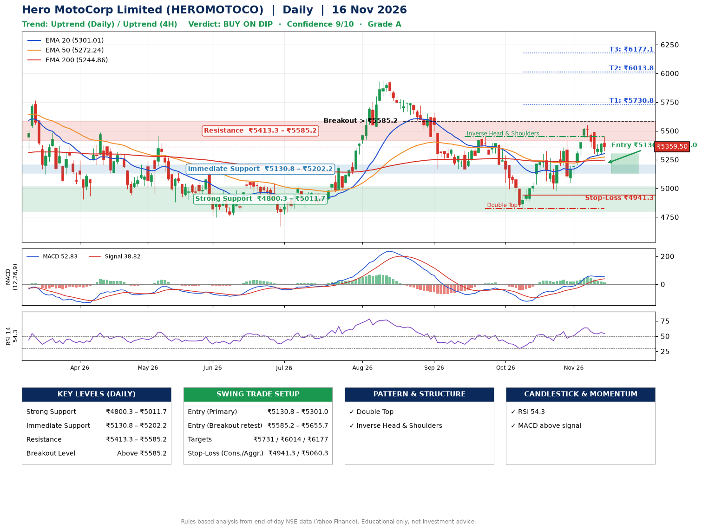

📌 **Hero MotoCorp Limited (HEROMOTOCO) – Multi-Timeframe Technical Analysis (Daily + 4H Combined)**
_Data up to 16 Nov 2026 · Close ₹5359.50_

**📍 Daily Timeframe Trend**
- Trend: **Uptrend** (higher highs and higher lows)
- Recent swing highs: ₹5937.0, ₹5448.5, ₹5550.0 · swing lows: ₹5166.0, ₹4825.0, ₹4976.5
- EMAs: EMA20 ₹5301.0, EMA50 ₹5272.2, EMA200 ₹5244.9; bullish stack (EMA20 > EMA50 > EMA200); price above EMA20, EMA50, EMA200
- MACD 52.83 above signal 38.82 (above zero); histogram falling
- RSI(14) 54.3; no divergence on the last two swings

**📍 4-Hour Timeframe Trend**
- Structure: **Uptrend** (higher highs and higher lows)
- Pullback/support area: recent 4H swing lows ₹5054.0, ₹5288.5; EMA20 ₹5343.7
- EMA20/50: bullish stack (EMA20 > EMA50); price above EMA20, EMA50
- MACD 36.69 below signal 50.06 (above zero); histogram rising
- RSI(14) 53.3; Hidden bullish divergence

**📍 Pattern Detection (Both Timeframes)**
- Daily: **Double Top** – tops near ₹5448.5/₹5550.0, neckline ₹4825.0, forming
- Daily: **Inverse Head & Shoulders** – head ₹4825.0, neckline ₹5448.5
- 4H: **Double Top** – tops near ₹5410.5/₹5550.0, neckline ₹5054.0, forming

**📍 Candlestick Patterns (last 3 daily candles)**
- No notable candlestick signal in the last 3 sessions.

**📍 Price Action Key Levels (Daily Structure)**

| Zone | Price Level (₹) | Context |
|------|-----------------|---------|
| Strong Support | ₹4800.3 – ₹5011.7 | Cluster of earlier swing lows (demand) |
| Immediate Support | ₹5130.8 – ₹5202.2 | Nearest swing-low / wick area |
| Resistance | ₹5413.3 – ₹5585.2 | Nearest swing-high supply |
| Breakout Level | Above ₹5585.2 | Swing continuation trigger (52-week high ₹6388.5) |

**📍 Swing Trade Setup**

🟢 **Entry Zone**
- Primary: ₹5130.8 – ₹5301.0 (daily support / EMA20 area; enter on a bullish 4H candle)
- Alternate: ₹5585.2 – ₹5655.7 (breakout retest)

🎯 **Profit Targets**
- T1: ₹5730.8
- T2: ₹6013.8
- T3: ₹6177.1

🛑 **Stop-Loss**
- Conservative: below daily swing low (₹4941.3)
- Aggressive: below 4H structure (₹5060.3)
- Risk per share ≈ ₹274.6; reward:risk to T1 ≈ 1.9
- Time to T1: about 26 trading days (it rose this much within 60 trading days 59% of the time in the last 2 years)
- Time to T2: about 35 trading days (it rose this much within 60 trading days 46% of the time in the last 2 years)

**📌 Strategy Notes**
- Higher timeframe: daily trend is uptrend; only take longs while price holds above ₹4800.3.
- Entry timing: wait for a bullish 4H candle (engulfing/hammer) inside ₹5130.8 – ₹5301.0 rather than buying mid-range.
- EMA stacking: bullish stack (EMA20 > EMA50 > EMA200); price above EMA20, EMA50, EMA200.
- Breakout rule: a daily close above ₹5585.2 with volume above its 20-day average (≈557,383) opens T2/T3.
- Momentum: RSI 54 – room to run; no divergence on the last two swings.
- Exit discipline: move the stop to entry once T1 is hit; book partial profits at each target.

**STEP 2 — Marked Up Chart**

**✅ Trade Validation Checklist**
- Trend + momentum aligned: Yes · Price at entry zone: No
- Stop defined (₹4941.3) · Reward:risk ≥ 1.5 to T1: Yes

## 📌 Final Verdict

Recommendation: **🟡 BUY ON DIP**

Confidence: **9/10**

Trade Quality: **A**

Reason:
• Daily uptrend (higher highs and higher lows)
• EMAs stacked bullishly

Next Action:
• Wait for a pullback to ₹5130.8–₹5301.0, or a breakout above ₹5585.2

_Rules-based analysis from end-of-day data. Educational only, not investment advice. Never place orders without your own confirmation._