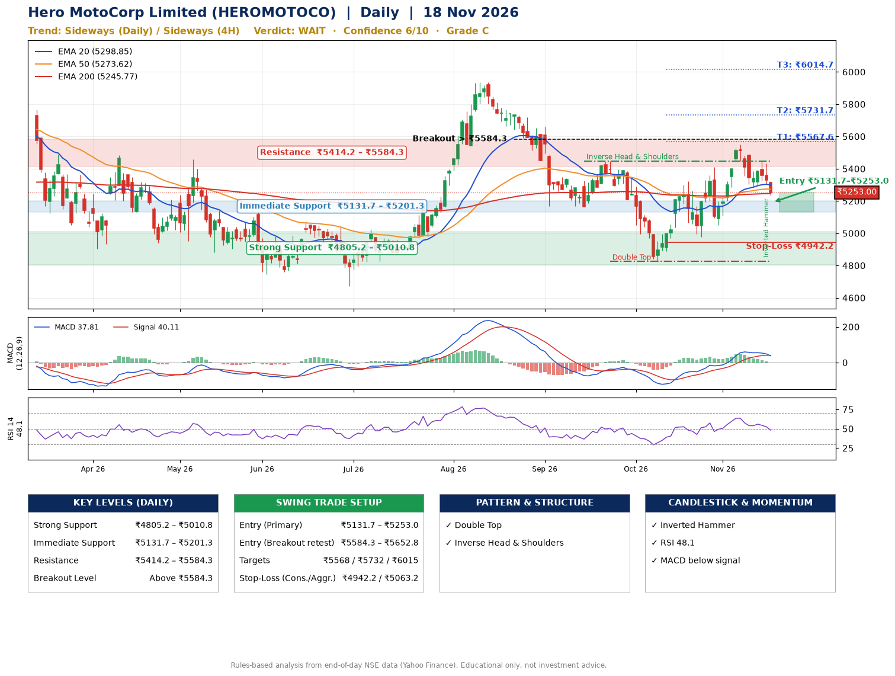

📌 **Hero MotoCorp Limited (HEROMOTOCO) – Multi-Timeframe Technical Analysis (Daily + 4H Combined)**
_Data up to 18 Nov 2026 · Close ₹5253.00_

**📍 Daily Timeframe Trend**
- Trend: **Sideways** (mixed swing structure)
- Recent swing highs: ₹5937.0, ₹5448.5, ₹5550.0 · swing lows: ₹5166.0, ₹4825.0, ₹4976.5
- EMAs: EMA20 ₹5298.8, EMA50 ₹5273.6, EMA200 ₹5245.8; bullish stack (EMA20 > EMA50 > EMA200); price above EMA200
- MACD 37.81 below signal 40.11 (above zero), fresh bearish crossover; histogram falling
- RSI(14) 48.1; no divergence on the last two swings

**📍 4-Hour Timeframe Trend**
- Structure: **Sideways** (mixed swing structure)
- Pullback/support area: recent 4H swing lows ₹5054.0, ₹5288.5; EMA20 ₹5329.7
- EMA20/50: bullish stack (EMA20 > EMA50); price below all EMAs
- MACD 11.79 below signal 33.09 (above zero); histogram falling
- RSI(14) 43.5; Hidden bullish divergence

**📍 Pattern Detection (Both Timeframes)**
- Daily: **Double Top** – tops near ₹5448.5/₹5550.0, neckline ₹4825.0, forming
- Daily: **Inverse Head & Shoulders** – head ₹4825.0, neckline ₹5448.5
- 4H: **Double Top** – tops near ₹5550.0/₹5448.5, neckline ₹5288.5, confirmed (closed below neckline)
- 4H: **Ascending Triangle** – converging swing highs and lows over the last ~60 sessions

**📍 Candlestick Patterns (last 3 daily candles)**
- **Inverted Hammer** – 17 Nov: long upper wick shows selling near ₹5431.5

**📍 Price Action Key Levels (Daily Structure)**

| Zone | Price Level (₹) | Context |
|------|-----------------|---------|
| Strong Support | ₹4805.2 – ₹5010.8 | Cluster of earlier swing lows (demand) |
| Immediate Support | ₹5131.7 – ₹5201.3 | Nearest swing-low / wick area |
| Resistance | ₹5414.2 – ₹5584.3 | Nearest swing-high supply |
| Breakout Level | Above ₹5584.3 | Swing continuation trigger (52-week high ₹6388.5) |

**📍 Swing Trade Setup**

🟢 **Entry Zone**
- Primary: ₹5131.7 – ₹5253.0 (daily support / EMA20 area; enter on a bullish 4H candle)
- Alternate: ₹5584.3 – ₹5652.8 (breakout retest)

🎯 **Profit Targets**
- T1: ₹5567.6
- T2: ₹5731.7
- T3: ₹6014.7

🛑 **Stop-Loss**
- Conservative: below daily swing low (₹4942.2)
- Aggressive: below 4H structure (₹5063.2)
- Risk per share ≈ ₹250.1; reward:risk to T1 ≈ 1.5
- Time to T1: about 18 trading days (it rose this much within 60 trading days 66% of the time in the last 2 years)
- Time to T2: about 28 trading days (it rose this much within 60 trading days 57% of the time in the last 2 years)

**📌 Strategy Notes**
- Higher timeframe: daily trend is sideways; only take longs while price holds above ₹4805.2.
- Entry timing: wait for a bullish 4H candle (engulfing/hammer) inside ₹5131.7 – ₹5253.0 rather than buying mid-range.
- EMA stacking: bullish stack (EMA20 > EMA50 > EMA200); price above EMA200.
- Breakout rule: a daily close above ₹5584.3 with volume above its 20-day average (≈568,971) opens T2/T3.
- Momentum: RSI 48 – room to run; no divergence on the last two swings.
- Exit discipline: move the stop to entry once T1 is hit; book partial profits at each target.

**STEP 2 — Marked Up Chart**

**✅ Trade Validation Checklist**
- Trend + momentum aligned: No · Price at entry zone: Yes
- Stop defined (₹4942.2) · Reward:risk ≥ 1.5 to T1: Yes

## 📌 Final Verdict

Recommendation: **🟠 WAIT**

Confidence: **6/10**

Trade Quality: **C**

Reason:
• EMAs stacked bullishly
• Double Top: tops near ₹5448.5/₹5550.0, neckline ₹4825.0, forming

Next Action:
• Wait for a breakout above ₹5584.3

_Rules-based analysis from end-of-day data. Educational only, not investment advice. Never place orders without your own confirmation._